# Dataset Production {#book-title}

## From one useful release to trustworthy evidence

Author: Puma

Principles-first edition | 13 October 2026

A dataset is a set of choices about what counts, what values mean and what evidence supports using them. This book teaches those reasons before workflows. Start with a small release you can inspect. Then protect independence, test one improvement and deliver bytes another person can interpret and recover.

The core assumes basic reading and arithmetic. No GPU, sensors, paid service, account or external dataset download is required. Code is optional until you choose the supplied CPU labs. Six optional tracks let the same principles travel across representations.

### How to learn

Observe and explain; calculate or classify on paper; optionally run a supplied CPU exercise; change one thing; defend a release decision. Read the worked answer after trying. An acceptance check identifies what evidence is missing, rather than rewarding a plausible explanation alone.

The four part assessments build one capstone: a bounded claim and contract, source and rights, lineage and split rationale, audit, controlled improvement, tested consumer and demonstrated recovery. Missing evidence means revise. Leakage, unsupported rights or compatibility, and misleading evaluation block acceptance.

### What the evidence labels mean

- Authored illustration: invented records or arithmetic for explanation, not observed population performance
- Executed fixture: reproducible CPU output from the supplied code, within its tiny teaching scope
- Independently reviewed reference: only when a named review protocol and independent reference evidence exist; the supplied gold file is separately authored, not this category
- Published result: the cited authors' experiment, not reproduced here
- Source-inspected receipt: a pinned project artifact read for this edition, not a fresh runtime reproduction
- Proposed or unrun work: an experiment, integration or validation still needing execution

The observation unit, denominator, revision and limits belong beside a result. A checksum proves identity of bytes. It does not prove labels, generalization, physics or permission.

### Companion boundary

Training Your Own Models stays a separate companion for fitting implementations, architectures and neural training. This book ends at a tested data and consumer contract. The educational text adapter supports its specifically named consumer; numeric companion examples generate their own inputs. There is no automatic text-to-numeric compatibility.

### Rights and privacy

The supplied records and tiny grids are fictional teaching fixtures, with no real participant data. No distribution license has been selected for this repository or book. Public visibility is not a reuse license. External sources retain their own terms. Do not put private messages into a fixture and assume quarantine sanitizes them.

## Contents {#contents}

- [Part 1: A first useful release](#part-1)
  - [1 Inspect and reproduce a small release](#chapter-inspect-release)
  - [2 Define the question and the claim](#chapter-question-claim)
  - [3 Represent meaning with a data contract](#chapter-data-contract)
  - [4 Choose sources and preserve their origin](#chapter-sources-origin)
- [Part 2: Evidence you can trust](#part-2)
  - [5 Extract cleanly without erasing evidence](#chapter-extraction-evidence)
  - [6 Protect independence and evaluation](#chapter-independence-evaluation)
  - [7 Treat labels as measurements](#chapter-labels-measurements)
  - [8 Audit quality and establish a baseline](#chapter-audit-baseline)
- [Part 3: Controlled improvement](#part-3)
  - [9 Collect or select the next useful examples](#chapter-useful-examples)
  - [10 Transform examples without changing the task](#chapter-valid-transformations)
  - [11 Scale supervision with honest uncertainty](#chapter-uncertain-supervision)
  - [12 Generate candidates and verify the claim](#chapter-generate-verify)
- [Part 4: A release others can use](#part-4)
  - [13 Evaluate change and diagnose failure](#chapter-evaluate-diagnose)
  - [14 Freeze and test what the consumer reads](#chapter-freeze-consumer)
  - [15 Operate recover and account for cost](#chapter-operate-recover-cost)
- [Optional tracks](#optional-tracks)
  - [Text and retrieval](#track-01-text-retrieval)
  - [Tabular and time series](#track-02-tabular-time-series)
  - [Vision and video](#track-03-vision-video)
  - [Audio](#track-04-audio)
  - [Reasoning and trajectories](#track-05-reasoning-trajectories)
  - [Physical fields and simulation](#track-06-physical-fields-simulation)
  - [Advanced methods after the first controlled improvement](#track-advanced-methods)
  - [Choose one track and keep the shared release standard](#track-advanced-track-assessment)
- [Rheon as a physical data evidence chain](#case-01-rheon)
- [Tuldok as a production lifecycle case](#case-02-tuldok)
- [Reconstruct published production systems](#case-03-published-production-systems)
- [Optional versioned project setup boundaries](#case-90-versioned-product-appendix)
- [Case evidence ledger](#case-evidence-ledger)
- [Appendix A Exact training companion contracts](#appendix-a)
- [Appendix B Production tools and edition boundaries](#appendix-b)
- [Appendix C Example schemas and export relationships](#appendix-c)
- [Appendix D Worksheets and release review](#appendix-d)
- [References and evidence notes](#references-and-evidence-notes)

# Part 1: A first useful release {#part-1}

Chapters 1–4.


# 1 Inspect and reproduce a small release {#chapter-inspect-release}

[Back to contents](#contents)

*Dataset Production · Puma · Part 1: A first useful release*

## A beginner's question: what have we actually made?

A helpdesk receives “Please send my invoice.” Someone puts it in a file beside the word “billing.” Is that a dataset? It could be the beginning of one. But a second person still needs to know what the word means, where the message came from, whether it was copied, and how the answer was obtained. If those decisions disappear, the file can teach the wrong lesson while looking perfectly tidy.

This chapter is a guided preview. You will follow one message through a small release and inspect an error. You do not need to understand every production technique yet. Chapters 2–8 explain the decisions you encounter here. No model, GPU, account, sensor, paid service, or downloaded dataset is needed. You can complete the main path on paper.

The supplied fictional helpdesk has three queues: **billing** for money and billing documents, **access** for getting into an account, and **technical** for concrete software/interface failures. These are task conventions for a teaching collection. They are not universal rules for every company. Our eventual **input** is the message a consumer reads; our **target** is the queue the task says should own its reported problem.

## The principle: a release is decisions plus evidence

A **source record** is what arrived. An **example** is a task-specific interpretation of source material. A **label** is an answer supplied under some procedure. A **release** is a fixed selection of examples and supporting files that another person can inspect or consume. These distinctions matter even in a folder containing only a few dozen messages.

Keep the source, the interpretation, the judgment, and the evidence distinct. Then a mistaken judgment can be corrected without pretending the original source said something different. A file's existence proves little; an understandable record of how it was produced gives the reader something to check.

### Evidence labels used throughout this book

Every result needs a status. Use these labels when doing the exercises:

- **Authored illustration:** invented values, messages, diagrams, or arithmetic used to explain a method. They are not observations of real customers or systems.
- **Executed fixture:** output recorded from running a supplied teaching program on its supplied inputs. It establishes those checks for those inputs and recipe.
- **Independently reviewed reference:** a judgment with a documented independent review process. This status requires evidence of the review; a filename such as “gold” does not confer it.
- **Reproduced experiment:** a new run of a declared experiment with its inputs, versions, procedure, and outputs retained. Record departures from the original experiment.
- **Published result:** a result reported by a cited primary source, bounded by its setup and assumptions.
- **Proposed work:** a suggested change or experiment that has not established an outcome.
- **Unrun work:** a described procedure or code path that has not been executed in the reported evidence.

The lab's `gold.json` contains **separately authored references**, not independently reviewed references. Both its messages and references are teaching material. Its audit is an executed fixture. When you calculate a fraction from that audit, identify the input counts and call your calculation descriptive fixture arithmetic. When you rerun the lab, keep your own run evidence before calling it a reproduction.

## Follow the invoice message

**Authored fixture source.** Record r01 contains “Please send my invoice.” Record r02 contains the same request in capitals, with extra spaces and a tab: “  PLEASE\tSEND my invoice.  ” Here `\t` describes the tab; it is not a word in the request.

For this task, the builder intentionally ignores case and repeated whitespace. It creates a **comparison form**, `please send my invoice.` Both records share that form. It therefore emits one distinct example. This is **deduplication**: identifying repeats and deciding how to represent them. It keeps both original records in **lineage**, the history connecting an output to its sources.

The comparison form is also the model-facing text in this simplified lab. That choice would be inappropriate for some other tasks; chapter 3 will explain the contract, and chapter 5 will examine what normalization erases.

A fixed rule sees the whole word “invoice” and proposes billing. This is a **weak label**, meaning a fallible procedure supplied a candidate answer. No classifier has learned anything. A present weak label does not mean a person approved it.

The example receives a **split**, a role in later learning and checking. Training material may teach a model. Development material may influence choices. Test material is reserved for a final check under a stated protocol. Related sources stay together: r01 matches r02, while r02 shares a declared family with r03, “Please email a receipt.” All three source records belong to one protected group. You do not need the grouping algorithm yet; the important idea is that a familiar relative should not masquerade as a new test.

Finally, a **manifest** records the recipe and file fingerprints. A hash is a compact fingerprint of bytes. It helps notice a change. It does not prove the bytes are correct, lawful, or written by a particular author.

## Inspect three failures rather than hiding them

The supplied rules are deliberately limited.

1. “I was charged twice for renewal.” receives no vote because the billing rule recognizes “charge,” not “charged.” This is an **abstention**.
2. “The login animation crashes.” attracts access and technical votes. This is a **conflict**; the aggregate supplies no answer.
3. “The charge indicator stays at zero.” receives billing because of “charge,” while its authored reference is technical. This is a labeled mistake.

Abstention, conflict, and incorrect prediction are different outcomes. Deleting all difficult messages would conceal a coverage problem. Guessing labels for all of them would conceal uncertainty. Retaining them makes the weakness inspectable.

The reference file has its own problems: r27 and r28 collapse to one example but have contradictory reference categories, while r12 and r20 have no references. The audit excludes unresolved references from agreement scoring and reports them. It does not let the weak rule settle the reference dispute.

## The theory, in ordinary counts

**Executed fixture snapshot.** The retained audit at `examples/first-release/expected/audit.json` reports 30 input lines, 28 accepted raw records, and 2 quarantined lines. Quarantine holds rejected material and reasons rather than silently dropping it. One line has broken JSON; another lacks the required family ID. The 28 accepted records become 24 distinct normalized examples because four repeated records collapse.

Of those 24 examples, 14 receive a weak label, 5 abstain, and 5 conflict. The accounting check is 14 + 5 + 5 = 24. Label **coverage** asks how much receives an answer: 14 / 24 ≈ 58.3%. Agreement asks whether scorable supplied answers match references. Only 13 of the 14 predictions have a resolved reference; 10 match. Agreement is 10 / 13 ≈ 76.9%.

Those quantities have different **denominators**, the totals below each fraction. Coverage concerns all eligible examples. Agreement concerns only predictions that can be scored. Neither describes reliable routing of future real customers. The collection is small, authored, and publicly inspected. Its test split is exposed teaching material after you study it.

The recorded source increment is `416c4b12ad2b9649c2c38bad4d2c7ed5f77eac5f`, merged in `ac62387a3a9760e3f1e9f8b8290552cb2dc13471`. The expected audit's SHA-256 is `96fa6e02cf575fe5aa768cf61275b204a8fc68d8cbddbe7169086269e09bee54`. These identify the evidence snapshot used for the lesson. A changed implementation needs its own run record; these identifiers are not a receipt for untested rewritten instructions.

## Controlled exercise: trace, classify, explain

**Evidence status:** paper inspection of authored fixture material and descriptive calculation from the executed fixture snapshot. **Observation unit:** a raw source record when tracing origin; a canonical example when counting labels. **Requires no execution:** all six steps below.

1. Draw the path r01 and r02 → one comparison form → one billing proposal. Write where both originals remain.
2. Explain why r03 must share the split even though its words differ.
3. Classify the three failure examples as abstention, conflict, or wrong label.
4. Account for all 30 arriving lines and all 24 canonical examples.
5. Calculate coverage and agreement, naming each denominator.
6. Write one supported claim and one claim the fixture cannot establish.

### Acceptance check

Pass when another reader can recover both invoice originals, tell a proposal from a reference, account for every line and example, and explain why 10/13 differs from 14/24. Revise if any difficult case disappears without a reason. Reject a claim of real-world model accuracy: no such model or independent customer sample has been measured.

### Worked answer and reviewer guidance

The originals remain in raw input and accepted lineage. r01 ↔ r02 ↔ r03 is a connected relationship, so splitting r03 away would expose family information across splits. The three failures are respectively abstention, conflict, and a labeled error. Raw accounting is 28 + 2 = 30; canonical status accounting is 14 + 5 + 5 = 24. One predicted example has conflicting references, leaving 13 evaluated predictions. Ten agree.

A supported claim is “this fixture's fixed rules label 14 of 24 canonical examples.” An unsupported claim is “the future helpdesk model routes 76.9% of real messages correctly.” A reviewer should ask the learner to explain both fractions without using the vague word “quality.” Exact terminology matters less than preserving the distinction.

## Optional CPU reproduction and deeper reading

From the repository root, with Python 3.10 or later, run:

~~~sh
python3 -B examples/first-release/build.py --out run-first-release
python3 -m json.tool run-first-release/audit.json
python3 -B -m unittest discover -s tests -p 'test_first_release.py' -v
~~~

Choose a new or empty output directory. The program refuses to overwrite existing contents. No package download is required. Retain the audit, manifest, command, input hashes, runtime/Unicode version, and test output. If counts differ, compare versions and inputs before interpreting the difference. A passing suite checks specified behavior, not all possible data errors.

Inspect `raw/records.jsonl`, `lineage.jsonl`, `quarantine.jsonl`, and `manifest.json` in the resulting release. The [lab README](../source/examples/first-release/README.md) describes fields and limitations. Measurement's distinction between a construct and its operationalization is developed in Jacobs and Wallach, [Measurement and Fairness](https://arxiv.org/html/1912.05511v3) [R01]. Chapter 2 makes that idea usable before any model choice.


# 2 Define the question and the claim {#chapter-question-claim}

[Back to contents](#contents)

*Dataset Production · Puma · Part 1: A first useful release*

## A beginner's question: what should this answer mean?

A message contains “refund.” Does its correct answer have to be “billing”? The helpdesk may ask which department should handle the message, whether the customer requests a refund, or which span expresses a requested action. These are different questions about the same source. A label can be perfectly consistent with one and wrong for another.

After chapter 1, you can inspect the release's parts. Here you will specify its purpose. You will finish with a bounded claim, a decision unit, a proposed baseline and measurement, and a clear account of what success would not establish. No fitting or model implementation is needed.

## The principle: state the decision before measuring success

Name five things before choosing labels or scores:

1. **Input:** the evidence available at decision time.
2. **Target:** the answer or behavior sought under a stated convention.
3. **Decision unit:** what receives one answer, such as a message, conversation, image, or one-second field transition.
4. **Population:** the set of situations to which the claim is meant to apply.
5. **Failure cost:** what goes wrong when an answer is wrong, missing, or late.

The **claim** connects them: what a result would establish, for which population, under which conditions. A benchmark score supports only the evaluation conditions actually measured. “Works on our data” is not a population definition.

For a deployed router, the input might be the latest message alone, or the whole conversation up to the decision time. If the target requires earlier context but the input omits it, a wrong label may actually expose a broken task. The input must exclude evidence available only after the decision, such as the queue assigned by an agent later. That would make an impressive score answer an easier and unintended question.

## A small worked comparison

**Authored illustration.** Consider these requests under two tasks:

| Message | Department routing | Explicit refund intent |
|---|---|---|
| Please refund this payment. | billing | refund requested |
| Please do not refund this payment. | billing | refund not requested |
| The invoice link returns an error. | technical | refund not requested |
| Password reset says error. | access | refund not requested |

For routing, both refund messages concern payment handling, even though they request opposite actions. For intent extraction, negation changes the target. The broken invoice link belongs to technical under this fixture's concrete-interface-failure policy. The password-reset error remains access because the message reports an unsuccessful account-recovery operation without a specific interface fault. Another organization could choose other owners, but it must document that policy.

Notice the cost of a vague label called “refund.” Does it mean the word occurs, a refund is requested, a refund is allowed, or a refund has happened? Those are not interchangeable. A router's billing output is not permission to move money. Define permitted use so a downstream consumer cannot turn a triage label into an authorization.

A bounded teaching claim is: “Given one fictional English helpdesk message, our fixed keyword rules propose one of the three routing queues or explicitly abstain/conflict under guide version 1. We describe their coverage and reference agreement on the supplied fixture.” A future claim might concern unseen customer conversations, but it would need new acquisition, rights, independent references, and appropriate evaluation. It remains proposed work here.

## The theory: a target is not the same as a measurement

A **construct** is the idea we want to learn about, such as useful routing or factual helpfulness. An **operationalization** is the procedure we use to observe it: a queue guide, rating scale, or reference review. Jacobs and Wallach explain why reliable measurement can still fail to capture its intended construct [R01]. Two people may reliably rate politeness while the project claims to measure correctness.

For this fixture, a department guide operationalizes “who should handle this problem.” Agreement with authored references measures conformity to that guide as represented by those references. It does not measure customer satisfaction, resolution time, or real department capacity. We have not observed those outcomes.

Use a **quality profile**, because several failure questions are separate:

- **Integrity:** are the records readable, complete, and traceable?
- **Target validity:** does the label answer the intended question?
- **Label fidelity:** does the recorded judgment agree with qualified review or verifiable evidence?
- **Coverage:** are relevant conditions represented, with enough independent examples?
- **Independence:** does evaluation avoid related or previously exposed material?
- **Usability and permitted use:** can the consumer interpret and lawfully use the release?
- **Downstream utility:** does it improve the actual behavior under a controlled comparison?

Some are acceptance constraints. Unsupported rights or known evaluation leakage cannot be compensated for by better average agreement. Other dimensions involve tradeoffs. Removing all ambiguous requests may improve agreement while excluding the requests the helpdesk most needs to handle.

### Choose a baseline and a metric together

A **baseline** is the declared starting procedure for comparison. It must be simple enough to understand and specified before using evaluation feedback to improve it. The fixture's fixed keyword rules are a measured data-production baseline, not a trained model. For an imagined deployed router, always choosing the most common queue is another proposed baseline. The two answer different questions.

A **metric** is a defined calculation. For agreement, let C be the number of correct comparable predictions and E the number of predictions with resolved references. Agreement is C/E when E > 0. For coverage, let L be the number given labels and N the eligible example count. Coverage is L/N when N > 0. If a denominator is zero, report “not estimable” and the count, not 0% or 100%.

A majority-queue baseline can perform well when one queue dominates while never finding a rare queue. Inspect per-category behavior and important failure slices. A failure **slice** is a specified subset, such as messages describing concrete login interface faults. A score without a population and denominator cannot show whether that subset is protected.

### Three distributions can legitimately differ

The deployment population might contain mostly ordinary requests. Training may deliberately oversample rare failures. Evaluation may sample rare failures heavily to inspect them. These are the deployment, training-exposure, and evaluation-sampling distributions. Do not silently substitute one for another.

**Authored arithmetic.** If expected deployment is 80% ordinary and 20% difficult requests, and a procedure's measured errors under suitable independent sampling are 1% and 6%, deployment-weighted error is 0.8 × 0.01 + 0.2 × 0.06 = 0.02, or 2%. This is an illustration, not this fixture's error rate. The weights, sample design, and meaning of “difficult” need evidence before that calculation supports a real claim. Chapter 8 returns to this example.

A coverage table is useful but incomplete. Having examples with negation and examples with software crashes does not show coverage of negated crash reports. Mark impossible combinations, excluded regimes, unobserved cells, and cells with few independent groups. Leave room to discover failures outside the initial table.

## Controlled exercise: write two task cards

**Evidence status:** authored illustration and proposed work. **Decision unit:** one message in the four-row table. **Denominator:** all four messages for paper classification; a future metric's denominator must be declared separately. No model is run.

Write one card for routing and one for explicit refund intent. Each card must include input, target, decision unit, population, permitted use, excluded conditions, proposed baseline, proposed metric and denominator, and an important failure cost. Classify all four messages. Then add this question: “Could the output authorize a refund?” Explain your answer from the contract, rather than from the presence of a word.

### Acceptance check

Pass when the cards produce different targets for the negated refund request, state what evidence is available, and separate proposed success criteria from observed results. A reviewer must be able to tell what future evidence could refute the claim. Revise a card whose metric omits abstentions without reporting coverage. Reject a refund-authorization claim: neither task supplies permission or verifies entitlement.

### Worked answer and reviewer guidance

Routing card: input is one message; target is an owning queue under the stated guide; unit is a message; population is the authored English teaching collection. Permitted use is teaching/triage illustration subject to source rights; refund execution and real deployment are excluded. The fixed keyword rules are a baseline already measured on the supplied fixture; a change to them is proposed work. Agreement uses predictions with resolved references, while coverage uses all eligible canonical examples. A key failure is sending an interface fault to access or billing because of a keyword.

Intent card: input is one message; target is whether an explicit refund is requested; unit is a message; population is the four authored examples for this exercise. A proposed baseline recognizes explicit requests and negation under a stated rule. A proposed exact-match metric would use all four independently resolved paper targets, with uncertain cases separately counted if added. A key failure is treating “do not refund” as a positive request. No intent-baseline execution or future accuracy is claimed.

The targets are those shown in the table. Both cards prohibit financial action. Reviewers should accept reasonable alternative baselines if they are fully specified and have no invented results. Ask the learner to change the population from fictional messages to new real customer conversations. A correct answer identifies missing evidence rather than merely changing the card's title.

## Optional deeper reading and companion boundary

Jacobs and Wallach, [Measurement and Fairness](https://arxiv.org/html/1912.05511v3) [R01], supply the measurement framework. Their discussion motivates explicit assumptions; it does not offer a universal quality score. Fitting choices, architectures, and neural training belong to the separate *Training Your Own Models* companion. Here a proposed baseline is enough to specify what the data must support. Dataset Production ends at a verified data and consumer contract; a text release does not automatically fit the companion's numeric examples.


# 3 Represent meaning with a data contract {#chapter-data-contract}

[Back to contents](#contents)

*Dataset Production · Puma · Part 1: A first useful release*

## A beginner's failure: the file loads, but the meaning moves

A four-cell temperature file loads without an error. It contains exactly four numbers. A second program reads its first row as the bottom of the square, though the writer meant the top. Every value has the right type and the wrong location. A validator that checks only “four numbers” cannot catch the mistake.

After chapter 2, you have a task and a claim. Here you will decide how each value carries that task's meaning. You will compare a table row, a tiny mask, and a four-cell field, then deliberately expose a unit or row-order mismatch. Everything needed is printed below.

## The principle: representations preserve some information and discard other information

A **representation** is a way to store or describe something. A **schema** describes structural requirements: fields, types, shapes, and allowed values. A **data contract** adds how a consumer must interpret them: units, coordinate order, time, missingness, labels, task scope, and versioned transformations. Structural correctness is necessary, but it cannot alone establish semantic correctness.

Keeping “billing” as a string preserves the category name. It does not preserve the ownership guide unless the guide is linked and versioned. Reducing a conversation to its last message discards earlier context. Turning a photo into four corners preserves a quadrilateral, not every visible pixel. A representation is good for a task when its retained information and declared conventions are sufficient for the intended decision.

### One source can support several targets

A photograph of a book might support an object-present category, four named corners, a visible-paper mask, or a caption. The image may be shared, but the targets are separate example revisions. A four-corner polygon is not automatically a pixel-perfect segmentation. A prompt used to generate an image is not automatically a verified description of its output. Keep the source asset, task, annotation revision, release, and consumer export separate so a convenient format does not silently redefine the target.

## Worked example 1: a table row

**Authored illustration.** A row says:

| message_id | message | queue |
|---|---|---|
| t01 | Please do not refund this payment. | billing |

The contract specifies one message per decision, text as received or transformed under a named recipe, and a queue under routing guide version 1. Here “billing” identifies an owner; it does not mean “refund requested.” The ID links evidence and should not become a predictor of the queue. The target is a proposal, an adjudicated reference, or an accepted training target only if its status says so.

Missing queue values need a convention. An empty string could mean no annotation was attempted, insufficient evidence, abstention, conflict, or a technical failure. Those states need separate fields or an explicit status vocabulary. The fixture uses `label_status` with `labeled`, `abstain`, or `conflict`; a missing reference is a separate audit state. Replacing every missing value with “billing” would invent information.

For time-dependent tables, also state when each feature becomes available. A value recorded after an outcome may be unsuitable as an input for predicting that outcome. Storing a timestamp does not, by itself, establish availability at decision time.

## Worked example 2: an image mask

**Authored illustration.** Imagine a two-by-two image and a matching mask:

~~~text
Image cells              Visible-object mask
book   background        1  0
book   background        1  0
~~~

A **mask** assigns a label to each spatial cell or pixel. Our mask uses 1 for visible book and 0 for background, with top row first, columns left to right, and the same two-by-two grid as the image. The contract prohibits filling an invisible occluded region. It states that this is a binary visible-object mask, not a class-ID palette or an instance-ID map.

If an adapter resizes the image, it must transform the mask consistently. If it swaps 0 and 1, the same byte values acquire the opposite meaning. If it rotates only the image, the input and target no longer align. The consumer must declare its expected orientation, geometry, label codes, and resizing policy. A loader accepting the file proves none of those meanings automatically.

## Worked example 3: a four-cell field

**Authored illustration.** A field attaches a quantity to positions. This scalar field gives one temperature per cell in a two-metre by two-metre square. The origin is bottom left; x increases rightward and y upward. Values describe cell centres. Stored rows run from top to bottom.

| Cell centre in metres | Temperature at 0 seconds |
|---|---|
| (0.5, 1.5), top left | 20 °C |
| (1.5, 1.5), top right | 22 °C |
| (0.5, 0.5), bottom left | 18 °C |
| (1.5, 0.5), bottom right | 21 °C |

The corresponding input array is:

~~~text
20  22
18  21
~~~

The authored target rule adds 1 °C to every cell after one second. The target is:

~~~text
21  23
19  22
~~~

This is an arithmetic teaching rule, not a heat-transfer model or a physical observation. The target at (1.5, 1.5) is 23 °C. If a file instead gives first row `19 22` and second row `21 23` while still declaring top-first order, it attaches the correct numbers to the wrong places.

Units are equally consequential. The same temperature as 20 °C is 293.15 K. Converting from Celsius to Kelvin adds 273.15 to the numerical value; changing the unit label alone does not convert it. A one-degree Celsius difference is a one-kelvin difference, but the absolute values differ. Thus the top-left input and target are 293.15 K and 294.15 K after consistent conversion.

An adapter is a versioned transformation from the release representation to a specific consumer's expected representation. Its contract might say: “adapter v1 emits four features in top-left, top-right, bottom-left, bottom-right order, in Celsius; target time is input time plus one second.” Adapter v2 could emit Kelvin, but it must update every relevant input, target, unit declaration, and test. Merely calling a file “compatible” is insufficient.

## The theory: make the interpretation reconstructible

A minimal semantic contract answers these questions:

- What is one example, and what source/time does it describe?
- Which fields are inputs, targets, metadata, or review evidence?
- What are the units and permitted numerical range, if meaningful?
- What do axes, row/column order, coordinates, sampling rate, and origin mean?
- What is the time reference, step, horizon, or interval? Are endpoints included?
- Which codes mean background, absence, unknown, abstention, or conflict?
- Which label guide and revision define the target?
- Which transformations occurred, and which adapter version emits the consumer's files?

Some of these are irrelevant to a particular modality; mark them not applicable rather than silently leaving them unknown. For a mask, time may be absent. For an audio segment, time and sample rate are essential. For a field sequence, cell centre versus corner location and boundary conditions can change the problem. Boundary conditions describe behavior at the edges, such as a held temperature; this toy addition rule does not claim any physical boundary model.

A contract needs both successful and failing examples. A test should identify the known location of 23 °C, not just assert that an array has shape two by two. A mask test should check that a known object cell remains object after decoding. Chapter 14 will apply that idea to the actual consumer's emitted bytes.

### Verification is narrower than physical validation

Checking that each cell increases by one verifies arithmetic against our authored rule. **Physical validation** would ask whether that rule represents observations well enough for the intended physical use. No such evidence exists here. NASA/NPARC distinguishes mathematical/numerical verification from validation against reality in its [overview](https://www.grc.nasa.gov/WWW/wind/valid/tutorial/overview.html). A low residual or attractive animation cannot close the missing observational step. A residual measures mismatch with specified equations, not whether those equations describe the relevant world.

This is a general lesson: checking file syntax, label consistency, and consumer interpretation establishes different properties. State which property each test checks.

## Controlled exercise: repair the contract, then the values

**Evidence status:** authored illustration, with paper arithmetic. **Unit:** one table decision, one mask cell, and one spatial field cell at a declared time. No model or physical experiment is run.

1. Write the table row's target semantics and distinguish a missing target from “refund not requested.”
2. State what 0 and 1 mean in the mask, its axis order, and one unsupported use of it.
3. Repair the reversed-row field target. Locate 23 °C in coordinates and time.
4. Convert the input top-left and target top-left to Kelvin. Explain why keeping 20 and 21 while changing the unit label fails.
5. Write an adapter declaration containing feature order, units, input/target times, missing-value policy, guide or rule version, and one semantic test.

### Acceptance check

Pass when another person can place every field value, interpret every mask code, and distinguish metadata from features without guessing. The paper adapter must have a semantic test that would fail the deliberate mismatch. Revise unknown axis, unit, time, or missingness conventions. Reject a physical prediction claim based only on the four-cell arithmetic.

### Worked answer and reviewer guidance

The table target is owning queue under routing guide v1. A missing routing target supplies no refund-intent judgment. The mask is binary visible-book segmentation, top-first and left-to-right, with 1 object and 0 background; it does not identify an occluded extent or distinct book instances.

The repaired target is top row 21, 23 and bottom row 19, 22. The 23 °C value is at (1.5, 1.5) metres at one second. Kelvin top-left values are 293.15 and 294.15. A valid adapter example flattens those Celsius arrays in top-left, top-right, bottom-left, bottom-right order, rejects missing cells rather than imputing unknown temperatures, names addition-rule v1, and tests that output position two equals the top-right target 23. Other consistent representations are acceptable if all values and metadata transform together.

The reviewer should read only the learner's contract and try to reconstruct the arrays. If reconstruction requires looking up an unstated convention, the contract needs revision. Do not reward a long schema that still leaves feature order ambiguous.

## Optional technical details and reading

For implementation, a machine-readable schema can validate types and shapes, while small authored tests check semantics. Retain both. Exact companion formats remain in the preserved training-contract appendix; these teaching arrays do not assert a new supported adapter. The optional physical track expands units, trajectories, boundaries, and numerical evidence after chapter 8. NASA/NPARC's [verification assessment](https://www.grc.nasa.gov/www/wind/valid/tutorial/verassess.html) is primary guidance for the verification distinction. It supports the scope of the concept, not the realism of this toy field.


# 4 Choose sources and preserve their origin {#chapter-sources-origin}

[Back to contents](#contents)

*Dataset Production · Puma · Part 1: A first useful release*

## A beginner's question: where did this example come from, and may we use it?

You can read a webpage without logging in. Does that make its contents yours to redistribute in a training dataset? No. Public access and permission to reuse are separate questions. Equally, a dataset assembled with an openly licensed tool does not inherit that tool's license for every imported source.

After chapters 2–3, you know the task and representation. Here you will explain source selection, preserve a path to original bytes, and document the permission basis for the intended use. The main exercise uses the authored helpdesk fixture. An external-source worksheet can remain a document-reading exercise without downloading or processing any data.

## The principle: selection shapes coverage; provenance makes decisions traceable

A source is not a neutral bag of rows. Choosing one channel, language, device, institution, or time period selects some parts of the intended population and misses others. A clear task should therefore guide acquisition before a large collection makes the omission expensive.

**Provenance** records where material originated and how it reached an example. **Lineage** describes its transformations and dependencies. Neither grants permission. A perfect hash of an unauthorized source still identifies unauthorized bytes. A permission record without source identity may not tell you which bytes it covers. Preserve both evidence paths.

For this teaching release, messages are fictional and newly authored. That avoids pretending a real helpdesk or its customers supplied them. It also limits the claim: fictional coverage is not measured deployment coverage. The source README states that the repository has no declared license at the time of the lab. This chapter does not grant a license, establish ownership, or authorize redistribution. Document rights for the actual use before sharing a release externally.

## A small worked source-to-output trace

**Authored fixture material with executed release structure.** r02 comes from an input line containing its ID, source ID, family ID, and original text. Its text is normalized to the same comparison form as r01. The canonical example refers through lineage to both origins.

To trace it back, preserve:

1. The acquired input bytes and a source locator or local filename.
2. The line number and exact raw line, including its line ending.
3. The original text and source/family IDs.
4. The normalization recipe and runtime-dependent character version.
5. The canonical example ID and its release/split assignment.
6. The source and release rights records, with the use they cover.

The lab's raw snapshot copies the acquisition file byte for byte. Its lineage retains hashes and an encoding of the raw line. If a reader disputes the normalization, these records let them compare the output with what actually arrived. Keeping just “please send my invoice” would not reveal the tab, spacing, or second origin.

The recorded fixture input has SHA-256 `6f5c21ce6e70abb56712fa0e5b6058cc678579564d9a36e22d6898af0d79071e`. The separately authored references have SHA-256 `203a8bb1ed213d2a61520717adc04fdfab654dc5b6eabd3a4de63337b9c76176`. Source increment `416c4b12ad2b9649c2c38bad4d2c7ed5f77eac5f` identifies the lesson's source evidence. Retain your run's manifest as well; source identification is not a claim that every later copy or modified recipe has been executed.

## The theory: rights have several dimensions

A worksheet should separate the intended operations rather than reducing them to one checkbox:

| Question | Evidence to retain |
|---|---|
| Who supplied or owns the source, and under what basis? | Source, author/provider identity where appropriate, exact terms or permission record, date/version |
| May it be used for the proposed training or evaluation task? | Scope of permitted purpose, relevant restrictions |
| May it be transformed? | Permission for derivatives, annotation, resizing, extraction, or translation as relevant |
| May bytes or excerpts go to an external processor? | Recipient, purpose, retention terms, approved data scope |
| May the release redistribute source or derived records? | Distribution scope, attribution, downstream conditions |
| What retention or withdrawal obligations apply? | Retention period, correction/deletion process, dependencies |
| Does it contain identifiable or sensitive material? | Necessary privacy review and safeguards; avoid collecting unnecessary details |

Source licensing, software licensing, model licensing, endpoint terms, and release licensing answer different questions. A model provider allowing an API call does not automatically authorize every input upload or every downstream use of its output. A dataset's name and an unchecked summary card are not substitutes for the actual governing terms.

Use explicit states such as `cleared_for_this_use`, `restricted`, `unresolved`, or `blocked`, with supporting evidence and reviewer. “Unknown” is not “allowed.” Material with unresolved rights remains outside a distributable release until the intended use is resolved. For sensitive, contractual, regulated, or high-impact situations, obtain appropriate organizational or legal review. These are operational practices, not legal advice.

An external-processing preview should name which bytes leave the system, the recipient, purpose, and permission basis. Credentials never belong in dataset payloads, examples, exports, or provenance logs. A source contract may be traceable without storing unnecessary personal information.

### Keep distinct objects so corrections can travel

A compact data system can be understood without a database product:

- An **asset** identifies source or derived bytes, their modality and dimensions/duration.
- A **task contract** defines input, target, guide, and validation.
- An **example revision** selects inputs and a target under that contract.
- An **annotation event** records who or what proposed, edited, accepted, or rejected a judgment.
- A **verification run** records checks, versions, inputs, and outcomes.
- A **family relation** links sources that must remain together for a stated claim.
- A **recipe run** records frozen inputs, settings, outputs, and failures.
- A **release** freezes selected revisions, splits, hashes, and reports.
- An **export** adapts a release to one exact consumer, with tests and version.

A nonempty target is not evidence of review. A resized mask in an export should not overwrite its source annotation. A second task can share an asset while creating a separate example revision. These distinctions make later corrections possible.

If a source label changes, descendants can be rebuilt under new revisions while old releases remain identifiable. A rights withdrawal may require stronger action, including restrictions or deletion across retained sources, exports, indexes, caches, and backups according to the applicable obligations. Previously downloaded files and trained weights do not disappear when a local row is removed. State what the system can enforce and what remediation remains outside it. Do not promise global erasure from a local action.

Versioned storage makes logical deletion and physical removal different. The legacy bibliography's [lakeFS retention guide](https://docs.lakefs.io/data-retention/) [R06] illustrates this distinction; moving documentation describes a product at a checked version, not a verified implementation for this project.

## Controlled exercise: an acquisition and rights worksheet

**Evidence status:** authored fixture inspection; proposed work for any optional external acquisition. **Unit:** the source collection and one traced output example. No download, upload, redistribution, or license acceptance is part of this paper exercise.

Complete these fields for the helpdesk fixture: source locator, bytes identity, acquisition method, population represented, known omissions, intended use, transformation permission basis, redistribution basis, external-processing basis, retention plan, rights state, and unresolved questions. Trace the invoice example to r01 and r02. Do not infer a grant from the fictionality of its messages.

Optionally choose one primary dataset or source documentation already listed in the book's references. Read its stated terms and format and complete the same worksheet for a proposed use. If terms, authority, or scope are not available, write unresolved and identify what evidence would be needed. Choosing an optional source does not authorize acquiring or sharing it.

### Acceptance check

Pass when a reviewer can locate the exact source bytes, reproduce the trace, identify the permission basis or unresolved issue for each intended operation, and explain one coverage omission. Unknown permissions must block external distribution. Reject “public website,” “fictional,” or “open-source tool” used alone as a sufficient redistribution grant.

### Worked answer and reviewer guidance

For the fixture, the locator is `examples/first-release/data/records.jsonl`, with the hash above; acquisition is authored teaching JSONL, not scraping. The represented population is the fictional messages, not a sampled customer base. Important omissions include languages, real conversational context, and measured operational outcomes. Normalization follows the recorded recipe, and r01/r02 remain available in raw/lineage evidence.

The intended use in this lesson is inspectable teaching and local reproduction under the permissions actually applicable to the repository. The README supplies no declared license. Redistribution, an external provider upload, or a commercial deployment therefore cannot be marked cleared merely from this lesson; record the missing grant and seek the appropriate permission. Retention includes source bytes needed for reconstruction and authored references needed for audit, subject to the resolved rights. For real private sources, retention requires a justified scope rather than copying everything indefinitely.

For an optional external source, there is no universal worked “allowed” answer. A complete unresolved worksheet is better evidence than an invented grant. Reviewers should inspect the governing source and the learner's use description, not assume that research access covers commercial redistribution.

## Part 1 assessment: a one-page release card

Submit one page covering the chapter 2 claim and unit, chapter 3 contract, this chapter's source and rights, permitted use, proposed baseline and metric, and one known weakness. State which fields describe the executed fixture and which describe proposed work. Include a lineage trace for one example.

**Worked card.** “Authored English helpdesk messages; one message is the routing decision unit. Fixed keyword rules propose billing/access/technical or abstain/conflict under the fixture guide. Case/spacing-normalized text is the consumer input; weak labels are proposals, and reference judgments remain evaluation-only. Source: the identified JSONL and separately authored reference file. No independently reviewed customer study is claimed. Local teaching/reproduction is the purpose; external redistribution rights require an explicit basis. The fixed rules provide a descriptive baseline: 14/24 coverage and 10/13 agreement on scorable predictions in the retained executed fixture. New real conversations, other languages, refund authorization, and model reliability are outside the claim. Known weakness: keyword context can misroute ‘charge indicator’.”

**Reviewer guidance.** Pass if a reader can explain each sentence in ordinary language and identify the missing evidence for deployment or redistribution. Revise a card that hides the unsupported rights or replaces the denominator with a headline percent. Reject an invented experiment. No model choice is needed to pass this part.


# Part 2: Evidence you can trust {#part-2}

Chapters 5–8.


# 5 Extract cleanly without erasing evidence {#chapter-extraction-evidence}

[Back to contents](#contents)

*Dataset Production · Puma · Part 2: Evidence you can trust*

## A beginner's failure: the clean sentence says the opposite

A page contains “I do not want you to refund this payment.” The extracted record says “I want you to refund this payment.” It is shorter, grammatically plausible, and valid text. The intended meaning has been reversed. No later hash, split, or model can recover the lost “not” from the cleaned sentence alone.

Chapters 3–4 established representation and origin. Here you will preserve meaning while extracting and normalizing records, find the first incorrect representation in a chain, and retain disputed material for review. You will also distinguish repeated record identifiers from duplicate text. The main exercise uses supplied strings; running code is optional.

## The principle: cleanup is a task-dependent transformation

**Extraction** selects the content intended as input. **Normalization** gives selected content a consistent form. **Deduplication** identifies repeated examples and decides how they are represented. Each can change what a future consumer sees. “Clean” is not a universal property: a transformation is defensible when its changes preserve the task's relevant distinctions or deliberately alter them under a documented contract.

Preserve source evidence and transformation reasons. A normalized output usually cannot reconstruct the original spacing, letter forms, or surrounding context. **Reversible lineage** means retaining enough origin and recipe information to reconstruct or reconsider a derived record, not claiming that every lossy transformation has a mathematical inverse.

## Small worked example: find the first wrong representation

**Authored illustration.** The task is to route the customer's request, not classify a webpage's navigation. The source is:

~~~html
<nav>Pricing | Invoice help | Contact</nav>
<article>
  <h1>Customer request</h1>
  <p>I do <strong>not</strong> want you to refund this payment.</p>
</article>
~~~

A broken extractor selects only direct text nodes of the paragraph and loses the nested `strong` element. Its output is “I do want you to refund this payment.” A later normalizer lowercases and collapses spaces. A later rule proposes billing.

Where did the first error occur? At extraction. The source contained the negation; the extracted message did not. Normalization did not cause that loss, and billing might still be the same routing owner for both sentences. An intent task would expose the opposite target. This is why an audit must check source meaning under the task, not merely whether the final routing label changed.

Another crude extractor joins all visible text, yielding “Pricing Invoice help Contact Customer request I do not want you to refund this payment.” It keeps negation but adds irrelevant navigation. Removing every occurrence of “invoice” is not an appropriate repair: a customer may actually report a broken invoice page. Select content using source structure and task evidence, then inspect failure cases.

A before/after record should retain the raw page, extracted request, comparison text, recipe/version, and reasons. If source structure is ambiguous, quarantine or flag the record rather than inventing a confident interpretation.

## Normalization deliberately creates equivalence classes

A recipe groups strings it treats as interchangeable. The set of strings sharing one comparison form is an **equivalence class** under that recipe. For routing, the fixture treats case, some Unicode forms, and whitespace differences as irrelevant. Thus r01 and r02 share `please send my invoice.`

The lab's documented sequence is:

1. Unicode NFKC compatibility normalization.
2. Unicode case folding.
3. NFKC again.
4. Collapse whitespace runs to one ordinary space and strip outside whitespace.

Unicode encodes written characters. NFC joins canonically equivalent ways of writing a character, such as an accented letter versus a letter plus combining accent. NFKC additionally merges some compatibility forms, such as fullwidth Latin letters. Case folding removes case distinctions. The second NFKC step normalizes combinations introduced by folding. The original remains important because those operations lose information.

**Authored illustration.** A fullwidth “Ｐｌｅａｓｅ” can normalize to “please.” Composed `é` and `e` plus a combining acute accent should converge under appropriate canonical normalization. But changing a mathematical superscript or case-sensitive program identifier may erase a distinction the task needs. `US` and `us` can have different meanings; a chemical symbol or identifier may depend on case. Unicode's [normalization specification](https://www.unicode.org/reports/tr15/tr15-57.html) explicitly distinguishes canonical and compatibility forms. Naming a standard is not enough; state why its mergers are acceptable for your task.

### Test stability without confusing it with validity

Let N(x) mean the normalized form of source string x. **Idempotence** means N(N(x)) = N(x): normalizing an already normalized value changes nothing. Explain x as the input string and N as the recipe before using the equation. This property matters when pipelines normalize more than once; an unstable key can create different IDs or duplicate decisions at different stages.

Idempotence is necessary for this comparison policy, but not proof of semantic safety. A recipe deleting every occurrence of “not” could be perfectly idempotent and profoundly wrong. Pair the stability test with preservation tests for punctuation, negation, meaningful symbols, and task-specific distinctions.

For the invoice pair, N(x) is `please send my invoice.` and applying N again leaves it unchanged. For the refund pair, “Please refund this payment” and “Please do not refund this payment” remain distinct because the recipe keeps negation. Similarity does not justify collapsing them.

## Two different duplicate problems

**Duplicate text** can be legitimate repeated acquisition. Different IDs can describe the same normalized message; the builder emits one canonical example while preserving every accepted origin and relationship.

**Duplicate record IDs** are an integrity ambiguity. An ID is supposed to name one source record. If the same ID names different text or origins, choosing the first or last occurrence makes input order determine which evidence survives.

The policy for this edition is **quarantine the whole duplicate-ID family**: every occurrence carrying the repeated identifiable ID stays out of accepted examples, with raw bytes, line numbers, and reasons retained. This does not mean automatically quarantining all semantically related messages or every member of the split component. It means all occurrences of the ambiguous identifier. Investigate related lineage as needed; do not invent a winner.

The corrected lab's safe-ID rule reserves a valid, unambiguous ID in a strictly decoded object even if another field is invalid. Suppose a valid row has ID `q01`, and another strictly decoded object also has ID `q01` but lacks a family field. The invalid object still creates identifier ambiguity, so both are quarantined. Undecodable input or an object with duplicate JSON keys has no safely identifiable ID for this purpose; its raw bytes are quarantined without guessing an identity. An invalid ID string likewise cannot become a trusted record identity. Gold referencing an unknown or quarantined record must fail the build rather than be silently reassigned.

**Authored policy test.** Put two records with ID q01 in either order: one otherwise valid, one missing `family_id`. The expected result is no accepted q01 occurrence. Put two valid records with different IDs but equal normalized text in either order: the expected result is one canonical example with both origins. These paper expectations are policy tests; call them executed results only after retaining a test run from the corrected implementation.

## Deduplication is evidence, not a universal removal rule

Raw-byte hashes find identical encodings. A canonical text key finds equivalence under its declared normalization. Decoded-media hashes, perceptual similarity, text shingles, and embedding similarity find other relations, with different false matches and missed matches. The fixture implements exact normalized-text equality only; it does not implement semantic or fuzzy similarity.

A near-duplicate candidate needs a decision: same example, same protected family, related but distinct, or unrelated under the claim. Counterfactuals can be almost identical yet require opposite labels. An exact-text duplicate with conflicting references is a reference problem to expose, not a cue to let a weak predictor choose the answer.

Lee and colleagues' primary [deduplication study](https://aclanthology.org/2022.acl-long.577.pdf) reports benefits under particular language-model experiments. It motivates checking duplicates, not indiscriminate deletion in every modality. The optional extraction study by [Trafilatura's author](https://aclanthology.org/2021.acl-demo.15.pdf) examines actual web content extraction; our nested-negation example is an authored diagnostic, not a reproduced extractor benchmark.

## Controlled exercise: preserve a disputed change

**Evidence status:** authored illustration and paper policy tests. **Units:** one source page per extraction judgment; one raw record per identifier check; one canonical message per text duplicate. No webpage extractor or model is run.

1. Record source, broken extraction, and normalized output for the nested-negation example. Mark the first lost evidence.
2. Write a correct extracted request and explain why navigation is excluded.
3. Compare a composed accented character with its decomposed variant, and fullwidth versus ordinary Latin letters. State which equivalences the routing recipe intends and one task where a merger is unsafe.
4. Test idempotence on the invoice comparison form. State why that test cannot establish meaning preservation by itself.
5. Classify the two duplicate cases above. Record accepted/quarantined status and retained evidence under both input orders.
6. Add a negation preservation check and a duplicate-ID check to your release worksheet.

### Acceptance check

Pass if source evidence survives, the first incorrect stage is identified, intentional equivalences are justified, and the whole duplicate-ID family is quarantined regardless of order. Revise a policy that names a normalization tool without its semantic scope. Reject first-row-wins or last-row-wins for ambiguous record IDs, or a claim that exact-text matching finds all semantic leakage.

### Worked answer and reviewer guidance

The nested “not” disappears at extraction; a correct extractor retains the paragraph's nested text as “I do not want you to refund this payment.” Navigation has a different source role and is outside the message input. Normalization may change case and whitespace, but retains negation. The invoice comparison form is unchanged by a second normalization. A code task is a valid counterexample to blanket case folding, and a symbol-sensitive mathematics task is a valid counterexample to compatibility mergers.

Both q01 occurrences are quarantined because two safely identified objects claim the ID. Raw bytes, reasons, and line numbers remain, including the otherwise valid row. Different valid IDs with equal normalized text may contribute to one canonical example, while their individual origins stay traceable. Undecodable bytes are preserved but not used to guess an ID. The reviewer should reverse record order and ask whether the decision changes; it must not.

## Optional technical checks

Run the supplied first-release tests and retain the implementation hash and results. Inspect the duplicate-ID regression covering an invalid sibling, Unicode combining marks, and gold independence. An implementation that has not passed the documented edge policy does not earn a publishable-release claim because its ordinary fixture counts happen to match. For a real extraction audit, sample ordinary pages as well as flagged failures and compare outputs with source evidence. Chapter 8 explains why a targeted three-page error hunt cannot estimate the error rate of every page.


# 6 Protect independence and evaluation {#chapter-independence-evaluation}

[Back to contents](#contents)

*Dataset Production · Puma · Part 2: Evidence you can trust*

## A beginner's failure: the exam contains a relative of the practice question

A student practices “Please send my invoice,” then answers the same request in capitals on an exam. The answer may be correct, but it tells us little about a new request. A dataset can create this illusion without exact duplicate rows: one crop from an image is in training and another crop is in test; one step of a trajectory is in training and the next is in test.

After chapters 2 and 5, you know what the claim is and which source relations cleanup can reveal. Here you will choose split units that match the claim, connect overlapping relationships, and record how evaluation has been exposed. Your goal is defensible independence, not an attractive split percentage.

## The principle: separate the information the claim says must be new

**Independence** is relative to a generalization claim. If the claim concerns new messages from familiar customers, customer identity may be permitted across splits while duplicate message families are not. If the claim concerns new customers, hold out customers. For new recording sessions, hold out sessions; for new speakers, hold out speakers. A source reused in retrieval may be intentionally searchable while query judgments remain held out. Name the allowable shared information.

A **split unit** is the group assigned as a whole to one role. A protected relationship says two records must not cross split roles for the chosen claim. Some relationships describe source identity, some derived ancestry, and some shared experimental conditions. A row is often too small a unit.

Store semantic roles: training, development/model selection, calibration when needed, and final evaluation. An adapter may rename these `train`, `dev`, `validation`, or `test` for a consumer. A convenient filename does not decide its epistemic role. If data influence construction choices, they are development evidence regardless of their name.

## A small worked connected-family example

**Authored fixture source with executed grouping snapshot.** r01 has family-01 and the ordinary invoice request. r02 has family-02 and its case/spacing variant. r03 also has family-02 and asks for a receipt. r01 and r02 share canonical text; r02 and r03 share a declared family.

Draw an edge r01–r02 and another edge r02–r03. All three are connected. A **connected component** is the set reached by following any protected edge, even if its outer records have no direct link. Therefore r01 and r03 must share the split. Comparing only the surviving canonical example's chosen family ID would lose r02's bridging relationship.

Another fixture chain connects r04 and r05 by source ID, and r04 and r06 by canonical text. Both chains illustrate why grouping must retain every accepted origin before final split assignment. One declared family field is not sufficient when different relations overlap.

The builder connects shared canonical IDs, source IDs, and family IDs transitively. Its recorded snapshot has 21 leakage groups. Under the supplied seed it assigns 12 groups to training, 4 to development, and 5 to test, containing respectively 12, 5, and 7 canonical examples. Group proportions are not guaranteed row or class proportions. The code does not use gold to allocate groups.

The snapshot's quantities are executed-fixture descriptions from the source increment identified in chapter 1. They do not prove that human-declared families captured all unknown relationships. A new run requires its own manifest. A tiny test with five declared groups cannot establish broad customer generalization, particularly when its public answers have been studied.

## The theory: constraints can overlap transitively

**Authored illustration.** Book A appears in sessions 1 and 2. Book B appears in session 2. A claim requiring both new-book and new-session independence must keep all those examples together. Grouping only by book would break session independence; grouping only by session would break book independence.

Construct a graph: nodes are source records or their stable examples; edges are protected relations under the contract. Components are indivisible split units. Descendants inherit the component assignment before crops, paraphrases, frame pairs, or segments are expanded. A shared class such as “English” is not automatically a protected edge, or it would merge the whole dataset. The contract determines which relations matter and why.

Sometimes the graph produces one large component. Then a requested 80/10/10 split may be impossible without leakage. Accept a different ratio, narrow the claim, or acquire more independent components. Do not delete edges simply to improve the percentages. Report group counts, row counts, and coverage by split separately.

### Four holdout questions

- **Entity holdout:** can the release support new people, customers, objects, sites, or documents? Group the chosen entity and its descendants.
- **Temporal holdout:** can it support later decisions using information available at the time? Train on earlier periods and evaluate later ones, respecting feature availability and overlapping windows. A random timestamped split is not a future-use test.
- **Seed holdout:** can a generated or simulated procedure handle fresh randomness or initial states? Keep descendants of the same seed or generated parent together; record exactly what the seed controls.
- **Regime holdout:** can it handle a different condition, such as an operating range, boundary rule, sensor, or source domain? Holding out a condition tests that declared condition, not every unseen regime.

These can be combined. A fresh seed under familiar physics is not a new-physics test. Different filenames may still share an initial state. A later frame may reuse earlier trajectory information. Adjacent video frames, related conversations, trajectory steps, and repeated seeds require a claim-specific relationship record.

### Counting rows does not count new evidence

Suppose 12 independent trajectories yield eight frames each. There are 96 frames and at most 12 trajectory units, possibly fewer if trajectories share protected seeds or conditions. Ninety-six is the row count, not the count of independent new trajectories. This is an authored counting illustration, not a Rheon result; project-specific quantities require pinned run evidence.

For uncertainty, resample or aggregate meaningful groups rather than treating frames as independent. A simplified equal-group design effect can illustrate the risk: with m rows per group and within-group error correlation rho, D ≈ 1 + (m − 1)rho. Here D is the approximate variance inflation relative to independent rows. For 1,000 rows in groups of five and rho = 0.3, D = 2.2, yielding an illustrative effective size near 1,000/2.2 ≈ 455. This model assumes an equal-group correlation structure; it does not magically determine the real dataset's effective sample size. Group-aware evidence is preferable to plugging guessed values into a formula.

## Protect evaluation from the whole production process

Leakage includes more than training rows. Final-test source documents used to generate new questions, known answers copied into rule design, and detailed evaluation feedback used repeatedly to select releases all expose the test. A benchmark decontamination matcher that finds no string overlap cannot prove the absence of these paths.

Keep an **evaluation exposure ledger**: evaluation identity/version, protected families, who or what saw inputs or references, when, which summaries or failures were inspected, and what decisions they influenced. Aggregate feedback can still influence selection. If developers use it to choose a recipe, record that fact.

The remedy is not renaming `test` to `test-new` or reshuffling inspected families. Reserve genuinely new independent material before a fresh final claim, freeze the procedure, and apply it once under the declared protocol. If new material is unavailable, narrow the result to descriptive performance on exposed data. This fixture is deliberately exposed; treat its split check as a demonstration of known grouping, not a private final exam.

Primary Tülu 3 material [R07] discusses practical lexical decontamination and the limits of embedding similarity. The transferable lesson is to combine source relationships, explicit benchmark/version checks, and reviewed match evidence, not to call every semantically similar pair a leaked paraphrase.

## Controlled exercise: assign whole components

**Evidence status:** authored graph exercise, using the fixture's documented relationships. **Unit:** a connected protected component. **Denominator:** component counts for allocations; canonical-example counts are reported separately. No model is fit.

Use these invented records: A and B share normalized text; B and C share source; C and D share family; E and F share trajectory; F and G share seed; H has no declared relation. All named relations are protected for this exercise.

1. List components and assign them to training, development, and test without overlap.
2. Explain why A and D cannot be split apart even though they share no direct edge.
3. Suppose H was inspected to select your rule. Record its current evaluation role.
4. Describe a new entity holdout, a temporal holdout, and a new-seed holdout in ordinary language. State what each cannot establish.
5. Add eight frames to each trajectory record E and F. Explain why that expansion does not create sixteen independent trajectories.

### Acceptance check

Pass if every protected edge and its transitive component stay in one split, the generalization claim matches the chosen unit, and exposure is honestly recorded. Reject any protected family crossing splits. Revise claims inferred from row percentages without group counts. If H influenced selection, it cannot remain an untouched final holdout.

### Worked answer and reviewer guidance

The components are {A,B,C,D}, {E,F,G}, and {H}. One valid paper allocation is training, development, and test respectively. Many assignments are possible, but there are only three independent components under these constraints, making any performance estimate extremely limited. A–B–C–D is a connected chain, so A and D must move together.

After inspecting H to select a rule, H becomes development/exposed evaluation material. A new untouched holdout must come from an independent component absent from the selection loop. Entity holdout supports the chosen new-entity claim under its measured conditions; temporal holdout supports later-time conditions observed, not arbitrary future drift; fresh-seed holdout tests the same generator/regime with new randomness, not a new regime. Extra E/F frames remain related by their trajectory and seed component.

A reviewer should draw each edge, check the components, and ask the learner to describe what information the future consumer may already know. A technically valid component algorithm cannot rescue the wrong generalization claim or incomplete ancestry records.

## Optional technical details and reading

An implementation may use union–find to compute components, but the paper graph is the core idea. Test every protected relation against final emitted split files, not just an intermediate graph. Changing or adding sources can change a content-derived component ID and allocation; reproducibility of one frozen release is different from an append-stable split service. The supplied lab is reproducible, not append-stable. Read [Tülu 3](https://arxiv.org/html/2411.15124v1) [R07] for the published production example, keeping its reported experimental scope separate from this exercise.


# 7 Treat labels as measurements {#chapter-labels-measurements}

[Back to contents](#contents)

*Dataset Production · Puma · Part 2: Evidence you can trust*

## A beginner's question: why do two reasonable labels disagree?

“The invoice link returns an error.” One reviewer chooses billing because the message mentions an invoice. Another chooses technical because the link is broken. Both may be following their instructions faithfully. Taking a majority vote without inspecting the guide can hide the disagreement's cause.

After chapters 2–3 and 6, you have a target, representation, and evaluation boundary. Here you will write a label protocol, distinguish missing and conflicting references, preserve original judgments, and adjudicate an ambiguity with reasons. You need only a few paper messages, not a labeling platform or a learned model.

## The principle: annotation observes a target through a protocol

An **annotation** is an observation or judgment obtained under instructions, evidence, and working conditions. Labels can depend on the guide, context shown, reviewer expertise, interface, time budget, and whether uncertainty is allowed. Record these when they affect meaning. Consistency can indicate a reliable protocol; it does not show that the protocol measures the intended construct or that its judgments are correct.

A **reference label** is the judgment used as comparison evidence under a declared process. It is not automatically truth. A label proposed by a heuristic or model is another kind of judgment. Keep its source and status. A nonempty target cannot stand in for acceptance, and a filename called “gold” cannot stand in for independent review.

## Small worked example: two instructions, two measurements

**Authored illustration.** Compare instruction A, “Route any invoice or refund mention to billing; otherwise any login or password mention to access; otherwise an error/crash report to technical,” with instruction B, the fixture's ownership guide:

- Billing owns money and billing-document requests.
- Access owns account recovery and access problems unless a concrete interface fault is described.
- Technical owns concrete application/interface failures, including broken links, blank pages, and frozen screens. Help-article content is sent here for triage.

The authored answers under those instructions are:

| Message | Instruction A | Instruction B | Reason under B |
|---|---|---|---|
| The invoice link returns an error. | billing | technical | Broken link is the reported fault |
| Password reset says error. | access | access | Unspecified account-recovery failure |
| The login button opens a blank page. | access | technical | Concrete interface fault |
| Please refund this payment. | billing | billing | Money request |

They match on two of four messages. That is 50% agreement between these two authored policies on this constructed selection. It is not a measured human reliability study or a random estimate of customer-label ambiguity. The disagreements reveal a policy difference: topic versus problem ownership. If the project intended B, faithfully following A is still the wrong measurement for this task.

An adjudication for the first message can say: “Under routing guide B v1, the observed problem is a link error, so technical owns it; ‘invoice’ is context. Preserve both original judgments and record that this resolves a guide convention, not a factual dispute about whether the link actually failed.” Without real system evidence, the annotation concerns what the message reports, not an independently verified incident.

## The theory: disagreement has several causes

Do not apply one repair to every disagreement.

1. **Ordinary mistake:** a reviewer missed a word, selected the wrong option, or drew the wrong boundary. Recheck source evidence and correct the judgment.
2. **Missing evidence:** the message omits context, a word is inaudible, or the object is obscured. Preserve uncertainty, obtain evidence if permitted, or narrow the task.
3. **Unclear task definition:** the guide fails to specify ownership, visible versus occluded shape, or relevant transcript conventions. Revise the guide and test fresh judgments.
4. **Legitimate boundary ambiguity:** several categories reasonably fit under the current ontology. Define a convention, allow multiple labels, or retain an unresolved case depending on the task.
5. **Stable perspective difference:** people legitimately prefer different styles or interpretations. A distribution of judgments may represent the target better than forced consensus.

The same raw mismatch could arise from any of these. Written reasons and retained judgments help distinguish them. An adjudication is a new event, not a retroactive rewrite of independent agreement. If reviewers discuss their answers first, their later agreement has a different provenance.

Davani, Díaz, and Prabhakaran [R03] study preserving annotator-specific judgments in subjective language tasks. Their findings support considering disagreement as information, with privacy and sparse-data limits. They do not require every dataset to model each annotator or claim that every disagreement is equally valid.

### Pilot the guide before scaling the labels

A useful **pilot** is a small trial designed to expose the protocol's weaknesses. Include ordinary cases, boundary cases, known counterexamples, and inputs with insufficient evidence. Ask reviewers to give reasons for some choices and record needed context or controls. Maximizing quick agreement is not the purpose.

Specify the annotation unit, label definitions, hierarchical or multi-label rules, coordinate/time conventions, normalization, permitted external evidence, uncertainty states, and escalation path. Distinguish directly observed fields from policy judgments. In a tool trace, the API response is an observation; “the best next action” is a judgment under a task. For masks, the guide must state whether only visible regions count. For transcription, punctuation and normalization policy can alter literal match without altering spoken meaning.

Use specialist review where judgment depends on domain knowledge, language, subtle sound, or fine-grained taxonomy. A generalist can flag uncertainty without guessing. Reviewer quality should not be measured only by conformity to a majority; a careful dissenter may expose the guide's systematic error.

After a guide change, repeat independent labeling on fresh material under the new version. Reusing adjudicated examples is useful for teaching but cannot measure unprompted agreement on new cases. Keep any final evaluation reference process separate from construction and calibration choices.

### Missing, conflicting, and resolved references are different states

A canonical example has a **resolved reference** when its available applicable judgments consistently identify one answer or an adjudication resolves them under a documented protocol. **Missing reference** means no applicable judgment is available. **Conflicting reference** means available judgments disagree and no resolution has been accepted.

The fixture maps separately authored raw-record labels to canonical examples. r01 and r02 agree on billing, so their canonical reference is resolved. r27 and r28 normalize to the same message but their authored references disagree, billing versus technical. The audit records the conflict and excludes it from single-answer scoring. r12 and r20 lack reference labels, so their canonical references are missing. It does not infer their answers from weak votes.

The executed snapshot has 21 resolved, 2 missing, and 1 conflicting canonical reference, totaling 24 examples. Those counts describe a teaching annotation pass, not independently reviewed truth. A duplicate family's conflict could result from an annotation mistake or unsafe normalization; investigate both source and protocol before choosing a remedy. For the authored r27/r28 example, the conflict is deliberate teaching material.

Three valid outcomes are an adjudicated single target under an operational convention, a distribution/multi-label target where the task permits it, or an unresolved record retained but excluded from a particular supervised export. Choose from the objective and evidence, not because a CSV column prefers one string.

## Agreement measures consistency, with assumptions

For categorical labels, **raw agreement** is matching judgments divided by comparable judgments. State how missingness, abstention, and multiple labels are treated. Two reviewers matching on three comparable items out of four have 75% raw agreement on that set. If an additional fifth item has no judgment from one reviewer, it does not become an agreement or disagreement automatically; count the missingness separately.

Prevalence can make agreement misleading. **Authored illustration:** two reviewers label 100 items. Both say negative on 90; on five only reviewer A says positive; on five only B does. They agree on 90% overall but never jointly identify a positive. Each reviewer's positive fraction is 0.05. A chance-agreement term based on their marginal rates is 0.05² + 0.95² = 0.905. Cohen's kappa, defined here as (observed agreement − that chance term)/(1 − that chance term), is (0.90 − 0.905)/(1 − 0.905) ≈ −0.053. This is arithmetic illustrating a prevalence effect, not a claim that one coefficient settles validity.

Show the contingency counts, per-label behavior, sampling composition, and missingness beside any coefficient. Krippendorff's alpha [R02] generalizes reliability as 1 − observed disagreement/expected disagreement, with a stated distance between labels and handling of missing ratings. A nominal distance treats any different category as disagreement; an ordinal distance can recognize ordered severity. Choosing the distance encodes what differences matter. Reliability cannot prove unbiased reviewers or a valid target.

For geometry and time, a category coefficient misses boundary errors. Measure appropriate mask overlap, boundary displacement, timing tolerance, and missed instances. For preferences, preserve ties and criterion-specific reasons. Do not import a universal “good agreement” threshold without a decision-specific rationale.

## Controlled exercise: label, adjudicate, retain

**Evidence status:** authored paper exercise. If two people actually label independently, record that as your own small annotation exercise, not a population study. **Unit:** one message. **Denominator:** four comparable paired judgments; missing and unresolved states are reported separately.

1. Label the four messages under A and B before reading the worked answer, retaining both columns and instruction versions.
2. Identify whether each mismatch is a guide difference, evidence gap, ordinary error, or another cause. Explain uncertainty in the cause.
3. Write an adjudication reason for the invoice-link message under guide B.
4. Construct a reference-state sheet for r01/r02, r27/r28, r12, and r20. Do not replace a missing or conflicting reference with the weak prediction.
5. Add “The renewal thing is wrong” and decide whether your guide can support a single routing target from that input alone.

### Acceptance check

Pass when original judgments remain available, each accepted answer names its guide, and missing/conflicting/resolved states remain distinct. A reviewer must reconstruct the adjudication reason and identify what evidence was unavailable. Revise a reference claimed independent merely because it was stored separately. Reject conflict resolution chosen only to match the evaluated procedure.

### Worked answer and reviewer guidance

The table supplies the authored A/B results: two matches and two policy-driven differences. The invoice-link adjudication chooses technical under B because the failure is the link, with the guide-convention reason retained. r01/r02 produce a resolved billing reference; r27/r28 remain conflicting; r12 and r20 remain missing. “The renewal thing is wrong” lacks enough detail to distinguish billing, access, or an interface fault, so retain uncertainty or seek context under the allowed process. Do not invent a specific incident.

Reviewers should accept a justified alternative ontology if the learner explicitly changes the task rather than mixing policies invisibly. Ask what consensus would and would not prove. A good answer says it may establish shared application of the guide, while source factuality, target validity, and downstream utility still need other evidence.

## Optional deeper primary reading

Read [Krippendorff's computational note](https://www.asc.upenn.edu/sites/default/files/2021-03/Computing%20Krippendorff's%20Alpha-Reliability.pdf) [R02] for reliability assumptions and [Dealing with Disagreements](https://aclanthology.org/2022.tacl-1.6.pdf) [R03] for subjective judgments. These are deeper concepts, not required software exercises. The next chapter measures a release using these reference states and explicit denominators.


# 8 Audit quality and establish a baseline {#chapter-audit-baseline}

[Back to contents](#contents)

*Dataset Production · Puma · Part 2: Evidence you can trust*

## A beginner's question: 100% of what?

A report says the test set has 100% accuracy. Another line says it scored four predictions. A third line says there are seven test examples. Which claim does the number support? Without the denominators, exclusions, reference process, and split/exposure record, “100%” can mislead more than it explains.

After chapters 6–7, you can group related examples and distinguish reference states. Here you will reconstruct a descriptive baseline, separate random audit from targeted diagnosis, and explain why many correlated rows do not create precise evidence. You will finish Part 2 with a split rationale and audit report that another person can reconstruct.

## The principle: measure the stated population, not just the convenient subset

An **audit** compares a defined collection or sample with the evidence and protocol needed to judge it. An **estimand** is the exact quantity sought, such as error per canonical row, fraction of families containing any error, or coverage of accepted examples. The word matters less than the discipline: name the unit, population, and denominator before calculating.

Coverage, reference agreement, and generalization are different quantities. Random sampling can estimate population properties under its assumptions. Targeted review can efficiently locate defects. Neither can establish what its evidence does not address. A baseline is useful precisely because its procedure and limitations are explicit enough for a later controlled comparison.

## Worked fixture accounting: reconstruct every denominator

**Executed fixture snapshot, with descriptive arithmetic.** The audit retained at `examples/first-release/expected/audit.json` reports these counts for the authored helpdesk fixture and fixed keyword rules. The source increment and expected-audit hash are recorded in chapter 1. The unit changes between raw records, canonical examples, and protected groups, so each is named.

| Accounting question | Count and unit |
|---|---|
| Arriving input | 30 raw lines |
| Accepted / quarantined | 28 / 2 raw lines |
| Distinct normalized examples | 24 canonical examples |
| Duplicate records collapsed | 4 accepted raw records beyond the canonical count |
| Protected split groups | 21 connected components |
| Labeled / abstained / conflicted proposals | 14 / 5 / 5 canonical examples |
| Resolved / missing / conflicting references | 21 / 2 / 1 canonical examples |
| Scored aggregate predictions | 13 canonical examples |
| Matching / nonmatching scored predictions | 10 / 3 canonical examples |

Check the totals before interpreting percentages: 28 + 2 = 30; 28 − 4 = 24; 14 + 5 + 5 = 24; 21 + 2 + 1 = 24; 10 + 3 = 13. None of these equations equates raw records with independent groups.

The reference/status relationship explains the scoring subset:

| Aggregate proposal status | Resolved reference | Missing reference | Conflicting reference | Total |
|---|---:|---:|---:|---:|
| Labeled | 13 | 0 | 1 | 14 |
| Abstain | 3 | 2 | 0 | 5 |
| Conflict | 5 | 0 | 0 | 5 |
| Total | 21 | 2 | 1 | 24 |

This cross-accounting follows the authored fixture references and the retained audit. r12/r20 are the two missing references and both abstain. The canonical r27/r28 invoice example is labeled but has conflicting references. Thus one of the 14 labels is unscorable, leaving 13. The other eight resolved references have no aggregate prediction: three abstentions and five conflicts. A reference conflict is different from a rule-vote conflict.

Coverage is 14/24 ≈ 58.3%. Aggregate agreement is 10/13 ≈ 76.9%. Nonagreement among scored predictions is 3/13 ≈ 23.1%. Confirmed matching predictions cover 10/24 ≈ 41.7% of all canonical examples, but the remaining examples are not all known errors: some are unpredicted or unresolved. Naming that fraction “overall accuracy” would obscure its meaning.

The baseline is the fixed aggregation of three keyword rules: no votes → abstain; mutually consistent nonabstaining votes → a label; differing categories → conflict and no label. It is not a trained classifier, probabilistic confidence, or learned label model.

### Per-rule and aggregate results have different denominators

The billing rule votes on 9 of 24 examples; 8 votes have resolved references and 4 match. Its coverage is 9/24 = 37.5% and agreement is 4/8 = 50%. The access rule votes on 7/24 and matches 4/7. The failure rule votes on 8/24 and matches 7/8. A rule's individual votes can be scored even when another rule causes aggregate conflict. Therefore per-rule scored counts need not add to the aggregate count, and summing them counts some examples more than once.

The fixture's development and test subsets happen to have agreement 3/3 and 4/4 on scored aggregate predictions. Development contains five canonical examples and four groups; test contains seven canonical examples and five groups. Those 100% conditional fractions omit unpredicted examples, rely on authored references, and are tiny. All three scored aggregate mistakes happen to fall in training under this seed. Moving them around or trying seeds until test looks good would not improve the data; it would select on evaluation exposure.

The mistakes are useful evidence: “charge indicator” is misread as billing; “login button opens a blank page” as access; “help article contains the word invoice” as billing. Their sources and ownership reasons are more informative than a headline fraction. Keep them in the report so a future proposed repair can be tested against its actual mechanism.

## Random audit and targeted diagnosis answer different questions

Maintain two queues with separate sampling records.

A **random audit queue** samples a frozen population with known inclusion probabilities. It can estimate a stated population property if the sample and review process support that inference. Retain population identity/count, selected IDs, sampling procedure/seed, reviewers and guide, outcomes, exclusions, and uncertainty method. A convenient sample of the first six rows is not automatically random.

A **targeted queue** uses suspicious content, disagreements, rare slices, failed checks, or model scores to find defects. Report confirmed issues per reviewed candidate and failure types. Its yield measures that selected queue, not the whole release's error rate. It can miss confident systematic errors and unexplored regions.

**Authored illustration.** From a frozen population of 60 independent one-record families, a genuinely random sample of six has one confirmed error. Its descriptive sample rate is 1/6, very imprecise evidence about that population. A separate suspicious-candidate queue reviews six and finds four errors. Its yield is 4/6. Combining them into 5/12 and calling it a random population rate loses the selection information. Reviewing the four targeted errors can still be valuable for repair.

### Stratified sampling needs population weights

**Authored arithmetic, preserved from the research edition.** A release has 8,000 ordinary examples and 2,000 difficult-condition examples. A probability audit independently samples 200 from each stratum and finds 2 and 12 errors. Here a **stratum** is a defined population subset sampled separately.

Within-stratum error estimates are 2/200 = 1% and 12/200 = 6%. The sample's unweighted error fraction is 14/400 = 3.5%. But difficult examples are 20% of the population and 50% of the audit. The population-weighted estimate is (8,000/10,000) × 1% + (2,000/10,000) × 6% = 2%.

This calculation assumes the declared population counts are correct, selection is random within strata, the review protocol can resolve the relevant target, and the independent unit matches the estimand. If difficult examples are many crops from a few scenes, counting each crop as an independent observation overstates precision. If rights-unknown or unlabeled records are excluded, declare whether the population is all acquired data or only the accepted release.

For optional planning, let w be a stratum's population fraction, p its estimated error fraction, and n its independent audited count. Add w²p(1−p)/n across strata, then take the square root, to obtain an approximate standard error under the simplified independent-binomial model. The example gives about 0.66 percentage points. A rough normal interval would be about 0.7% to 3.3%; two observed errors in the ordinary stratum make that approximation fragile. This is illustrative uncertainty arithmetic, not a prescribed confidence interval for every real audit. Finite-population corrections and an appropriate stratified/group-aware interval may be needed. Expose counts so a reviewer can assess assumptions.

## Uncertainty follows the independent observation unit

An uncertainty interval does not fix a biased sample or unreliable references. Even a perfect calculation can describe the wrong population. With related examples, assess dependence before choosing the calculation.

If the goal is fraction of families with any error, review and score whole sampled families. A four-row family with one error and a one-row family with none give row error 1/5 = 20% but error-containing-family fraction 1/2 = 50%. These estimands ask different questions; neither should be substituted for the other. For row-weighted error when families differ in size, the sampling and weights must recover the row population rather than silently treating all families as equally sized.

When using resampling, sample whole protected components with all their descendants, preserving the declared weighting and design. Do not bootstrap individual frames of the same video and call the result a new-video interval. If components still share seeds or regimes relevant to the claim, the independent unit may be larger. Report uncertainty limits rather than manufacturing a precise effective sample size from row counts.

### No observed errors is not no risk

**Authored probability illustration.** Under n independent Bernoulli observations of a fixed error probability p, the chance of zero observed errors is (1−p)^n. A one-sided 95% upper confidence bound after zero failures solves (1−p)^n = 0.05. With n = 300, p is approximately 0.00994, or 1%. The “rule of three” approximates that upper bound as 3/n.

Here n is the number of independent trials, not arbitrary rows, and p is the population failure probability under the sampling assumptions. The bound does not establish safety of every rare slice or a changed deployment distribution. Three hundred correlated frames are not the required 300 independent trials. To have a 95% chance of seeing at least one error if the true independent rate were 1%, solve 1−0.99^n ≥ 0.95; n = 299 suffices. Detecting an error's existence differs from estimating its rate precisely or meeting a release threshold.

Do not put a deployment confidence interval around this deliberately authored fixture as if it were a random customer sample. Its counts are descriptive; a statistical generalization claim would need additional evidence.

## Controlled exercise: reconstruct an audit and defend a claim

**Evidence status:** descriptive calculation from the retained executed fixture, plus authored sampling illustrations. **Units and denominators:** explicitly stated in each step. No model fitting or new customer study is performed.

1. Rebuild the three count partitions and the status/reference table. Explain why 13 predictions are evaluable rather than 14 or 21.
2. Calculate aggregate coverage/agreement and billing-rule coverage/agreement. Explain why per-rule counts cannot simply be summed.
3. Report the test's 4/4 fraction with its exclusions, group/row counts, and exposure caveat.
4. Compare the random 1/6 and targeted 4/6 queues. Write a permitted conclusion for each.
5. Recompute the weighted stratified example. Name its population and assumptions.
6. Explain how uncertainty changes for eight adjacent frames from each trajectory. Do not invent a confidence interval without a sampling design and independent units.

### Acceptance check

Pass when every numerator can be traced to an outcome and every denominator to a defined eligible set, exclusions are counted, the fixed baseline is specified, and descriptive/targeted/random evidence remain distinct. Reject a generalization claim from exposed fixture data, a pooled random/targeted rate without design correction, or independent-frame uncertainty for related trajectories. Revise undefined zero denominators; use “not estimable,” not a fabricated percent.

### Worked answer and reviewer guidance

The count equations and table above are the worked reconstruction. Aggregate coverage is 14/24 and agreement 10/13; billing coverage is 9/24 and agreement 4/8. Predictions with missing/conflicting references are not scorable, and resolved references without predictions do not enter conditional aggregate agreement. Individual rules can vote on overlapping examples.

A correct test sentence is: “Four aggregate predictions with resolved authored references match in this exposed teaching test; its seven examples form five known groups, and the other three examples have no aggregate prediction. This does not establish real-world or new-family model performance.” Random 1/6 describes a probability sample with large uncertainty; targeted 4/6 describes confirmed-issue yield among selected suspicious candidates. The weighted illustrative population error is 2%, not 3.5%. Eight adjacent frames add within-trajectory observations, not eight independent new trajectories; use trajectory or larger protected units and report design limitations.

The reviewer should ask the learner to explain one denominator without reading the formula. Then deliberately remove a reference or add a conflicting reference and ask which counts change. A good response changes reference/evaluable counts and keeps construction predictions unchanged, because references are evaluation-only.

## Part 2 assessment: split rationale and audit report

Deliver a report with (a) the generalization claim; (b) protected relations, components, and split allocation; (c) canonical/raw/group counts; (d) label/reference states and scoring exclusions; (e) baseline procedure, coverage, agreement, and known errors; (f) sampling/uncertainty plan; and (g) evaluation exposure ledger.

**Worked miniature report.** “This is a teaching-process claim on an authored collection. Shared canonical text, source ID, and family ID are protected and joined transitively. The retained fixture has 21 components allocated 12/4/5 and 24 canonical examples allocated 12/5/7. No known protected edge crosses splits. Twenty-eight raw records are accepted and two lines quarantined. Aggregate labels partition 14/5/5; references partition 21/2/1. One labeled canonical example has conflicting references, leaving 13 scored predictions; 10 match. Fixed keyword aggregation is the baseline. ‘Charge indicator,’ blank login page, and help-article context expose errors. No random deployment audit or population interval is claimed. All public fixture inputs/references have been exposed for teaching. A future new-customer claim requires new independent customer families, supported rights, and independently reviewed references under a frozen protocol.”

**Reviewer gate.** Reconstruct the grouping chain for r01–r02–r03 and verify every protected relationship against emitted assignments if running the lab. Reject any crossing. Require the learner to justify the grouping from the claim, not merely repeat an algorithm name. Check raw/canonical/group distinctions and all exclusions. Missing source, group, or denominator evidence means revise. A numeric pass without a bounded generalization claim does not pass the assessment.

## Optional technical review and primary reading

For the CPU lab, retain `reference/gold.json` with the frozen raw input and manifest so a later reader can reproduce the reference audit. It is evaluation-only: the construction procedure receives no gold; labels, groups, and splits must remain unchanged if references change. Verify that property with the supplied regression tests. Gold references to quarantined/unknown IDs fail rather than quietly vanish. Retaining reference bytes is subject to the source's actual rights and privacy obligations.

A model can nominate likely label problems, but nomination is not adjudication. Confident Learning [R04] uses out-of-sample probabilities and a class-conditional noise framework with explicit assumptions. Family-aware cross-fitting avoids fitting on the same or related record being scored; otherwise memorization can masquerade as reassuring evidence. Low assigned-label probability may reflect a true label error, a rare valid case, shift, missing input evidence, or model inadequacy. Source review decides the next action.

Northcutt, Athalye, and Mueller's benchmark-label study [R05] motivates separately auditing evaluation references. Its nomination can miss errors, and its corrections are imperfect. Its ordinary correction/removal comparisons did not generally reverse rankings; the paper's instability experiment increased the proportion of originally mislabeled cases. Do not inflate a published result into a universal claim. Freeze review criteria and avoid choosing corrections to favor a preferred procedure.

Read [Confident Learning](https://arxiv.org/pdf/1911.00068) [R04] and [Pervasive Label Errors in Test Sets](https://arxiv.org/html/2103.14749v4) [R05] as optional research, not prerequisites for the paper report. You now have enough shared foundations to choose a modality and one controlled improvement in Part 3.


# Part 3: Controlled improvement {#part-3}

Chapters 9–12.


# 9 Collect or select the next useful examples {#chapter-useful-examples}

[Back to contents](#contents)

*Dataset Production · Puma*

## The question: would another hundred messages help?

Suppose the release from Chapter 8 already contains many invoice requests, but the baseline still confuses device charging problems with payments. A producer proposes collecting a hundred more invoice messages because they are easy to find. The file becomes larger, yet the observed confusion may remain.

The principle is **acquire evidence for a stated gap**. More rows can repeat the same evidence. A useful next batch adds a missing condition, resolves a consequential uncertainty, or tests an explanation of failure. None of those benefits follows from a row count alone.

You enter this chapter with a source/rights worksheet and a baseline audit. You leave with an acquisition plan, a fair budget comparison, and an honest account of what the acquired examples establish. No fitting implementation is required. If you later test model utility, use the separate training companion and a compatible consumer.

## Work a small acquisition decision

**Authored illustration.** Imagine a pool of 40 independently sourced fictional requests: 30 familiar billing requests, six account requests and four device-indicator requests. The intended population includes all three. The error investigation nominated device terminology, not billing in general, as the gap. Our budget is eight reviewer decisions.

Two policies are proposed before seeing labels:

- A documented random draw selects six familiar billing requests, one account request and one device request.
- A targeted draw selects the four device requests, two account requests and two familiar billing requests, each from a different family.

These are supplied draws, not a claim that a random draw always has this composition. On review, the random batch yields eight resolved targets. In the targeted batch, one device request is outside the supported product and another has insufficient context, so six targets are resolved. One resolved random target and two resolved targeted targets address the nominated device-indicator gap. The targeted batch has greater gap coverage but fewer immediately usable labels.

If each review costs two minutes and pool scoring costs the targeted policy four additional minutes, random acquisition costs 16 minutes and targeted acquisition costs 20. Cost per accepted target is 16/8 = 2 minutes versus 20/6 ≈ 3.33 minutes. Cost per accepted *gap example* is 16/1 = 16 versus 20/2 = 10 minutes. Neither measure proves downstream improvement. They expose the tradeoff we would otherwise hide behind “eight labels each.”

The unresolved device request is evidence that the guide or available source context is inadequate. Counting it as a correct label because a reviewer spent time on it would obscure a bottleneck. The out-of-scope request should be excluded from this task, with its reason retained, rather than force-labeled into one of the three queues.

## Four different ways to change a collection

**Acquisition** obtains new source evidence or new labels. **Review** checks existing labels. **Pruning** excludes retained material from a particular view. **Sampling** changes how often a consumer sees retained material. They have different mechanisms and costs. None requires erasing the canonical source history.

For the indicator failure, acquiring device requests tests a coverage explanation; reviewing existing indicator targets tests a label-error explanation. Pruning all device requests might raise a convenient development score by making the task easier while removing a required population. Sampling existing device requests more often changes exposure without adding independent information. State which intervention you mean.

Start with random or stratified random acquisition as a baseline. Stratification gives known conditions a minimum share. Keep some exploration even in a targeted policy: a selector built from current failures can miss a confidently wrong category it has never recognized. An initial seed collection should cover the task's known categories and source families before trusting model-based acquisition scores.

## Why uncertainty and diversity are signals

A model's **uncertainty** describes its current predictions. Low maximum probability, a small margin between the leading classes, entropy spread over classes, or disagreement among models offer different ways to find hesitation. A tied two-class decision and uncertainty spread over ten classes need not identify the same examples.

Hesitation is not the same as learning value. A permanently unreadable request can remain uncertain after ten labels. A confidently wrong device request can look uninteresting to an uncertainty selector. Disagreement is also conditional on the committee: several models with shared sources and objectives can share the same blind spot.

**Diversity** asks what the batch adds collectively. Eight adjacent frames of one incident may be eight files but one family of evidence. Embeddings can help locate redundancy, yet distance in an embedding space is a measurement chosen by a model. If that space organizes background color rather than the small object that matters, excellent geometric coverage may still miss the decision boundary. Inspect actual selected examples and retain domain-based coverage checks.

A **hard example** is hard for a particular model or objective. High loss can indicate a valuable rare condition, a bad target, an extraction error or an impossible task. Review the failure before increasing its weight. In retrieval, a highly ranked supposed negative may be another valid answer. High similarity does not establish nonrelevance; retain multiple positives and unresolved judgments.

## Mixture weights count something specific

After acquisition, a release says what is available. A mixture says how much of it a fitting process sees. Always name the weighting unit: rows, source families, audio seconds, all tokens, or supervised target tokens.

**Authored illustration.** Source A has 10,000 answers of 20 target tokens; B has 1,000 answers of 400 target tokens. A has ten times as many rows, but B has twice as many target tokens: 200,000 versus 400,000. Equal numbers of A and B rows place 400/(400+20) ≈ 95.2% of supervised tokens in B, if each token receives equal loss weight. Per-example normalization changes that conclusion. Tokenization, packing, truncation and target masks belong in the declared recipe.

Likewise, spending 50 million tokens on a 10-million-token source creates five corpus-equivalent exposures; spending 50 million on a one-million-token source creates fifty. Equal mixture weight does not mean equal unique evidence. Repetition can help fitting, but repeated exposure does not add independent source coverage. Ordering examples in a curriculum also changes a fitting path. To test order itself, hold total exposure as close as feasible; otherwise an apparent curriculum gain may come from changed weights.

## Controlled exercise: spend the same review budget

**Evidence label: authored illustration; proposed utility experiment.** Use the eight-review example above. The unit is an independently sourced request family. These counts are not outputs from the CPU lab.

1. Observe: identify the missing population and why more invoice messages may not address it.
2. Calculate: report resolved targets, accepted gap targets and total minutes for both policies. Keep unresolved and out-of-scope attempts in the denominator of attempted acquisition.
3. Classify: decide whether each alternative is acquisition, review, pruning or sampling.
4. Make one controlled change: propose a stratified-random batch with a device coverage floor. Fix the pool, family rules, annotation guide and budget before drawing it.
5. Defend: describe the evidence needed to accept the batch as useful. If no model runs, make the narrower claim “adds reviewed coverage of the stated condition,” not “improves generalization.”

An optional CPU exercise is to inspect `lineage.jsonl` and `audit.json` from the first-release lab. Count canonical rows and protected groups separately. Do not inject the final gold references into an acquisition rule while continuing to call their audit independent. The fixture cannot estimate the value of a real acquisition policy because its entire tiny population is authored and inspectable.

## Acceptance check and worked answer

Pass the acquisition plan when another reader can reconstruct the candidate pool, permission basis, inclusion policy, protected families, review budget, accepted/rejected/unresolved counts, and the measured gap that motivated it. A reviewer should reject a utility claim supported only by confidence, embedding distance or row count.

The worked arithmetic is random: 8 resolved, 1 gap example, 16 minutes; targeted: 6 resolved, 2 gap examples, 20 minutes. Device-indicator requests are the nominated missing condition. Both batches address it to different degrees. The targeted result supports better measured gap yield in this illustration, with lower total accepted-label yield. It does not demonstrate a learned model's improvement. A model comparison would freeze release differences, fitting budget and development metrics, repeat where feasible, and use a genuinely independent final check as described in Chapter 13.

Reviewer questions include: was the unresolved label quietly counted as accepted? Did source scoring or repeated training consume hidden budget? Did the policy remove a critical rare condition? Does the acquisition estimate describe its selected queue or the deployment population? A targeted queue's error average is not a population risk estimate without a sampling design and appropriate weights.

## Optional methods, tools and primary reading

The shared lesson does not require an active-learning package. Specialist methods refine the signals after the simple experiment is understood:

- Core-set selection covers a chosen representation space using a center-covering objective; its assumptions and distance do not establish all semantic coverage. Read Sener and Savarese, [Active Learning for Convolutional Neural Networks: A Core-Set Approach](https://arxiv.org/abs/1708.00489), sections 4.2–4.4 [legacy R08].
- BADGE combines uncertainty and batch diversity with gradient embeddings based on predicted labels. Those proxy labels are not references. Read Ash et al., [Deep Batch Active Learning by Diverse Uncertain Gradient Lower Bounds](https://arxiv.org/abs/1906.03671), algorithm 1 [R09].
- GraNd/EL2N nomination depends on scoring checkpoint and implementation. Preserve the [corrected Data Diet paper](https://arxiv.org/abs/2107.07075v2) and [Kirsch's reproduction](https://arxiv.org/abs/2303.14753) [R10–R11]; the initialization-time GraNd conclusion was retracted after a software bug. Do not repeat the old conclusion.
- Active testing estimates a fixed model's risk; active learning acquires training supervision. They need different estimators. Read Kossen et al., [Active Testing](https://proceedings.mlr.press/v139/kossen21a.html) [R12].
- DoReMi learns source proportions with a smaller proxy relative to a reference, then resamples data for a larger model. High raw loss and learnable headroom are different. Proxy transfer and its extra fitting cost need validation. Read Xie et al., [DoReMi](https://arxiv.org/abs/2305.10429v4) [R13]. Fitting recipes remain in the companion.
- Data Shapley averages a record's marginal utility over subset/order contexts; it is conditional on learner, metric, population and approximation. Two substitute records can each have zero leave-one-out effect yet share Shapley value equally. Read Ghorbani and Zou, [Data Shapley](https://proceedings.mlr.press/v97/ghorbani19c.html) [R17]. This is not ownership, consent or a price.

For repetition and curriculum assumptions, retain Muennighoff et al., [Scaling Data-Constrained Language Models](https://arxiv.org/abs/2305.16264) [R14], Bengio et al., [Curriculum Learning](https://ronan.collobert.com/pub/2009_curriculum_icml.pdf) [R15], and Hacohen and Weinshall's [curriculum study](https://proceedings.mlr.press/v97/hacohen19a.html) [R16]. Published results stay results of their stated settings; no selector or mixture has been reproduced here.


# 10 Transform examples without changing the task {#chapter-valid-transformations}

[Back to contents](#contents)

*Dataset Production · Puma*

## The question: is a changed input still the same lesson?

A producer moves a square to create another image and keeps the label `square`. Another producer moves the image but leaves its segmentation mask in place. Both used the same image operation. One may teach the intended task; the other teaches that the object is somewhere it is not.

The principle is **justify the target transformation before increasing volume**. Some tasks should keep their answer when an input changes. Others must change their answer consistently. A third possibility is that the changed input no longer supports any accepted answer. A library's operation name cannot choose among these cases for you.

You already have a contract, label guide, family split and measured gap. This chapter produces an augmentation policy and validity audit. A valid derivative is not yet evidence of a better model.

## Work one square through two tasks

**Authored illustration.** Number rows and columns from zero at the upper left. These character grids are explanatory drawings, not executable PNG files. `#` marks foreground and `.` marks background.

```
Original       Shifted right
.....          .....
.##..          ..##.
.##..          ..##.
.....          .....
.....          .....
```

For “classify the visible shape,” the complete shifted foreground is still a square. Its category stays `square`. This is **invariance**: an intended input change leaves the target unchanged.

For “mark the foreground pixels,” the original target is cells (1,1), (1,2), (2,1), (2,2), written as (row,column). After the move the target is (1,2), (1,3), (2,2), (2,3). This is **equivariance**: the answer changes in the same relevant way as the input. For an exclusive-maximum box in pixel coordinates, the original is `(x_min=1,y_min=1,x_max=3,y_max=3)` and the moved box is `(2,1,4,3)`. Writing x and y explicitly prevents row/column confusion. A normalized box would divide x values by width and y values by height under its declared contract.

If the pixels move but the mask stays, the files may have identical dimensions and valid integer values. Schema checks pass while semantic alignment fails. Overlaying the decoded emitted mask on the decoded emitted image makes the failure visible. Inspect what the consumer reads, not only what an editor preview displayed.

## Cropping can change the question

Crop the original to columns 0 and 1:

```
..
.#
.#
..
..
```

For “classify the visible shape,” the foreground is now a narrow rectangle. Keeping `square` is unsupported. For “identify the original object despite occlusion,” `square` may be intended, but the visible evidence may not distinguish it from a rectangle. That task requires an occlusion policy, perhaps an uncertain target. For visible-foreground segmentation, retain only the two surviving foreground pixels and update shape/coordinates. For a caption saying “a complete square,” revise or reject the caption.

A crop can also remove all foreground. A segmentation contract may permit an empty mask for a negative image. An object-identity contract may require a minimum visible fraction. State the policy rather than guessing a target from the parent's category. Hidden versus absent objects, visible versus full-object masks, and clipped versus unclipped boxes are distinct conventions.

## Text, sound and fields have the same dependency

**Authored illustration.** “Please refund this payment” becomes “Please do not refund this payment.” Department routing may remain billing, but refund-action extraction changes from requested to not requested. Lexical overlap is high while action meaning reverses. A polite paraphrase of an invoice request may preserve routing; a rewrite that deletes a condition may not.

For audio, bounded volume changes may preserve a transcript, but clipping can erase phonetic evidence. Cropping a segment requires synchronized transcript and timing updates. Changing sample-rate metadata without resampling changes interpreted time and pitch. For a physical field, reordering cells may be valid only when axes, boundary conditions and targets move consistently. A unit conversion must change values and metadata together. For a tool trajectory, deleting an observation can remove the evidence needed for the next action.

These cases do not require software to recognize. They require the task definition from Chapter 2 and the representation contract from Chapter 3. A transformation is safe relative to those definitions, not safe in general.

## Separate validity from utility

An augmentation has at least three questions:

1. Does the derivative meet the declared semantic and representation contract?
2. Does it resemble a condition relevant to intended use, rather than an arbitrary disturbance?
3. Does using it improve a controlled downstream comparison without unacceptable regressions?

The first is a data-validity gate. The second is a relevance hypothesis. The third requires a fitting/evaluation experiment. Passing one does not settle the others. A realistic noisy input can be invalid if its target is stale. A perfectly valid shift can be useless if the original collection already covers position adequately.

Keep a record of parent revision, operation/version, parameters, randomness, output hash, target policy, checks and decision. Derivatives inherit the parent's protected family and split. Ten crops do not create ten independent acquisition units. Transform only allowed training material for training; never expand a final-test family into training and count it as newly independent.

When augmentation is sampled on the fly, freeze its policy, distribution and seeds for the reproducibility claim you need. Exact bitwise replay may require environment/version pins. A statement that training uses “random crops” is insufficient to reconstruct which shapes are legal or how labels change.

## Controlled exercise: audit six derivatives

**Evidence label: authored illustration; no model or image program executed.** Unit: a proposed derivative of one authored parent. Use the grids and requests above. Each decision must name the task, not just the operation.

1. Shift the original square down one row. Write the category and foreground coordinates.
2. Shift its pixels right while keeping the original mask. Accept or reject for segmentation?
3. Keep “a complete square” after the two-column crop. Accept or reject for visible-image captioning?
4. Add `not` to the refund request. Supply targets for both routing and refund-action extraction.
5. Mirror an image containing text to be transcribed. Can the old ordinary transcription be silently retained?
6. Put a derivative in test while its parent remains in train. Explain why a correct target does not repair the evaluation problem.

Then make one controlled change: revise the risky crop policy to reject crops below a declared evidence threshold, or explicitly support negative/occluded cases with the corresponding targets. Record attempted, accepted, rejected and unresolved candidates. If four of six are rejected, report six attempts and two acceptances; do not present the retained pair as evidence that the original recipe was perfectly valid.

For an optional CPU reproduction, implement the five-by-five arrays and a joint image/mask shift using the standard library. Assertions should compare all foreground coordinates, count pixels, reject out-of-bounds shifts under your chosen policy and verify inherited family identity. This implementation is **proposed work**, not a delivered augmentation program. No package or model download is needed for the paper exercise.

## Acceptance check and worked answer

A valid policy names the relevant gap, supported task, target update, prohibited/uncertain cases, lineage, family inheritance and checks on emitted data. A reviewer should be able to explain a counterexample in which a familiar operation fails. Utility acceptance is a separate decision under Chapter 13's controlled comparison.

Worked answers: the down-shifted category remains `square`; foreground rows become 2 and 3, columns remain 1 and 2. The unshifted mask is rejected because it marks wrong locations. The complete-square caption is rejected because the crop cannot support it. Routing remains billing under our guide; refund requested becomes false. Mirroring a sign requires a transcription policy and fresh verification; silently retaining the old transcription is unsupported. The split derivative leaks a parent family even if its pixels and target are otherwise correct.

Reviewer guidance: do not accept “the model should learn robustness” as a label-validity argument. Ask to see the transformed target and its interpretation. Check axes after rotation, exclusive maxima at image edges, empty masks, color/label encodings, clipping, time alignment, negation and conditional statements. An apparently small operation may erase the only task-relevant evidence.

## Optional consistency methods, tools and reading

A consistency objective encourages compatible predictions across valid versions of an input. It inherits the augmentation policy's assumptions. If a strong crop makes the category ambiguous, asking the learner to agree confidently can amplify an unsupported target. Training mechanics belong in the companion.

Read Xie et al., [Unsupervised Data Augmentation for Consistency Training](https://proceedings.neurips.cc/paper/2020/hash/44feb0096faa8326192570788b38c1d1-Abstract.html), for augmentation as part of a consistency method. Read Lowell et al., [Unsupervised Data Augmentation with Naive Augmentation and without Unlabeled Data](https://aclanthology.org/2021.emnlp-main.408/). Their empirical study finds that simple perturbations can match or exceed more elaborate ones in the examined NLP settings. No universal improvement follows from a transformation name.

An image/mask tool can reduce bookkeeping, but choose one only after specifying joint operations and export tests. Audio tools must expose sample rate, segment boundaries and resampling. Text generators must preserve source spans and support semantic review. None of these tools is required for the shared lesson or supplies an independent validity guarantee.


# 11 Scale supervision with honest uncertainty {#chapter-uncertain-supervision}

[Back to contents](#contents)

*Dataset Production · Puma*

## The question: who supplied this answer?

Our helpdesk has more messages than reviewers can label. A producer writes three keyword rules; another proposes accepting every model prediction above 90% confidence. Both can fill a target column cheaply. Neither creates independent truth merely by writing a value.

The principle is **preserve the source and uncertainty of supervision**. A rule vote, a model prediction, an adjudicated reference and a missing target are different observations. The release must keep those distinctions available to construction, audit and consumers.

You enter with a label guide, protected families, an augmentation policy and an audit baseline. You leave able to distinguish abstention, conflict, coverage, reference agreement and calibration, and to propose a controlled supervision comparison. Teacher/student fitting stays in the training companion; the supplied CPU exercise runs rules only.

## Work the rule votes before combining them

A **labeling function** proposes a label or abstains. The first-release builder has three fixed whole-word rules: billing terms such as invoice/refund/charge/payment; access terms such as password/login/locked; failure terms such as crash/crashes/error/frozen.

**Authored examples from the teaching fixture.** A dash means abstention.

| Message | Billing | Access | Failure | Combined decision |
|---|---|---|---|---|
| Please send my invoice. | billing | — | — | billing |
| I was charged twice for renewal. | — | — | — | abstain |
| The login animation crashes. | — | access | technical | conflict |
| The charge indicator stays at zero. | billing | — | — | billing, although its routing reference is technical |

The whole-word `charge` rule does not match `charged`. That is a coverage defect, not an erroneous prediction. In the animation case, two incompatible categories are proposed. That is a conflict, not absence of evidence. In the indicator case, the rule proposes the wrong category because the same word has different meanings.

The transparent combined policy accepts a category when the distinct non-abstaining categories agree; it records conflict when they differ and abstains when none vote. It is not a fitted label model. Copying the billing rule into three separately named functions adds no independent evidence: all copies use the same clue and can make the same error.

## Coverage and agreement have different denominators

**Executed fixture, not generalization evidence.** Running the supplied first-release builder yields 24 canonical examples, of which 14 are labeled, five abstain and five conflict. Aggregate coverage is 14/24 ≈ 58.3%. There are 13 labeled examples with resolved references; ten agree, so reference agreement is 10/13 ≈ 76.9%. One labeled example has conflicting reference annotations and is not scorable. These are descriptive results on an authored collection, not performance on future customer messages.

Coverage asks “on how many eligible examples did this policy provide a target?” Agreement asks “on how many scorable predictions did it match the specified references?” Report the excluded references and nonpredictions beside the metrics. A policy cannot improve its coverage merely by removing abstentions from the eligibility denominator. It cannot claim a population accuracy from agreement on a selected subset without stating what remains unmeasured.

A per-rule vote can be scorable even when the aggregate has a conflict. Accordingly, a per-rule agreement denominator differs from the aggregate denominator. Recompute from the actual audit's documented policies; do not compare percentages that quietly score different sets.

## A model supplies pseudo-labels under a policy

A **pseudo-label** is a model prediction reused as a target. A teacher proposes it; a student learns from selected proposals alongside checked labels. In **self-training**, the student may become the next teacher. **Semi-supervised learning** is the broader use of labeled and unlabeled training examples; self-training is one approach within it.

**Authored score sheet, not model output.** These four rows are a calibration teaching set C. The “reference” column is supplied with the illustration, not independently reviewed experimental evidence.

| Previously unlabeled input | Teacher label | Score | Supplied reference |
|---|---|---:|---|
| Please email my invoice. | billing | 0.97 | billing |
| My account is locked. | access | 0.94 | access |
| The charge indicator stays at zero. | billing | 0.98 | technical |
| Where is the export button? | technical | 0.61 | technical |

At a 0.90 cutoff, three rows are retained and two agree. The most confident retained row is wrong. At 0.95, two remain and only one agrees. At 0.60, all four remain and three agree. Increasing a confidence threshold need not improve observed precision on a small or shifted collection.

A confidence score has an interpretation only under evidence. **Calibration** asks whether predictions assigned similar confidence have similar observed success frequencies in a relevant checked population. A ranking score need not be a probability. Even calibrated average confidence can conceal category-specific or source-specific failures. A tiny score sheet cannot establish calibration; it can only expose why a threshold needs independent justification.

## Keep calibration and final references in different roles

Use checked development or calibration references to design rules, estimate operating points and choose thresholds. Reserve separately governed final audit references A. Once their judgments influence a rule, cutoff, prompt or selection policy, log that exposure and change their status. A renamed row or re-shuffled split does not restore independence.

Final references must not enter pseudo-label construction, source selection or acceptance decisions while serving as untouched confirmation. If no new independent references are available, report development agreement honestly and narrow the claim. That is preferable to disguising adaptive tuning as final evaluation.

For every accepted proposal, preserve input/source revision, teacher/checkpoint or rule version, score, threshold version, predicted label, selection reason, parent family and later review. Retain rejected proposals and abstentions with enough detail to measure who is losing supervision. A class can have high accepted precision while receiving almost no coverage.

A weather report is not a valid helpdesk input just because a three-class model confidently assigns billing. Check unlabeled-pool membership and source permissions before scoring. A teacher trained on a narrow initial pool can be confidently wrong on a new regime. Random exploration and checked slice audits help reveal that problem but do not eliminate it automatically.

## Consistency does not create independent truth

Consistency training encourages compatible predictions on task-valid variants. From Chapter 10, moving a complete square can preserve its category; cropping most of it away may not. A weakly changed image can supply a confident pseudo-label for a more strongly changed version, but both must support that target under the guide.

A repeated teacher mistake is **confirmation bias**: selected predictions become training evidence that makes the same mistaken belief easier to reproduce. Consistency across two invalidly labeled views reinforces the problem. Independence can come from separately acquired observations, a checked specification, qualified review or a different source of evidence. Two prompts, two names or two models do not guarantee it.

## Controlled exercise: audit the operating point

**Evidence labels: authored illustration for the score sheet; executed fixture only when the builder is run.** Units: canonical requests for the rule audit; four supplied examples for threshold arithmetic. Neither denominator estimates generalization.

1. Observe the difference between “charged twice” and “charge indicator.” Identify absence of a vote versus a wrong vote.
2. Calculate retained count, coverage and agreement at thresholds 0.60, 0.90, 0.95 and 0.99. What does agreement mean when nothing is retained?
3. Classify an added copy of the billing rule. Does extra agreement count as an independent reference?
4. Make one controlled proposal: add a reviewed word-form rule or change the cutoff using C. Record what C influenced and reserve A for a final audit.
5. Defend the proposal against a supervised-only baseline, meaning a learner using checked labels without pseudo-label additions. Declare matching of fitting budget, source coverage and evaluation roles. This model comparison is proposed, not executed here.

Optional CPU check, using a fresh output directory:

```
python3 examples/first-release/build.py --out /tmp/dp-weak-run
```

Inspect `rule_votes`, `label_status` and `weak_label` in `release.jsonl`, and recompute the audit's labeled, conflicting, abstained and evaluable counts. This command fits no teacher, student, Snorkel or consistency model. Modifying a rule is development work and changes implementation hashes; preserve the old release and compare the new one explicitly.

## Acceptance check and worked answer

A supervision policy passes its data gate when it names who or what supplied every target, what abstention/conflict mean, which references influenced construction, and which separately governed references support the stated audit. Its threshold report includes coverage, agreement, exclusions and sensitivity by relevant category/source where evidence permits. Missing final references means revise the claimed independence, not fill them with teacher votes.

The score-sheet answers are: 0.60 retains 4/4 and agrees on 3/4; 0.90 retains 3/4 and agrees on 2/3; 0.95 retains 2/4 and agrees on 1/2; 0.99 retains 0/4, so agreement is undefined rather than zero or 100%. The copied rule shares errors. Neither `labeled` status nor high confidence proves correctness. The first-release 14/24 coverage and 10/13 agreement use different denominators for documented reasons.

Reviewer guidance: inspect accepted and rejected proposals, class-specific coverage, unresolved references, off-task inputs and shared teacher ancestry. Ask whether higher agreement came from better targets or excluding harder classes. Reject any claim that rule votes were independently reviewed when the “review” was another keyword match. Accept a small transparent baseline before requiring a complex label model.

## Optional models and primary reading

Ratner et al., [Snorkel: Rapid Training Data Creation with Weak Supervision](https://www.vldb.org/pvldb/vol11/p269-ratner.pdf), models noisy labeling sources and their relationships before training a predictive model. The core lab deliberately uses a simpler fixed voting baseline. A learned label model's assumptions and independence limits still require checked evaluation.

Sohn et al., [FixMatch](https://arxiv.org/abs/2001.07685), combines confidence-selected proposals with weak/strong augmentation in its studied image settings. Oliver et al., [Realistic Evaluation of Deep Semi-Supervised Learning Algorithms](https://arxiv.org/abs/1804.09170), motivates checking unlabeled-pool/task mismatch and realistic comparisons. These papers are optional conceptual extensions, not dependencies or reproduced results.

Later class-specific threshold or calibration methods should be tested against this same accounting. Their names cannot establish a universal safe cutoff. Recheck the operating point after teacher, rubric, domain or augmentation changes. Tool installation and teacher/student optimization are outside this book's core consumer boundary.


# 12 Generate candidates and verify the claim {#chapter-generate-verify}

[Back to contents](#contents)

*Dataset Production · Puma*

## The question: what did the checker actually prove?

A generator answers “What fraction equals 0.5?” with “The answer is not 1/2.” A checker finds the substring `1/2` and accepts it. The output passed an implemented test, yet it did not satisfy the intended task.

The principle is **separate proposal, verification and acceptance**. Generation creates candidates. A verifier checks defined properties under a specification. Acceptance combines those checks with source, relevance, rights, independence and review gates. Passing an incomplete checker cannot establish broad correctness.

You enter with protected families, audit methods, target-valid transformation rules and supervision provenance. You leave with a bounded generator/verifier plan, explicit rejected candidates, and a statement of what remains unsupported. Generating teacher responses or supplying reward-bearing tasks belongs here at the data-contract level; architectures and fitting implementations belong in the companion.

## Work a fraction contract before building a verifier

**Authored illustration.** The task is: return exactly one reduced fraction equal to 0.5, written as integer numerator/positive denominator with ordinary digits, no plus signs or leading zeros, and no explanation. Surrounding whitespace may be trimmed. “Reduced” means numerator and denominator have no common divisor greater than one.

| Candidate | Mathematical value | Format/process issue | Decision |
|---|---|---|---|
| `1/2` | correct | meets exact contract | accept |
| `2/4` | correct | not reduced | reject |
| `0.5` | correct | not a fraction | reject |
| `1/3` | wrong | otherwise interpretable | reject |
| `1/2 or 2/3` | competing answers | not exactly one fraction | reject |
| `The answer is not 1/2.` | does not assert required answer | extra prose | reject |
| `1/2 because 1 + 1 = 3` | fraction correct | extra prose and false reasoning | reject |

An exact trimmed-string check for `1/2` happens to suffice for this narrow task. It does not generalize to arbitrary fractions or allowed equivalent expressions. A general verifier would need bounded parsing, denominator/domain checks, equivalence and format checks. Never evaluate untrusted expressions with unrestricted code execution.

Now change the contract to allow unreduced fractions. `2/4` becomes acceptable. The verifier should change because the task changed. A checker cannot be correct independently of the specification it implements.

Separate **format**, **answer correctness** and **reasoning correctness**. An answer-only response offers no steps to review. A correct final answer does not certify an attached explanation. A process label identifies a property of a step under available evidence, rather than merely the terminal answer.

## Verify one synthetic helpdesk record

The fraction task changes modality to expose checker scope. Return now to our running helpdesk.

**Authored illustration.** A generator proposes:

```
source: authored-device-example-1
text: The charge indicator stays at zero.
target: billing
parent_family: device-indicators-1
```

A structural checker can establish that the record has the expected fields and permitted target string. It cannot establish that billing owns the problem. A semantic check under our routing guide identifies a device indicator failure and proposes technical. Another keyword-based judge may agree with billing because it shares the generator's `charge` shortcut. Agreement between similar systems is evidence of shared decisions, not independent truth.

Accept a corrected record only after the guide and context support it. Record the initial candidate, rejection reason, revised target and review evidence. The source is authored; it is not a real customer's message, and the derivative does not add a new independent family. “Verified” must identify the property and checker, not become an unqualified badge.

A synthetic four-cell field illustrates another limit. If values are 1, 2, 3, 4 in a declared axis order, a sum checker confirms 10. Reversing the order still gives 10, so that check cannot certify spatial alignment. Conservation-like checks can detect some numerical defects while leaving unit, boundary, resolution and physical-validation claims unanswered. The optional physical track explores those limits further.

## Choose generation for the missing evidence

Several strategies change different pieces of the task:

- **Grounded transformation** starts with permitted source evidence, then extracts, translates, paraphrases or recaptions it. Verify against the source and Chapter 10's target policy.
- **Seed expansion** uses a few examples to propose new tasks. The seeds shape the output distribution; keep seed ancestry and reserve evaluation families before expansion.
- **Controlled evolution** adds constraints, reasoning steps or broader topics. Longer prompts are not automatically coherent, solvable or useful.
- **Model-prior sampling** uses a teacher's learned task distribution. It can reduce manual seed work while still inheriting the teacher/template's biases.
- **Factorized generation** samples a structured scenario, then realizes it. Record requested and verified factors separately; asking for two objects does not prove two appear.
- **Environment-backed rollout** records actions and actual observations in a controlled executable environment. It supports claims about that environment and tests, not an unexecuted production service.

A real image with a generated caption, a rendered image with a simulator mask and a fully invented conversation have different evidence chains. Preserve which parts are observed, generated, mechanically checked and human-reviewed. Permission to use a seed is also not unlimited permission to reuse every third-party fragment a generator reproduces.

## A verifier changes both quality and composition

**Authored production funnel.** Imagine 10,000 candidates, 60% correct under one binary reference. A verifier accepts 95% of correct candidates and 10% of wrong ones. It accepts 6,000×0.95 = 5,700 correct and 4,000×0.10 = 400 wrong candidates. Accepted precision is 5,700/6,100 ≈ 93.4%; acceptance is 6,100/10,000 = 61%.

The false-accept rate among wrong candidates is 10%, while error among accepted candidates is 400/6,100 ≈ 6.6%. They are different denominators. If the generator's starting quality falls, the same verifier can leave a worse accepted collection.

Two verifiers with those rates and conditional independence would accept 6,000×0.95² = 5,415 correct and 4,000×0.10² = 40 wrong candidates, about 99.3% precision. If both pass the same wrong subset, the squared-error calculation is unjustified. The numbers are constructed assumptions, not measured model capabilities.

Audit false rejection too. A filter can produce excellent retained precision by deleting a useful rare condition. Report funnel counts, accepted family counts and coverage shifts by relevant slice. Maximum embedding distance can select nonsense, and diverse wording can still restate one fact. Useful diversity concerns task conditions and independent sources, not visual novelty alone.

## Keep roles and failures visible

Name generator, grounder, verifier, judge, refiner and reviewer. A single teacher can do several jobs, but its feedback is dependent. A deterministic specification, actual environment observation or qualified review may add evidence unavailable in another prompt to that same teacher.

A judge needs a rubric, reference-based checks where possible, order swaps or blind identity to investigate bias, ties/uncertainty, and qualified-review calibration by slice. Fluent verbosity can influence preference without improving factual correctness. Selecting the highest judge score among many candidates may exploit a proxy's weaknesses.

Refinement is another candidate proposal. Save the original, critique, revision and recheck. Compare an extra critique/rewrite call with another same-budget candidate judged by the same checker. Set a stopping rule: verified success, exhausted budget, repeated failure or unresolved ambiguity. A final attractive output is not the whole cost record.

For executable verification, version environment/dependencies, starting state, random seeds, test suite and resource/time limits. Separate wrong answer, malformed candidate, insufficient task evidence, verifier timeout and environment failure. A crate-fraction task with no counts is invalid even if a reference file says `1/2`. A timeout does not prove the candidate mathematically wrong.

## Controlled exercise and Part 3 assessment

**Evidence label: authored illustration; verifier execution and downstream utility remain unrun work.** Unit: candidate attempt, with parent problem/family as the independence unit.

1. Observe and classify the seven fraction candidates by format, answer and process properties.
2. Calculate both funnel precisions. Write the independence assumption needed for the second.
3. Check the synthetic helpdesk record with a structural rule and the routing guide. Name what each check establishes and cannot establish.
4. Make one controlled change: revise a failing candidate, verifier rule or acquisition policy. Keep ancestry, rejected attempts, seed exposure and evaluation roles in the record.
5. Defend one improvement from Chapters 9–12 under a fixed comparison plan. Submit baseline, expected mechanism, changed artifacts, acceptance gates, full attempted/accepted counts, costs and observed failures. Test a paper-visible property or a supplied CPU data check; label model effects as proposed until fitting/evaluation evidence exists.

The Part 3 assessment needs one controlled change in practice, not a collection of method names. A data-validity result can support acceptance of a better contract or corrected label. An asserted performance improvement requires a fair learned-consumer experiment and independent evaluation. Do not convert the supplied invented score sheets into executed evidence.

## Acceptance check and worked reviewer answer

Pass when every accepted record is traceable to its source/seed, the verifier's scope is explicit, rejected candidates remain counted, final references stayed out of construction, and the controlled change meets the predeclared gates without unsupported claims.

Worked answers: only `1/2` passes the original fraction contract. Under the relaxed unreduced-fraction contract, `2/4` also passes. A substring check fails on negated answers and prose. The helpdesk structure is valid while its proposed target is unsupported; the routing guide points to technical. The sum 10 cannot detect axis reversal. One verifier gives 93.4% accepted precision; the hypothetical independent pair gives about 99.3%. Independence must be justified, not inferred from different names.

Reviewer guidance: challenge the verifier with plausible wrong answers, missing information, schema-valid invalid IDs and hard-coded visible test responses. Demand source and environment evidence for an execution claim. Count seed families separately from response attempts. A correct answer with unreviewed reasoning supports only an outcome claim. An unresolved judge disagreement calls for evidence or abstention, not invented certainty.

## Optional deeper methods and primary reading

Retain the original research edition's source trail: Wang et al., [Self-Instruct](https://arxiv.org/abs/2212.10560) [R18]; Xu et al., [WizardLM/Evol-Instruct](https://arxiv.org/abs/2304.12244) [R19]; Xu et al., [Magpie](https://arxiv.org/abs/2406.08464) [R20]. These strategies motivate candidate distributions rather than replace release verification.

For process versus outcome evidence, read Lightman et al., [Let's Verify Step by Step](https://arxiv.org/abs/2305.20050) [R21]. Preserve its comparison and generator/selection setting rather than treating step labels as a universal guarantee. Madaan et al., [Self-Refine](https://arxiv.org/abs/2303.17651v2) [R22], and Huang et al., [Large Language Models Cannot Self-Correct Reasoning Yet](https://arxiv.org/abs/2310.01798) [R23], examine different feedback/stop conditions; neither supplies a timeless verdict on every teacher. Zheng et al., [Judging LLM-as-a-Judge](https://arxiv.org/abs/2306.05685) [R24], and Gao et al., [Reward Model Overoptimization](https://arxiv.org/abs/2210.10760) [R25], motivate proxy and bias audits.

Recursive replacement and accumulation are different retention experiments. Losing a rare category in an empirical-resampling toy process can remove its future support, while retaining earlier sources changes the process and cost. Read Shumailov et al. [R26] together with the [2025 correction](https://www.nature.com/articles/s41586-025-08905-3) [R27], and Gerstgrasser et al., [Is Model Collapse Inevitable?](https://arxiv.org/abs/2404.01413) [R28]. Do not derive a universal safe synthetic percentage. The optional reasoning track retains full trajectory and learner-state examples; fitting/reward optimization remains in the companion.


# Part 4: A release others can use {#part-4}

Chapters 13–15.


# 13 Evaluate change and diagnose failure {#chapter-evaluate-diagnose}

[Back to contents](#contents)

*Dataset Production · Puma*

## The question: did the change help, and why?

A producer fixes some messages and sees a higher score. Was the gain caused by better labels, extra training, easier evaluation examples, or chance? A headline number cannot answer all those questions.

The principle is **separate measured change, explanation and generalization**. A fair comparison states what changed, what stayed fixed, what population was measured and which results influenced selection. An ablation removes or varies a proposed mechanism to test its explanation. A final evaluation supports only its stated independence and regime.

You enter with an audit baseline and one controlled improvement from Part 3. You leave with an experiment record, failure trace and evaluation-exposure ledger. If no fitting experiment is run, your justified result can still be a corrected data artifact or a narrower claim. This book does not require a model to demonstrate that a parser erased evidence.

## Find the first wrong artifact

**Authored incident illustration, executable toy analogue in Chapter 15.** The source is:

```
<p>Please do <span>not</span> refund this payment.</p>
```

Under refund-action extraction, the intended text preserves `not` and the target is `refund_requested=false`. A faulty parser drops nested text and emits “Please do refund this payment.” A later labeler assigns true. The labeler appears to contradict the source, but it answers the corrupted input consistently. The first incorrect representation is extraction.

Relabeling that emitted text as false while leaving its wording unchanged would create an unsupported input/target pair. The repair starts with the parser, then invalidates or rebuilds descendants: canonical text, labels, derivatives, exports, indexes/embeddings and any consumers whose behavior depends on them. A fitted model does not forget faulty data merely because a dataset pointer changes; model repair/evaluation is a separate task.

Begin diagnosis by decoding what the consumer actually received. For images, overlay emitted geometry on emitted pixels; for audio, inspect the exact segment and timing; for conversations, inspect template tokens and loss masks; for decisions, check option-ID remapping; for retrieval, compare query positives with the emitted corpus. A correct editor preview is not proof of a correct exported batch.

Save a failure record with release/source/example revisions, adapter, model/inference recipe if present, expected target, actual output, metric decision and environment state. Label hypotheses provisionally: target defect, missing evidence, extraction/representation error, unsupported task, uncovered condition, shortcut suspicion, environment mismatch or evaluation defect. Several may contribute. Inspect some randomly selected successes as well: correct answers can rely on accidental shortcuts.

## Work a paired comparison without exaggerating it

**Authored score sheet, no trained model run.** Ten independent fictional request families are evaluated under the same refund-intent task. Four are negated requests; six are ordinary requests. Baseline A gets two of four negated families and four of six ordinary families correct. Candidate B gets four of four negated and four of six ordinary families correct.

A is correct on 6/10, B on 8/10: a 20-percentage-point difference on this sheet. The candidate repairs two baseline errors and introduces no observed regression in the supplied families. The negation slice changes from 2/4 to 4/4; the ordinary slice stays 4/6. Four clean slice examples are enough to describe those examples, not to establish a precise future error rate or zero risk.

Pairing means the comparison uses the same evaluation families for both releases. Preserve individual outcomes, not only totals. If B's eight successes included newly introduced failures offset by fixes, the same headline score would conceal a different release decision. Report regressions on consequential slices even when the average improves.

A controlled model comparison also fixes task, consumer contract, reference policy, fitting implementation, inference configuration and the budget that matters: steps, tokens, examples, wall time or compute. State unavoidable differences. Removing records changes exposure; filling the saved budget with repeats is another intervention. Equal file size alone does not make a comparison fair.

## Test the explanation with a separate intervention

Suppose label review nominates 200 suspect records in a 10,000-example collection. Compare:

1. Baseline unchanged release.
2. Removal of 200 records under a matched random policy.
3. Removal of the 200 nominated records.
4. Correction of only confirmed wrong targets among the nominated records, retaining useful inputs.

This is a **proposed experiment**, not a delivered result. If targeted removal beats baseline but not random removal, the evidence does not establish that nomination located uniquely harmful records. If correction beats both removal variants, keeping inputs with better labels may be preferable. If rare-slice results worsen, acceptance is a tradeoff under the declared quality requirements.

Ablate only what the explanation requires. To test whether preserving nested text matters, compare parsers on a frozen source set with the same label guide and consumer. To test whether more examples matter, compare against a same-budget random addition. To test curriculum order, hold exposures comparable. To test source mixtures, examine interactions: A may help only when B is retained. Individual gains need not sum.

Repeated fitting seeds describe training variability; resampling independent evaluation families describes evaluation-sampling uncertainty. They answer different questions. A frame-level confidence interval treats related frames as independent and can overstate precision. Use the protection unit from Chapter 6 and report how many units remain. If the available sample/budget cannot distinguish a small gain from noise, say the result is inconclusive.

## Slices and regimes bound the claim

A **slice** is a meaningful condition: nested markup, device terminology, overlapping speech, occlusion, long tool traces, source organization or resolution. Declare important slices from intended use before examining outcomes. Add failure-discovered slices as development hypotheses, then confirm them on fresh material if possible.

A camera-associated failure may actually be caused by lighting or class mix. A language-associated failure may come from transcript normalization or vocabulary. Association directs investigation; it does not establish the cause. A challenge set that changes only an irrelevant background can probe a shortcut hypothesis, but its artificially constructed error frequency is not a deployment prevalence estimate.

A **regime holdout** asks about a new condition, such as future time, unseen organization, device or physical boundary setting. A random holdout from known sources answers a different question. If the intended use is new queries over a fixed corpus, say so; do not claim unseen-corpus transfer. If every seed trajectory shares one initial-condition family, many frames do not establish new-regime performance.

Underspecification is a further limit: fitting objectives can permit several predictors with similar ordinary scores but different stress-test behavior. Some failures require a better objective, inference rule, system constraint or specification rather than another data cleanup. Keep alternative explanations visible.

## Keep an exposure ledger

Record evaluation asset ID/hash and protected family, its original role, date/source revision, who or what inspected its results, the decision influenced and its resulting role. Exposure includes using aggregate results to choose a source or threshold, reading individual failures, generating near copies, and selecting a favored seed.

Freeze the pipeline before final evaluation: source rules, transformations, target policy, split map, selected improvement, adapter and fitting/inference recipe when used. Once final results influence a revision, their status changes. Obtain a genuinely new holdout from independent families to support a new final claim. A renamed, shuffled, re-encoded or paraphrased inspected family is not new evidence.

If independent data is unavailable, report the observed development/challenge result and narrow the conclusion. “The corrected parser preserves nested negation on the inspected cases” is useful. “The system is robust to all real requests” is unsupported. Honest limitations preserve the next reader's ability to make a safe decision.

## Controlled exercise: defend one release difference

**Evidence label: authored score sheet; proposed fitting comparison.** Unit: ten independent authored families; denominator: 10 overall, 4 negated, 6 ordinary. Source is this on-page construction, not the helpdesk CPU audit.

1. Observe the source→extraction→label chain and identify the first incorrect artifact.
2. Calculate paired overall and slice results for A/B. List what the sheet cannot establish.
3. Classify the proposed targeted-removal and correction conditions by their mechanism and budget changes.
4. Make one controlled repair, using the supplied recovery parser in Chapter 15 or a paper-visible transform from Chapter 10. Retain the old artifact and record the difference.
5. Defend its claim with an exposure ledger. Explain which inspected cases are now development regression cases and what fresh family evidence would be required for final generalization.

Without model fitting, inspect an emitted record and test its contract/meaning. That is a data repair result. With a later fitting implementation, record every seed/run, exact consumer and reference roles; do not report only the best seed.

## Acceptance check and worked reviewer answer

Pass when the release comparison isolates the stated change as far as the design allows, shows budgets and individual/slice outcomes, traces failures to intermediate artifacts, and states evaluation exposure and remaining uncertainty. Reject a causal conclusion supported only by an average gain, or an independence claim contradicted by the exposure ledger.

The worked source-chain answer is extraction, because the original still contains nested `not`. The paired sheet is 60% versus 80% overall, 50% versus 100% on four negated families, and approximately 66.7% for both on six ordinary families. This supports the supplied descriptive difference; it is not an executed experiment or precise population estimate. After using those failures to select a repair, all ten inspected families belong in the exposure record. New names do not undo that use.

Reviewer guidance: verify reference labels before treating model disagreement as error. Check whether a removed subset changed class balance or effective fitting exposure. Ask what random correction/removal baseline would show. A negative result can still be valuable: the suspected source was not the cause, the gain did not repeat, or current evidence cannot distinguish explanations.

## Optional diagnostic methods and primary reading

Automated slice discovery proposes hypotheses. [Domino](https://arxiv.org/abs/2203.14960v3) [R42] uses embeddings and error information; inspect cluster members/nonmembers and confirm a frozen definition on new evidence. Searching many candidate slices creates selection effects, and an attractive cluster description is not a causal mechanism.

[Dataset Cartography](https://arxiv.org/abs/2009.10795v2) [R43] records target probabilities across training checkpoints. In an authored four-checkpoint example, probabilities 0.1, 0.2, 0.8, 0.9 average 0.5 with substantial variability, while four values of 0.5 average the same with zero variability. The first changes over fitting; the second remains uncertain. Neither pattern alone diagnoses a wrong label. The scoring run has a cost and must be versioned.

[Influence functions](https://proceedings.mlr.press/v70/koh17a.html) [R44] approximate the test-loss effect of a small training weight change near a fitted optimum. They combine test gradient, inverse loss curvature and training-example gradient; upweighting and removal have different signs. Smoothness/convexity assumptions do not automatically hold for a neural learner. [Basu et al.](https://arxiv.org/abs/2006.14651v2) [R45] and [Epifano et al.](https://arxiv.org/abs/2303.12922) [R46] disagree in part about validation/retraining interpretations, so validate against the exact intended intervention. [TracIn](https://papers.neurips.cc/paper/2020/hash/e6385d39ec9394f2f3a354d9d2b88eec-Abstract.html) [R47] uses checkpoint gradient alignment along a training path, a different quantity from leave-one-out retraining. Influence does not establish ownership, consent or memorization. Use scores to nominate review, compare with cheap loss/disagreement/nearest-neighbor baselines, then perform a bounded intervention.

For generalization boundaries, read [WILDS](https://proceedings.mlr.press/v139/koh21a.html) [R48] and [Underspecification](https://jmlr.org/papers/v23/20-1335.html) [R49]. Their concrete shifted/stress evaluations motivate declared regimes rather than a universal robustness claim. Published system cases are optional tracks; project-specific run findings require their own pinned evidence.


# 14 Freeze and test what the consumer reads {#chapter-freeze-consumer}

[Back to contents](#contents)

*Dataset Production · Puma*

## The question: why did a valid file teach the wrong thing?

A file has all expected columns and a loader accepts it. The producer assumes the release is ready. Later, a consumer interprets temperature as Fahrenheit instead of Celsius, swaps two features, or treats target ID 1 as access instead of billing. Valid syntax did not preserve the data contract.

The principle is **test emitted bytes through the actual named consumer**. Reproducibility connects inputs, transformations and outputs. Compatibility connects those outputs to one consumer's interpretation. Hashes detect byte changes; semantic tests detect mismatched meaning. Neither alone establishes rights, target quality or generalization.

You enter with a representation contract, protected splits and a bounded comparison. You leave with a frozen release, declared adapter, consumer test and reproducibility evidence. This is the end of Dataset Production's consumer handoff. Neural architectures and fitting are separate work in *Training Your Own Models*.

## A release and an export are different identities

A working collection changes. A **release** selects exact accepted revisions: source and canonical bytes, labels/ontology, permission basis, family graph, split map, recipe, exclusions and audit evidence. Correcting a label or changing a normalization creates another release; it should not overwrite the old name's bytes.

An **export** materializes one release for a declared consumer. Record adapter version, required fields, transformations, output layout/hashes, target encoding, supported split names, exclusions and consumer/version. Multiple exports may use the same canonical release without becoming competing sources of truth.

A useful release card names purpose, permitted/excluded uses, source composition, real/generated proportions, count of rows and independent families, annotation method, group rationale, evaluation exposure, known weaknesses and exact checks performed. A provenance metadata format can supplement it; it cannot certify quality or replace source-use records.

## Work an exact educational adapter

The supplied helpdesk release contains normalized `text`, canonical/group IDs, split, rule votes, weak label and label status. It is not the numeric input expected by the introductory training companion, which generates its own two-feature or sensor data. Assigning an integer to a department does not turn text into a supported numeric feature array.

Our delivered CPU path instead supports one small, documented consumer: `examples/consumer-contract/contract.py`, function `load_batch`, version `educational-text-routing-1`. This is an actual read-only educational consumer. It reads text and weak department targets; it performs no tokenization, fitting, inference or accuracy evaluation.

The adapter emits four files:

- `rows.jsonl`: accepted records with exactly `id`, `features`, `target`, `group_id`, `split`.
- `schema.json`: exact feature order/type/unit and target encoding.
- `exclusions.json`: canonical IDs omitted because their weak status is abstain or conflict.
- `manifest.json`: adapter/consumer versions, source release/manifest hashes, emitted hashes/byte counts and accepted/excluded counts.

A feature array has exactly one element: canonical text as a UTF-8 string. Its declared unit is `UTF-8 text, no tokenization`. Target IDs are `access=0`, `billing=1`, `technical=2`. Group/split/ID fields are provenance or selection fields, not model features. The adapter retains the source's family and split assignment. Labeled rows are retained; unresolved rows are excluded visibly rather than guessed. The target is still weak supervision, not a newly verified reference.

**Worked example.** A canonical row with text `please send my invoice.`, weak label billing, labeled status and its existing group/train assignment emits the same string in `features[0]`, target 1, and unchanged IDs/split. Decoding 1 as access would violate the exact declared target map even though 1 is a valid integer. Moving the group ID into `features[0]` would be a feature-order/type violation. Including reference gold would violate the canonical input schema and expose an evaluation target as construction data.

## Test two independent kinds of correctness

The adapter first verifies the source `release.jsonl` against its manifest. It accepts only the narrow canonical schema and rejects duplicate canonical IDs, unsupported labels/splits, unresolved rows with filled targets and cross-split protected groups. It writes a new or empty output directory and refuses overwrite.

The actual consumer then rereads emitted files. It verifies their hashes and byte counts, exact version/schema, feature order/unit, integer target encoding, row fields, unique IDs, split names, group isolation and accepted count. It can select one split and returns the decoded rows. Tests compare every text, target and group/split with the source canonical record.

Two failure tests distinguish integrity from meaning. Corrupt a file without changing the hash receipt: integrity fails. Change the schema's unit or target map and update the file's hash: byte integrity passes, but compatibility still fails because the named consumer does not support the new contract. A release needs both gates.

These checks have limits. The consumer cannot decide that a weak billing target should be technical; semantic label audits do that. An unsigned manifest can be replaced alongside files, so hashes do not authenticate authorship. The in-memory reader is not a hostile-input production parser. Its successful batch read is not a training-runtime result. A different consumer requires its own declared adapter and tests.

## Rebuild while retaining audit inputs

The first-release builder preserves original input bytes in `raw/records.jsonl` and, in recipe version 3, exact evaluation-reference bytes in `reference/gold.json`. The gold input is needed to reproduce `audit.json`; it is not included in canonical construction, grouping, splits or rule targets. Retaining an audit JSON without its reference input would leave a reproducibility hole.

Freeze builder bytes, input bytes, seed, rule/normalization/split recipes, Python and Unicode database version, output ordering and serialization policy. The manifest's own hash is excluded from its output map to avoid recursive self-hashing; identify the manifest separately in an external release receipt. Store permission/annotation-guide evidence alongside the manifest because hashes alone cannot represent changed interpretation or allowed use.

On the same relevant environment, identical input bytes and recipe produce identical outputs. Reordered raw input can leave canonical content unchanged while changing raw bytes, line-number provenance and manifest identity. A gold-only change should leave construction unaffected while changing audit/reference evidence. A code change can alter the implementation receipt even when canonical rows happen to remain equal. State which equality you tested.

Archive equality is another contract. Stable JSONL/media hashes do not prove a ZIP archive has identical bytes if timestamps differ. Distinguish identical logical records, identical individual files and identical complete archive. Test the level you promise.

## Controlled exercise: build, export, read and challenge

**Executed authored CPU fixture.** This supplied path needs only Python's standard library, no GPU, external data or service. Use fresh paths; substitute new names if the examples already exist.

```
python3 examples/first-release/build.py --out /tmp/dp-release-a
python3 examples/first-release/build.py --out /tmp/dp-release-b
python3 examples/consumer-contract/contract.py --release /tmp/dp-release-a --out /tmp/dp-export-a
python3 examples/consumer-contract/contract.py --read --out /tmp/dp-export-a
python3 -m unittest discover -s examples/consumer-contract/tests -p 'test_*.py' -v
```

1. Observe: inspect one decoded invoice row and identify its feature, target and provenance fields.
2. Calculate: compare the two releases' file hashes and explain why audit/reference files belong in the retained input set.
3. Run: read the actual export and inspect accepted versus excluded counts. The authored fixture exports 14 labeled rows and excludes ten unresolved rows; this is a selection count, not 14 correct answers.
4. Make one controlled fault: in an expendable copy, alter the schema's target map and update its file hash. The supplied test performs this safely. Confirm the actual consumer rejects the semantic mismatch.
5. Defend: write a compatibility statement naming precisely this consumer/version and limitations. Do not claim numeric companion compatibility.

The suite also tests deterministic export and relocation to another directory, corruption, bad targets, unexpected gold fields, overwrite refusal and duplicate JSON keys. For your own modality, add representative boundary cases from its contract. A consumer assertion on an ordinary row is not enough to cover the full supported domain.

## Acceptance check and worked reviewer answer

Pass the release handoff when another reader can reconstruct accepted source revisions, reproduce the audit from retained input/reference bytes, identify adapter/consumer versions and read the emitted bytes with the actual consumer. Required gates cover schema, feature order, units, target conventions, splits, provenance and exact source/output integrity. Missing execution evidence means revise a supported-compatibility claim.

Worked answer: the invoice text stays the sole feature; target is 1 for billing; IDs and group/split remain metadata. The adapter keeps 14 labeled examples from 24 canonical rows and records ten abstentions/conflicts as exclusions. Its targets remain weak and known imperfect. The reader supports text-routing only. Corrupt bytes fail hash verification; a rehashed incompatible unit/map fails the consumer's schema check. Both failures should prevent handoff. Gold bytes are retained for reference-audit reconstruction while excluded from construction and model features.

Reviewer guidance: inspect actual emitted rows, test a fresh relocated directory, check known errors as well as accepted examples, and distinguish executed CPU data checks from source inspection, GPU/model tests or independently reviewed references. If a package or consumer version changes, rerun its relevant checks before retaining the compatibility claim. Check source permissions even when hashes are stable.

## Optional tools, boundary fixtures and primary reading

For media and structured tasks, keep the inherited release chapter's boundary cases: EXIF rotations, one-pixel edge boxes, crossed polygons, hidden corners, empty masks, mismatched dimensions, 0/1 versus required 0/255 masks, rectangular 90-degree rotations, short/long clips, synthetic-fixture flags, stale/missing media, empty class folders, missing option IDs, prompt-only chats, truncated answers and retrieval positives altered by preprocessing. They are optional consumer-specific tests, not capabilities of the text adapter.

A versioning tool can record dependencies and hashes; an interchange descriptor can make schema/provenance portable. Read the official [DVC lock-file documentation](https://dvc.org/doc/user-guide/project-structure/dvcyaml-files) [legacy R76] and [Croissant format documentation](https://docs.mlcommons.org/croissant/) [R78]. They complement, rather than replace, the tested contract. Avoid installation before a measured workload justifies it.

Exact training-companion contracts remain in the updated appendix: class folders, binary masks and mask-based detection, UTF-8 language data, retrieval corpus/query/pairs, typed option decisions, image-caption metadata, consented aligned ASR and fixed waveforms. They require their actual consumer tests. A schema sketch or repository read is not successful runtime compatibility. The introductory numeric examples generate their own data, and this helpdesk export is not a supported input to them.


# 15 Operate recover and account for cost {#chapter-operate-recover-cost}

[Back to contents](#contents)

*Dataset Production · Puma*

## The question: can we use it safely tomorrow?

A build finished, the consumer read its files, and the release passed today's checks. Tomorrow a parser update drops a word, a source permission changes, or the working disk loses files. Which signal will detect a consequential change? Which earlier bundle can still be used? What does it cost to recover and keep the release useful?

The principle is **operate with explicit references, reversible choices and whole-pipeline accounting**. Monitoring needs stable checks and action criteria. Restart, rollback and independent backup restore solve different failures. A cheap candidate is not a cheap accepted, maintained release.

You enter with frozen inputs, contract/adapter/consumer evidence and known limitations. You leave with a tested toy recovery rehearsal, a matched-quality cost ledger and the core capstone. The recovery lab contains no trained model; model fitting and model acceptance remain separate companion work.

## Work the parser incident into a decision

**Authored incident, with an executed bounded CPU analogue below.** The request “Please do not refund this payment” has `not` inside an HTML span. Parser P1 preserves all paragraph text. Faulty P2 reads direct paragraph text only, emitting “Please do refund this payment.” The refund-intent target becomes true under a consumer that correctly follows the emitted text.

A source/format monitor can count extraction failures; a semantic regression checks that this saved source still retains `not` and produces false. Neither should merely alert “quality changed.” A useful alert names the check, affected version/family and first observed incorrect artifact. Frequency drift may trigger investigation without proving an error; stable averages can conceal a critical rare regression.

Set the response before seeing results: hold new outputs, mark affected releases, preserve faulty evidence where rights allow, verify the previous compatible bundle and contain harm through supported authorized controls. Reprocess affected descendants after repair and rerun both semantic and consumer gates. Review a sample beyond the known span case, because the same defect can drop words other than `not`.

A proposed repaired release is not automatically approved. If four saved regressions pass but two of twenty reviewed affected records remain unresolved, adjudicate them or exclude them under the policy and disclose coverage loss. A corrected dataset does not repair a previously fitted model. A production rollback must restore a compatible dataset/preprocessor/adapter/model/configuration bundle and then test actual selected behavior. The toy exercise has a parser and read-only consumer only.

## Three recovery verbs, three kinds of evidence

**Restart** resumes work from existing state. It needs intact inputs/checkpoints and an idempotent or reconciled job protocol. It does not undo a faulty recipe or recover deleted source bytes. Repeating a failed generation call can create duplicates or charges if the previous outcome is unknown; reconcile stable work/attempt IDs before retrying.

**Rollback** selects an earlier approved compatible bundle that still exists. Check hashes, versions, contract and behavior before switching, then verify the active selection. Reverting one dataset filename while keeping incompatible preprocessing or a model fitted from faulty inputs may not contain the incident. Rollback is unavailable if its earlier artifacts have been lost.

**Backup restore** reconstructs missing state from a separately retained copy. The copy must survive the failure being rehearsed. A checkpoint or another pointer in the same deleted working tree is not that backup. Verify restored hashes, versions and consumer behavior, then confirm the application selects the restored bundle. Backup without a tested restoration procedure is an assumption about recovery.

A production plan records recovery point, meaning how much recent work may be lost, and recovery time, meaning how long acceptable service can be unavailable. It also needs ownership, authorized access, external storage/dependencies, credential availability and rights/retention policy. The hardware-free exercise demonstrates the distinctions, not production durability.

## Execute an independent toy restore

The delivered `examples/recovery/recovery.py` creates two authored bundles. R1 uses `all-text-v1`; R2 uses faulty `direct-text-v2`; both declare `toy-refund-consumer-1`. The consumer recognizes exactly the two supplied fictional request strings, not unrestricted natural language. Each bundle stores HTML source bytes, the record, a release/parser/consumer/unit/target contract and hash manifest.

Run from the repository root with an absent or empty output directory:

```
python3 examples/recovery/recovery.py --out /tmp/dp-recovery-run
python3 -m unittest discover -s examples/recovery/tests -p 'test_*.py' -v
```

**Safety boundary.** The demo refuses a nonempty root and deliberately deletes only its own newly created `toy-working-files` directory. Do not point an exercise at valuable material. It needs only Python's standard library, no hardware, package download or service.

The rehearsal performs distinct checks:

1. Restart the interrupted R2 toy checkpoint; repeat restart idempotently if desired. The job finishes, but nested-negation regression still fails.
2. Verify existing R1's exact file hashes and compatible parser/consumer semantics; switch the active pointer; reread it to prove selection took effect.
3. Copy verified R1 into `independent-toy-backup`, outside the working tree. Record all R1 file hashes.
4. Remove the complete toy working tree, including both releases, job state and active pointer. Confirm it is absent.
5. Restore R1 from the independent copy, recreate the active selection, recheck hashes/versions/behavior and compare restored file hashes with the originals.

The generated `receipt.json` contains actual run evidence, including `working_tree_removed_before_restore=true` and `restored_hashes_match=true` when successful. It shows false for refund requested and `all-text-v1` for the restored parser. Tests reject hash corruption, incompatible rehashed contracts, missing/corrupt backup, backups inside the working tree and a nonempty demo root. Restart success is deliberately insufficient for semantic repair.

The sibling backup is independent of the deleted working tree, but shares a filesystem and physical machine. It does not survive whole-disk loss or establish remote durability, ransomware protection, authentication or production recovery time. Those require a separately authorized realistic implementation and rehearsal. No model has been rolled back, restored or evaluated here.

## Count the whole cost pipeline

The relevant unit may be an accepted independent request family, reviewed speech hour, verified trajectory or required quality improvement. Record total work, including rejected candidates and repeat runs, rather than divide only a generator's bill by accepted rows.

A complete ledger includes:

- Acquisition, rights/permission review and source preparation.
- Extraction, normalization and transformation/generation attempts, including rejected and uncertain attempts.
- Annotation, expert review, adjudication and retained references.
- Structural/semantic/executable verification, consumer tests and evaluation.
- All fitting: reference/proxy/teacher/student or other parameter estimation, regardless of whether an optimizer took gradient steps.
- Storage, copies/backups, indexes, serving/input processing and access costs.
- Repair, repeat builds/fitting, withdrawal, source/ontology changes and ongoing monitoring.

**Authored funnel, invented USD costs.** Generate 10,000 candidates at $0.02 each: $200. A structural screen passes 8,000. Verify those at $0.05: $400; half pass. Review the remaining 4,000 at $0.50: $2,000; 90% pass, yielding 3,600 accepted rows. Counted total is $2,600, or about $0.72 per accepted row. The two-cent generation price does not describe accepted production cost. This subtotal still excludes setup, structural-screen cost, acquisition, fitting, storage, serving and repair. Add them before comparing pipelines. If those rows belong to few families, cost per independent family is higher.

Acceptance rates are conditional on reaching a stage. Do not multiply unrelated unconditional rates as if filters were independent. For two order-independent filters A/B, expected cost A-first is `c_A + p_A*c_B`; B-first is `c_B + p_B*c_A`. Compare cost per expected rejection `c/(1-p)` only under the stated assumptions. Representation dependencies, correlated slice behavior, permission/privacy and legal ordering constraints can override a cheap-first schedule.

## Allocate review to the decision

Keep three budgets visible: learning a new source's failure profile, repairing likely consequential defects, and estimating release quality. A high-yield targeted repair queue does not replace a separately selected population audit. Critical slices may need a minimum checked sample even when their population weight is small.

For an optional stratified-audit calculation, let each stratum's weight be its share of the target population, its standard deviation describe variation in the measured outcome, and its review cost be cost per independently checked unit. Under independent sampling and a fixed total cost, a variance-minimizing allocation is proportional to `population weight × standard deviation / square root of review cost`. This is a planning result under assumptions, not an obligation to trust uncertain pilot estimates. For two equally weighted/equally variable strata costing one and four units to review, the cheaper stratum receives twice as many reviewed units. Use whole-number allocations, feasibility and coverage floors explicitly. Related examples need family-level sampling and uncertainty, not row-level imitation of the formula.

Repair prioritization asks a different question: probability of error, chance review can resolve it, consequence of leaving it wrong, and effort required. These are estimates, not intrinsic data values. A confident but common wrong target may deserve attention more than a permanently ambiguous request. Adding five votes without new evidence may not resolve ambiguity. Escalating only difficult items also makes repeated-annotation agreement describe that selected queue; retain an ordinary overlap sample if estimating general annotator reliability.

## Compare costs at matched quality

**Authored complete comparison; no vendor quotations or executed spending.** Two hypothetical pipelines each deliver 100 accepted independent request families meeting the same gates: correct source/contract, no family leakage, 90/100 agreement on the same supplied reference sheet and 4/4 critical negation cases. They use the same declared consumer, evaluation population and service period.

| Cost component, USD | Pipeline A | Pipeline B |
|---|---:|---:|
| Acquisition and rights preparation | 200 | 100 |
| Generation/transformation, all attempts | 100 | 50 |
| Annotation/adjudication | 300 | 200 |
| Verification/export/evaluation checks | 200 | 100 |
| Fitting, including repeats/proxies | 400 | 800 |
| Storage and backup for the stated period | 50 | 50 |
| Serving/input processing for that period | 100 | 100 |
| Repair and repeated work allowance | 150 | 200 |
| Total | 1500 | 1600 |

Cost per accepted independent family is $15 versus $16. B is cheaper at candidate generation but more expensive overall. This decision is meaningful only at the matched quality, coverage, independent-unit and service assumptions. If B supplies more quality or a different rare-slice capability, first compare at an agreed operating point rather than treat totals as interchangeable. The invented four-case gate cannot establish zero future risk.

Separate fixed setup, marginal attempt cost and ongoing maintenance. Use measured quantities where available; label uncertain forecasts. Fast generation can simply grow an expert-review queue. Measure age, rework and accepted-output latency, not only requests per second. A clearer guide or more reliable source may reduce cost more than a faster teacher.

For large releases, separate authoritative manifest from convenient shards/caches. Shard size affects startup, parallelism, retries and wasted reads. Sampling only between domain-ordered shards can alter exposure. Cache dependencies include source, model/tokenizer, normalization, rubric and rights status; identical bytes do not guarantee unchanged permitted use. Lineage supports correct partial rebuilds, not unconditional cache reuse.

## Controlled exercise and acceptance check

**Evidence labels: executed authored fixture for the recovery demo; authored illustration for cost tables; proposed production controls.** Unit: one toy nested-negation request for recovery; 100 assumed independent accepted families for the cost comparison. Source hashes/version evidence are in run manifests/receipt, not implied by a screenshot.

1. Explain why a completed restart leaves P2's semantic error intact.
2. Run the demo, inspect the receipt and prove the working tree was removed before restoration. Identify which independent files supplied recovery.
3. In the tests, observe that changing a contract and rehashing it still fails compatibility. Explain why a hash match is insufficient.
4. Calculate funnel subtotal and complete matched-quality totals. Include rejected candidates and repeated fitting, and mark forecasts.
5. Defend the production recovery plan: owner, stable checks, action criteria, compatible bundle, independent backup, permitted retention and realistic recovery objectives.

Pass the toy rehearsal only if restart/rollback/restore are distinguished, missing state is reconstructed from the backup and restored consumer behavior agrees with the declared contract. Pass an economics conclusion only when matched quality/coverage and all relevant cost stages are stated. Do not call restart a verified backup restore or a cheap generated token a useful independent example.

Worked answers: restart uses R2's remaining files and only changes job completion state. Rollback verifies/selects the existing R1. After complete toy loss, the sibling `independent-toy-backup/R1` supplies source/record/contract/manifest bytes. Matching hashes plus `refund_requested=false`, correct parser/consumer versions and active reread establish this bounded restore. The funnel subtotal is $2,600/3,600 ≈ $0.72; complete hypothetical totals are $1,500 and $1,600, or $15/$16 per accepted family. A $50 difference in generation cost alone cannot settle the decision.

## Core capstone: deliver a release another reader can defend

Choose one modality and keep a small, inspectable project. Deliver:

1. A bounded claim, input/target/decision unit, population, permitted/excluded use and important failure cost.
2. A semantic contract: schema, units, axes/time/order, missing-value/target conventions and exact supported consumer.
3. Source/rights evidence and traceable lineage through transformations, annotations and accepted/rejected decisions.
4. Protected-family graph, split rationale and evaluation-exposure ledger.
5. An audit with all eligible, labeled, missing, conflicting and evaluable denominators, sample design and uncertainty limits.
6. One controlled improvement, expected mechanism, comparison/budget, failures and defensible acceptance decision.
7. A frozen release with retained raw/reference inputs, hashes, versions, actual emitted-byte consumer test and known limitations.
8. Stable monitoring references/action criteria, demonstrated recovery and a whole-pipeline matched-quality cost ledger.

A hardware-free text capstone can use the supplied helpdesk builder, educational adapter and separate refund-parser recovery fixture. Explicitly name the two different tasks/consumers; do not imply refund-intent behavior is tested by department-routing labels. A nontext capstone must deliver its own actual tested consumer, not borrow the text consumer's pass.

### Capstone rubric and worked reviewer guidance

**Pass** requires traceable sources with supported rights, no protected-family overlap, correct audit denominators, tested consumer semantics and demonstrated bounded recovery. **Revise** when evidence is missing or a narrower claim is needed. **Block acceptance** for leakage, unsupported rights/compatibility or misleading evaluation. Unsupported future physical or model performance is not repaired by confident prose.

For the supplied fixture, a worked submission can claim an authored reproducible weak-routing release with documented errors and a supported educational text reader. It cannot claim real-customer generalization, numeric-companion training compatibility or independent human ground truth. The parser rehearsal separately demonstrates toy recovery of one authored refund request after working-file loss. A reviewer checks exact reference-input retention, exclusions, group identity, decoded feature/target mapping and restoration receipt rather than accept a “ready” badge.

A check-by-check worked review for the supplied teaching path is:

1. Claim: department routing under the authored guide, with one canonical request as the decision unit. The source collection is fictional English messages; it does not represent a sampled customer population. Refund authorization is excluded.
2. Contract: the educational text consumer reads one UTF-8 text feature and integer weak department target, with the exact access/billing/technical map from Chapter 14. Units and target conventions are explicit; no numeric training-companion input is claimed.
3. Origin and rights: trace the invoice example through r01/r02, raw bytes and lineage. Authored sources are identified, but the repository supplies no declared distribution license. Local inspection/reproduction under applicable permission is a narrower activity; an external/distributable capstone remains blocked until its permission basis is supplied. Fictionality is not a redistribution grant.
4. Independence: reconstruct the 21 protected groups from source/family/canonical relations. Verify each group stays in one split. Record that inspecting all fixture outcomes makes them teaching/development evidence; they cannot later become an untouched real-population holdout.
5. Audit: 24 canonical examples, 14 labeled, five abstentions and five conflicts. Thirteen aggregate predictions have resolved references and ten agree. Preserve unresolved/missing-reference exclusions and the supplied references' authored status; do not call them independent human ground truth.
6. Controlled improvement: a suitable data-production change is retaining the exact gold input for repeatable reference audits or adding the declared consumer export. Show baseline/candidate artifact differences and test the expected reproducibility/compatibility mechanism. Acceptance can support that bounded data property; a learned-performance gain remains unrun without a matched fitting experiment. If the comparison itself was not run, record revise rather than borrow another lab's pass.
7. Freeze and consumer: keep recipe version 3's raw/reference inputs, implementation/environment identity and manifests. Decode the invoice feature/target and record actual consumer tests, including rejection of rehashed incompatible contracts. An observed loader pass supports this educational consumer only.
8. Recovery and cost: the separate refund-task toy receipt demonstrates restart's remaining failure, existing R1 rollback and backup restoration after deliberate working-tree loss. Its task/consumer boundary and same-filesystem durability limit stay explicit. Use the complete cost ledger with actual quantities where measured and forecasts where not; the invented USD table is arithmetic practice, not spending evidence.

This review can pass the executed local teaching checks while marking an external distribution or real-model claim blocked or unfinished. Missing authority or evidence must not be papered over by the complete-looking artifact list.

Have an independent reader reconstruct the artifacts and explain limits in ordinary language. Then have a technical reviewer check computations/versioned files and an evidence reviewer challenge each executed/published/proposed label. Successful data handoff identifies exactly which consumer is supported. Any later model fitting, rollout or deployment needs its own evidence and approval under the companion's contract.

## Optional tools and primary reading

Versioned storage, job ledgers and monitoring services can implement these controls once scale warrants them. Choose by failure domain and workload, not tool popularity. Read the official [Hugging Face Datasets cache/fingerprint documentation](https://huggingface.co/docs/datasets/about_cache) [legacy R59], [DVC lock files](https://dvc.org/doc/user-guide/project-structure/dvcyaml-files) [R76] and [lakeFS retention documentation](https://docs.lakefs.io/data-retention/) [R06]. None independently proves backup durability, rights or semantic correctness.

Sambasivan et al., [Data Cascades in High-Stakes AI](https://storage.googleapis.com/gweb-research2023-media/pubtools/5936.pdf) [R58], connects upstream data problems to technical/organizational handoffs in a qualitative practitioner study. Its sample findings are not population prevalence. The transferable lesson is to budget documentation, responsibility, domain communication and repair alongside software and fitting. Production readiness is an evidence chain that can be used, monitored and recovered.


# Optional tracks {#optional-tracks}

Choose a track after chapter 8. Carry its small example through chapters 9–15; the track does not replace independence, audit or recovery checks. Complete one controlled improvement and study the other approaches conceptually.


# Text and retrieval {#track-01-text-retrieval}

[Back to contents](#contents)

A search result contains the right words but leaves out the condition that makes the answer true. How do we preserve evidence rather than merely collect similar strings?

After core 8, start with these two authored notes. D1: “Refunds are available within 30 days. Opened custom items are excluded.” D2: “An exchange is available for damaged custom items.” Query Q1: “Can I refund an opened custom item after 10 days?” The reference answer is no under D1. The fact that 10 is within 30 does not remove the exception. This is an authored illustration, not a real merchant policy.

## Work one retrieval example

Treat each whole note as its source family. Make D1-a from the first sentence and D1-b from the second, retaining ordered offsets and D1 as parent. A retrieval record needs query ID, corpus snapshot, candidate chunk IDs and relevance judgments. D1-a alone is insufficient evidence for Q1. D1-b is necessary; D1-a plus D1-b supplies the scope and exception. D2 shares a topic but answers a different question. Mark a merely unjudged chunk as unjudged, not negative.

A lexical baseline matching “refund” can rank D1-a first and still lead to a wrong answer. For the tiny audit, define success as retrieving sufficient evidence within the first two results. Rank [D1-a,D2] fails; [D1-a,D1-b] passes. That is one authored query judgment, not a population recall estimate. A controlled improvement adds section-aware neighboring context. It is justified if it repairs missing exceptions without exceeding the declared context budget or merging unrelated sections.

The theory is conditional relevance. A passage is relevant to a query in a fixed corpus under an answerability guide; semantic similarity is only a signal. Chunking changes what evidence a consumer can see, and selection changes the denominator of any reported retrieval metric. Keep answer spans, insufficient evidence, multiple positives and disputed relevance distinct.

## Carry this project through core 9–15

- Core 9: collect independently authored queries about exceptions, with the same review budget as a random alternative.
- Core 10: a paraphrase preserves the answer only if it preserves the opened/custom/10-day conditions. Dropping “opened” changes the question.
- Core 11: use a keyword rule as a weak proposal; audit against resolved relevance references and retain abstention.
- Core 12: generate candidate questions only from held-in notes; check every answer against the complete source. Reserve other document/query families first.
- Core 13: compare sufficient-evidence retrieval under a fixed corpus, result budget and query guide; log every inspected query family.
- Core 14: freeze corpus/chunks/queries/judgments and test ID resolution, offsets, order and the neighboring-context policy with the actual retriever.
- Core 15: a chunker change that loses exclusions is an incident. Restore the source, chunker version and index together; a running search process is not a recovered compatible release.

## Exercises and worked answers

1. Can D1-a support “all custom items qualify within 30 days”? No. The full source contains an exclusion, and the universal claim is unsupported.
2. May D1-a be training and D1-b final evaluation for unseen documents? No. Both descend from D1; keep the document family together. A known-corpus/new-query claim needs a different explicit split rationale.
3. Two answers use the same context: A says “No, opened custom items are excluded”; B says “Yes, 10 days is within 30.” Which is chosen for correctness? A. Do not generalize that correctness judgment into a style preference without a rubric.
4. A typed choice has IDs refund, exchange, clarify. Display order changes. What must stay stable? Target ID and evidence, followed by a checked ID-to-index mapping; the old display index is unsafe.

Acceptance: preserve the complete condition and answer provenance, correctly distinguish related from relevant, and show that a changed chunking policy actually supplies the necessary evidence. Model training is optional.

Text records can look valid while carrying the wrong supervision. The same string can be context in one objective, a target in another, and an evaluation-only reference in a third. Keep source evidence, canonical roles, target semantics, and rendered model input separate.

## Documents conversations and preferences are different units

Continued pretraining consumes document text under a next-token objective. Instruction tuning consumes a context and desired response, often with only selected assistant tokens receiving loss. Retrieval training consumes relevance relationships. Preference training consumes comparative judgments under shared context. Typed decisions consume state, candidate options, and a target choice or distribution.

A document extraction pipeline should retain page/section anchors and ordered structure, including tables or code where relevant. Inspect OCR and cleanup on representative layouts. A classifier that prefers textbook-like prose may be appropriate for one pretraining objective and erase the informal language needed for another.

For style examples, separate facts from presentation. A teacher can rewrite a response fluently while changing a commitment or number. Review both factual preservation and style, and vary topic independently from voice. For preferences, preserve ties, both-bad, uncertainty, rubric, and candidate provenance before mapping to a binary chosen/rejected export.

For typed decisions, stable candidate IDs matter more than display order. Preserve constraints and evidence, distinguish infeasible options from less-preferred feasible ones, and define abstention where the application permits it. A calibrated probability is a prediction under a population and protocol; it is not permission to execute the chosen action. The Jev/Kev/CLM/Laya studies and original option-pointer exercise remain distinct in the companion appendix.

## Retrieval supervision and negative mining

A retrieval example links a query to one or more relevant passages in a specific corpus snapshot. Keep relevance separate from similarity. A high-scoring neighbor can be a hard negative, a duplicate of the positive, another valid answer, or an ambiguous partial answer. Unjudged is not synonymous with irrelevant.

A sound process registers a rights-cleared corpus, generates or collects queries from held-in material, verifies positive evidence spans, retrieves candidate negatives, removes related positive families, and has a qualified reviewer or validated scorer judge the remaining candidates. Preserve multiple positives and uncertainty. Record the miner and scorer versions, ranks, scores, and query-generation conditions.

Qwen3 Embedding describes synthetic weak supervision followed by labeled data and filtered synthetic pairs. Its query-generation dimensions include role, type, length, difficulty, and language. NVIDIA's public embedding recipe explicitly addresses false negatives and uses margin filtering, but its numeric thresholds are recipe-specific. Neither is a reason to label all nearest neighbors negative. [R37] [R38]

## Preference judgments and pair construction

Preserve the shared context, all candidates, display order, judge identity/version, criteria, decision, confidence when meaningful, and rationale or evidence. Allow ties, both-bad, and uncertain. Only a later pair-construction policy maps eligible judgments to chosen/rejected records for a particular trainer.

Blind and randomize A/B display when possible. Keep factual correctness separate from style and brevity. A shorter answer is not automatically better, and a rejected response is not a classification negative. Hard comparisons should include plausible alternatives; artificially broken responses can make preference learning look easy without teaching useful distinctions.

Argilla's curated UltraFeedback documentation describes cases where numeric scores contradicted strongly negative critiques. This is a concrete warning to audit judge output parsing and pair ordering, not merely trust that a model returned valid JSON. Check duplicate candidates, inverted ordering, rubric contradictions, and accidental prompt differences. [R39]

## Optional tools and deeper path

A text editor and ordered IDs suffice for this example. Later, a corpus loader, search index and review interface can implement the same contract. Test the actual tokenizer, chat template, truncation policy and assistant loss mask before calling an SFT export supported. Tool environments continue in the reasoning track. The five published production cases explain why filtering rubrics and generated preferences need independent checks.


# Tabular and time series {#track-02-tabular-time-series}

[Back to contents](#contents)

A spreadsheet predicts tomorrow perfectly because one column contains tomorrow's answer. What information was really available when the prediction had to be made?

## Define time before calculating a score

Use this authored inspection table. At 09:00 each day, decide whether a machine's temperature at 10:00 will exceed 30 °C. Inputs are the machine ID and temperature observed at 09:00. The 10:00 temperature is the label source, unavailable at prediction time. These numbers are an illustration, not sensor observations.

| Machine | Day | 09:00 temperature °C | 10:00 temperature °C | Target exceeds 30 |
| --- | --- | --- | --- | --- |
| A | 1 | 24 | 28 | no |
| A | 2 | 29 | 32 | yes |
| B | 1 | 25 | 27 | no |
| B | 2 | missing | 31 | yes |

The prediction horizon is one hour. Distinguish event time, when a value describes the world, from availability time, when the consumer could read it. A maintenance report about 08:00 written at noon is still unavailable for a 09:00 decision. A corrected historical table can silently give an evaluator information that the live system did not have.

## Work one feature-timing failure

A proposed feature “daily maximum” is computed from both observations. Its values are 28, 32, 27 and 31. The threshold daily maximum >30 agrees with all four labels, because the feature includes the target measurement. The 4/4 agreement is authored arithmetic and leakage, not useful generalization evidence.

A permitted baseline is 09:00 temperature >27, abstaining on missing input. It predicts no, yes, no, abstain. Coverage is 3/4; conditional agreement on the three evaluated nonabstained rows is 3/3. Across all four rows, it has three correct decisions and one undecided case. Those denominators answer different questions. Missing is not zero: zero °C would describe a real cold measurement. An imputation policy must retain a missingness indicator and be fitted on training data only. Never use the later 10:00 value to repair the earlier input.

## Match the split to the question

For future days on known machines, allocate time with training before evaluation and prevent windows from overlapping across the boundary. Purging overlapping windows means removing examples whose feature or target intervals intersect protected evaluation intervals. A gap or embargo can help when dependence extends beyond the explicit window; its duration must follow the process, not a magic constant.

For unseen machines, keep A and B in different families. For both unseen machines and future periods, design both constraints together. This four-row table cannot provide a credible train/calibration/final-test experiment with broad coverage. State that limitation rather than fragmenting machines to fill every split. Repeated entities, shared maintenance events and common production batches can connect records even when their IDs differ.

Features have semantics as well as types: fixed column order, Celsius versus Kelvin, hourly versus cumulative counts, categorical vocabularies, absent versus unknown, clock/time-zone conventions and interval closure. A loader accepting four numbers does not establish that they match the companion's internally generated four-sensor project. That consumer must receive its exact feature meanings and units through a tested adapter.

## Carry this project through core 9–15

- Core 9: acquire independent missing-input cases and new machines under the intended claim; more adjacent rows do not establish entity diversity.
- Core 10: a unit conversion transforms every relevant value and threshold together. Random row shuffling is not a valid temporal augmentation.
- Core 11: a maintenance rule proposes labels, but post-outcome repairs and human overrides must retain their provenance.
- Core 12: generated rows need feasible joint constraints; independent column sampling can make impossible machines.
- Core 13: compare under the same prediction/availability cutoff; report machine and missingness slices, exposure and temporal shift.
- Core 14: freeze exact feature order, training-only preprocessing statistics and target horizon; test a row with swapped columns and a late report.
- Core 15: alert on changed units, unavailable features and missingness. Restore preprocessing and schema with data; compare total cost per accepted independent decision example.

## Exercises and worked answers

1. Why is daily maximum forbidden? It includes observations after the decision cutoff, including the label source.
2. If B's missing value becomes 0 and the baseline emits no, is its coverage now 4/4? It emits four decisions, but the change is an undocumented representation error. Apparent coverage does not justify the false interpretation; audit this as a policy failure.
3. What does 3/3 agreement establish? Only agreement of this authored baseline on these three evaluable rows. It excludes the abstention and supplies no uncertainty estimate over future machines.
4. Can a noon correction of a 09:00 value enter a retrospective input? Only if the claim is explicitly about a corrected archive. It cannot support a live 09:00 prediction claim.
5. Give one consumer edge fixture. Declare [temperature_C, elapsed_seconds], feed [60,20] instead of [20,60], and require rejection or a visible semantic check. Types alone cannot detect the swap.

Acceptance: all features must have an availability time, missingness policy and unit; protect the entity/time relationships implied by the claim. Inadequate independent examples require a narrower claim or more collection.

## Optional tools and primary reading

Paper and a spreadsheet suffice. Later, a dataframe library and temporal SQL query can implement “as of” joins, but check the join against a manually traced example. [WILDS](https://proceedings.mlr.press/v139/koh21a.html) provides concrete domain and temporal-shift evaluation examples; its protocols do not validate this toy table. The data contract comes before a predictive model.


# Vision and video {#track-03-vision-video}

[Back to contents](#contents)

A shape moves correctly in an image, but its mask stays behind. A perfect learner would now be punished for finding the actual shape. This is a representation failure we can expose before any training.

## Work an authored image and mask

Use a four-column, three-row grid. Coordinates are integer pixel indices (x,y), origin at top-left; x grows right and y down. The authored foreground occupies (1,1) and (2,1). Both image and binary mask are 1 at those positions and 0 elsewhere. Foreground is 1; background is 0; no value means ignore in this toy contract.

| Row y | x=0 | x=1 | x=2 | x=3 |
| --- | --- | --- | --- | --- |
| 0 | 0 | 0 | 0 | 0 |
| 1 | 0 | 1 | 1 | 0 |
| 2 | 0 | 0 | 0 | 0 |

Translate right by one pixel. Image and mask must now be 1 at (2,1) and (3,1). The exclusive-maximum bounding box changes from [1,1,3,2] to [2,1,4,2]. The right edge 4 is permitted for a width-four image because it denotes a boundary, not a pixel index. A mask left at its original coordinates has intersection one and union three with the correct translated mask, giving IoU 1/3. This is authored arithmetic, not a model score.

A crop to x=0,1,2 removes the rightmost foreground pixel after translation. The target must change with the crop. A caption saying “two visible foreground pixels” would become false. For a visible-mask task, do not invent the cropped pixel; for an amodal task, specify separately what hidden extent is being labelled.

## Carry this project through core 9–15

- Core 9: add empty scenes, last-column objects and occlusion events that a random batch may miss.
- Core 10: apply the joint translation; compare with the deliberately broken image-only transform.
- Core 11: review a proposed mask without treating acceptance as independent double annotation.
- Core 12: a renderer supplies scene-relative labels; verify realized visibility and reserve independent scenes before generating derivatives.
- Core 13: diagnose localization and identity separately; reserve complete recording/object/session families under the stated claim.
- Core 14: cold-read empty masks, holes, last-pixel boxes and orientation metadata; test foreground/ignore semantics, interpolation and target conventions.
- Core 15: preserve source image, accepted mask, mapping and adapter in a recovery bundle; include correction/verification time in costs.

## Exercises and worked answers

1. Write the shifted foreground coordinates. (2,1) and (3,1); the new exclusive box is [2,1,4,2].
2. Why is resizing a class-ID mask with unconstrained linear interpolation unsafe? It can create values that are not valid classes; use a label-preserving policy and check the consumer's semantics.
3. Three adjacent frames depict the same object disappearing and reappearing. Are they three independent unseen-object trials? No; retain object/recording identity and define continuity across occlusion.
4. Does a plausible generated image inherit the requested caption automatically? No. The prompt specifies intent; the accepted caption describes verified pixels.

Acceptance: image, geometry/mask, caption and family metadata must describe the same transformed example. Audit small and boundary objects, not only attractive overlays.

Visual datasets contain geometry as well as appearance. A label can be semantically correct and still be unusable because it refers to the wrong orientation, crop, pixel convention, frame, or object identity. Production should preserve the original image or video, the coordinate system of each annotation, and the transforms that produce the model input.

## Collect variation that could change the decision

Start from the deployment conditions: devices, distance, resolution, motion, illumination, background, occlusion, object state, and the prevalence of empty or confusing scenes. Collect independent physical objects and sessions where the generalization claim requires them. Hundreds of adjacent frames may improve temporal coverage without supplying hundreds of independent scenes.

A capture protocol should identify which properties are deliberately varied and which remain fixed. For an object classifier, changing backgrounds can test whether the model relies on the object. For a geometry model, varied viewpoint and partial visibility matter. For a defect detector, pristine examples alone cannot establish the boundary between normal variation and the defect of interest.

Preserve negatives with a precise meaning. An empty detection scene is a reviewed statement that no target object is present under the guide, not an unlabeled image. A background class in classification is a defined category, not a universal container for every unknown object. Ignore regions, unknown classes, and occluded parts need their own semantics.

## Choose annotation units before choosing drawing tools

A class label, axis-aligned box, rotated box, keypoint set, polygon, semantic mask, instance mask, and track answer different questions. A polygon around an object's extent can include occluded material; a visible-pixel mask excludes it. The guide must say which is intended.

Store object or instance identity separately from class identity. In video, also preserve track identity and rules for disappearance, re-entry, splitting, merging, and uncertain identity. Do not quietly assign a new ID every time an object is occluded if the task requires continuity.

Image transformations need label-aware transforms. Rotating or resizing the image without its mask is an obvious error; subtler errors come from interpolation, rounding, padding, and exclusive versus inclusive bounds. Masks containing discrete class IDs generally need label-preserving resampling rather than interpolation that creates new class values. A value of 255 can mean foreground in one binary format and ignore in another. The consumer contract decides.

Use tiny boundary fixtures to test conversions: a one-pixel region on the last row/column, an empty mask, a hole, a partially visible object, and a rotated image with orientation metadata. A large attractive overlay can conceal an off-by-one error. The exact corner-versus-box and binary-mask contracts of the training companion are retained in the appendix as concrete examples.

## Simulation provides known scene state

A procedural scene can expose object identity, pose, depth, camera parameters, visible masks, optical flow, and other targets that would be expensive to annotate manually. The renderer knows the scene state; that makes some labels exact relative to the simulation. It does not make the simulated world representative of the real deployment.

Kubric joins a scene description, a physics simulator, rendering, and export. Its published pipeline supports annotations including segmentation, flow, depth, normals, trajectories, collision events, and camera parameters. This illustrates the advantage of generating inputs and targets from shared structured state rather than asking an image model to invent both independently. Asset provenance, renderer versions, and simulation assumptions still matter. [R29]

An original scene recipe for a tabletop task might sample object type, pose, distractor count, camera distance, light direction, and material. Validate physical plausibility and target visibility before rendering an expensive high-resolution frame. Save the sampled factors and realized measurements, such as visible area or actual occlusion fraction. A requested occlusion level is not a measured one.

Separate errors in the renderer, simulator, asset metadata, and target extraction. Transparent or reflective objects can make visible boundaries ambiguous. Motion blur complicates the definition of a per-pixel target. Collision meshes may differ from rendered geometry. A perfect mask of an unrealistic scene can teach the wrong deployment behavior.

## Domain randomization is a transfer hypothesis

Domain randomization varies nuisance factors so that a learner cannot rely on one synthetic appearance. Tobin and colleagues randomized textures, objects, camera properties, and lighting in a simulated localization task and demonstrated transfer in their real-world setup. This is evidence that photorealism is not always necessary for useful transfer, not proof that arbitrary randomization covers every real environment. [R30]

Choose ranges from observed deployment conditions and plausible uncertainty. Broad randomization can improve robustness, but physically impossible combinations waste capacity or teach artifacts. Too little variation encourages shortcuts. If a factor changes the target rather than merely its appearance, update the target accordingly.

Evaluate on real held-out captures that were not used to tune the recipe. Compare real-only, synthetic-only, and mixed training where the budget permits, and include an equal-compute or equal-example baseline. A synthetic validation set generated by the same renderer mostly measures consistency with that renderer. Inspect which real slices benefit and which regress.

Simulation assets also carry rights and coverage limitations. A diverse texture library does not guarantee diverse object shapes or behaviors. Changing random seeds without changing the underlying asset set may add appearance variety while preserving a narrow shape distribution.

## Model assisted masks need temporal quality checks

Interactive segmentation can reduce drawing effort: propose a mask, correct it, propagate it, and inspect failures. Record the model, prompt/clicks, human corrections, and accepted revision. Review missed objects and disputed boundaries rather than only whether the suggested region looks plausible.

Video propagation introduces drift, identity swaps, lost objects, and failures at occlusion or re-entry. Sample both routine frames and event boundaries, and inspect the complete trajectory at a speed that reveals temporal discontinuities. A high mask overlap on selected frames can coexist with incorrect identity association.

The HOTA metric formalizes the need to account for detection, association, and localization rather than only per-frame detection. Its decomposition provides a useful debugging vocabulary even when a project uses a different task-specific metric. A tracker can find the right boxes while attaching them to the wrong object histories. [R31]

A video review guide should define interpolation and propagation policies, annotation frame rate, how unreviewed frames are marked, and whether a model-filled interval counts as accepted supervision. Use actual media timestamps where frame timing is irregular. Split at the independent recording/session or object level required by the claim, not by random neighboring frames.

## Captions for image generation

For image-generation training, keep image, caption or conditioning, rights, quality checks, and transform history. Store the original caption and recaptioned revisions. An accurate simple caption can be more useful than a richly detailed false one. Ground nouns, counts, colors, composition, text, and style claims in the actual image.

DALL-E 3 research is evidence that descriptive generated captions can improve prompt following under its studied setup. It does not establish a universal preference for longer captions or publish the full image corpus. A production team should compare caption policies using a fixed evaluation rather than adopt verbosity as a quality metric. [R32]

A generation prompt is a request, not a verified description of the result. Keep original prompts, image-conditioned caption revisions, and accepted captions separate. Check nouns, counts, relationships, visible text, and style claims against the image after every crop or transform. A crop can remove the object that justified the caption. Compare caption policies through held-out prompt following and image quality, not caption length alone.

For a captioning audit, stratify by caption origin and difficult visual attributes. Let the reviewer mark supported, wrong, omitted, and unverifiable spans. Retain a simple accurate caption when the alternative adds unsupported detail. If the intended task needs only a class token or a short subject description, do not force a long scene narrative merely because another training recipe used one.

## Optional tools

A drawn grid is sufficient. Image editors, segmentation assistants and video review tools can reduce labor after the guide and boundary fixtures are established. Freeze their versions and exported conventions; their availability does not establish mask quality. The SAM 2 case below separates proposal speed from verified temporal quality.


# Audio {#track-04-audio}

[Back to contents](#contents)

The text is correct for a recording, but its exported clip cuts off the first word. The label is now wrong for the actual input. Sound data need source time and sample meaning, not only a transcript column.

## Work an authored waveform interval

Use this eight-sample, single-channel illustrative waveform at 8 samples per second: [0,0,1,-1,1,-1,0,0]. Amplitudes are dimensionless normalized sample values. It represents a toy pulse, not speech or a measured recording. Sample indices are 0–7; the recording spans [0,1) seconds. The half-open source-frame interval [2,6) contains four samples [1,-1,1,-1], starts at 0.25 seconds, ends at 0.75 seconds and lasts 0.5 seconds. Its target is the class “pulse”.

A manifest that stores end frame 6 inclusively yields five samples and 0.625 seconds. Both interpretations can load, so the interval convention must be explicit. A producer that relabels the same eight samples as 16 samples/s halves duration and changes their physical time spacing; that is not resampling. Proper resampling derives a different waveform under a specified reconstruction/filtering method. Do not silently apply amplitude normalization if loudness is part of the target.

This interval exercise establishes indexing and duration only. It does not establish speech alignment, acoustic realism or recognition quality. A later listening check must inspect the emitted waveform after every transformation.

## Carry this project through core 9–15

- Core 9: collect meaningful independent sessions/speakers or authored signal families; count unique recording time separately from multiple task views.
- Core 10: time shifts require corresponding target timestamps; noise augmentation needs a task-specific validity check.
- Core 11: ASR proposes words; a resolved transcript of the exact interval is the reference, not the model confidence.
- Core 12: verify generated content and allowed voice use; waveform validity alone cannot verify spoken words.
- Core 13: analyze boundary, silence/hallucination, speaker and language failures separately; protect the appropriate recording/session/script families.
- Core 14: freeze source and canonical hashes, channel, rate, offsets and transcript policy; cold-read the exact emitted samples and target.
- Core 15: treat unexpected sample-rate or channel changes as incidents. Restore original audio, annotations, preprocessing and consumer together.

## Exercises and worked answers

1. How long is [2,6) at 8 Hz? (6−2)/8=0.5 seconds, four samples.
2. What is wrong with calling the same bytes “16 Hz conversion”? The header changes their time meaning without computing a resampled signal.
3. A reference has two words and the hypothesis adds three extra words with no substitutions/deletions. What is WER? 3/2=150%; WER can exceed 100%.
4. Does a diarization cluster number identify a person? No. It is a clustering label under an algorithm/protocol; do not infer sensitive identities from it.

Acceptance: a reviewer must locate every target in original source time and reproduce the sample count. Recognition, generation and transcript normalization need separate gates.

Audio has at least three identities: the original recording, the selected time interval, and the canonical waveform emitted for training. Transcripts and speaker labels attach to specific intervals. Changing a boundary can change the correct target even if the filename remains the same.


## Distinguish the stages

Voice activity detection estimates where speech occurs. Diarization estimates who speaks when, usually as anonymous speaker clusters. ASR proposes words. Forced alignment places supplied words or phonemes in time. Source separation estimates component signals. These stages can assist each other, but none proves the others correct.

The pyannote.audio 2.1 paper describes local speaker segmentation, speaker embeddings, and global clustering. It explicitly notes that local speaker indices are not automatically consistent across windows. This is a useful warning for dataset production: a local cluster label is not a verified person identity, and merging segments requires evidence and review appropriate to the task. [R33]

WhisperX combines VAD-based cut/merge, batched transcription, and phoneme alignment. Its paper states that alignment models must suit the language and that a translated transcript lacks the direct phonetic correspondence needed for this alignment method. This separates three useful outputs: a transcript, its timing, and a translation. They should not be stored as interchangeable labels. [R34]


## Segment with the target in mind

Keep original start/end times and the exact transformation to exported samples. Check boundary rounding, channel selection, resampling, silence trimming, and duration. A transcript copied from an entire recording is not valid for every segment cut from it.

Avoid cutting words or discarding a quiet speaker through an aggressive VAD threshold. A low-energy segment may be valid whispered speech, while a loud segment may be music or clipping. Automatic quality scores should be calibrated against the intended corpus, including languages, accents, channel conditions, and speaking styles that matter.

Listen after conversion, not only before it. A file can satisfy the required WAV header while containing clipped, misordered, empty, or otherwise incorrect audio. Retain source and canonical hashes and rate/channel metadata. Normalization can be useful for one task but destroy amplitude information needed by another, so make it a recipe decision rather than a silent import default.

## Decide what the transcript represents

A verbatim transcript may preserve disfluencies, repetitions, and partial words. A normalized transcript may standardize numbers, punctuation, casing, and hesitations. Both can be legitimate targets, but mixing conventions without a rule creates avoidable disagreement.

Word error rate is (substitutions + deletions + insertions) divided by the number of reference words. It can exceed 100 percent when insertions are numerous. Character error rate uses characters instead. Both depend on tokenization and normalization. Report those choices, and examine names, numbers, technical terms, and other consequential units separately when aggregate error obscures them.

Timing quality is another axis. A transcript can be textually correct but shifted by several seconds; a forced aligner can assign plausible timestamps to wrong text. Review suspicious boundaries, competing hypotheses, and no-speech segments. Hallucinated text over silence is a distinct failure mode, not merely an ordinary substitution.

For diarization, record whether overlap is allowed, how unknown speakers are represented, and whether speaker count is supplied or inferred. Evaluate missed speech, false speech, and speaker confusion under a declared scoring convention. A good transcript with wrong speaker attribution can still be unusable for a dialogue task.

## Diversity and split design need more than speaker count

Speaker diversity, session diversity, linguistic diversity, and content diversity are different. Ten people reading the same ten sentences can support some speaker comparisons while providing narrow lexical coverage. One person recorded on many devices cannot establish unseen-speaker performance.

Choose the claim and design collection accordingly. If both unseen speakers and unseen scripts are required, a corpus in which every speaker reads every script can create a large connected family under both constraints. The solution may be a different collection design, not a cleverer random split. Do not mark every shared word or language as a protected group; protect relationships that would invalidate the stated claim.

Use consented, relevant metadata for coverage analysis rather than inferring sensitive identities from voices. Preserve permission for the actual use. Recognition training, redistribution, external transcription, and cloning an identifiable voice are different scopes. A public audio URL or a clean recording is not itself proof of all those permissions.

## Recognition and generation need distinct release gates

For recognition, the target is usually text or structured linguistic information conditioned on audio. For speech generation, audio is an output conditioned on text, speaker/style information, or other controls. For sound generation, the conditioning may be a class or caption rather than a transcript.

Speech-generation review should include content fidelity, pronunciation, artifacts, speaker consistency where authorized, prosody, and naturalness. Listening preferences and automatic acoustic metrics measure different properties. A high predicted quality score cannot establish that the intended words were spoken or that a voice use is permitted.

Retain the model-specific representation as a derivative: waveform, spectrogram, codec tokens, or other features. Pin preprocessing and verify that it matches the consumer. The tiny class-conditioned waveform example in the training companion is intentionally narrow and should not be presented as a universal speech-generation contract.

## Read the applicable subset terms

Emilia-Pipe is a useful methods reference for source separation, VAD, diarization, ASR, and quality assessment. Its repository acknowledges issues including overlap and hallucinated transcripts. The edition's cited card distinguishes noncommercial Emilia from CC-BY Emilia-YODAS despite a CC-BY-4.0 header. This is historical evidence of why subset terms matter, not a current access or license clearance. Recheck the exact acquired revision and applicable subset terms before use. [R35] [R36]

## Optional tools

No recorder or playback tool is needed for the paper interval. Later, an audio inspector, forced aligner and diarization tool can implement different stages; independently check interval and label quality. The Granary case below shows how segmentation, retranscription and filtering can change together.


# Reasoning and trajectories {#track-05-reasoning-trajectories}

[Back to contents](#contents)

Choose this optional track after core chapter 8 and carry it through core chapters 9–15. So far, many of our targets have been short labels such as billing or square. A model that solves a problem or takes actions needs a different kind of training example: a sequence, a task with a way to judge answers, or an ordered record of actions.

We will use one fraction question and a two-step navigation task. Both are fully supplied on this page. No language model, dataset or verification package is needed to understand the lesson.

## Copying a solution and checking an answer are different jobs

Consider this prompt:

~~~text
What fraction is equal to 0.5?
~~~

A teacher could supply this response:

~~~text
0.5 is five tenths. Dividing the numerator and denominator by five gives 1/2.
~~~

If we train a student model to reproduce responses like that, the response is a target sequence. **Sequence distillation** means learning from sequences produced by a teacher. The teacher is often another model, but recording its output does not make the output correct.

**Supervised fine-tuning**, or SFT, adapts an already trained model using examples of desired outputs. In a reasoning SFT example, the prompt is the input and the teacher's response is the target. We would preserve where the question came from, which teacher produced the response, and whether anyone checked it. Multiple responses to the same question remain related examples.

Now consider **reinforcement learning**, or RL. A learner produces an attempt and receives a reward, such as a score for meeting a task's requirements. Training uses that feedback to make rewarded behavior more likely. For this data-production track, our job is to supply tasks and a trustworthy scoring procedure. We are not running an RL trainer here.

A **verifier** is the program or procedure that checks an attempt. A weak verifier can reward an incorrect answer, so constructing the verifier is part of constructing the dataset.

## Write the answer contract before writing a checker

Let us make the fraction task precise:

~~~text
Return exactly one reduced fraction equal to 0.5.
Write integer numerator/denominator, with a positive denominator.
Use digits without plus signs or leading zeros.
Do not include an explanation or any other text.
~~~

A **reduced fraction** has no common divisor greater than one in its numerator and denominator. The valid target for this particular task is 1/2. We allow surrounding whitespace to be trimmed, but we do not allow decimals or extra prose.

Here are worked judgments under that contract. They are deductions from the stated rules, not results from a verifier program run in this chapter.

| Submitted response | Mathematical relationship | Format judgment | Task judgment |
| --- | --- | --- | --- |
| 1/2 | Equals 0.5 | Meets the contract | Accept |
| 2/4 | Equals 0.5 | Fraction is not reduced | Reject under this contract |
| 0.5 | Has the requested value | Decimal rather than fraction | Reject under this contract |
| 1/3 | Does not equal 0.5 | A reduced fraction | Reject: wrong value |
| 1/2 or 2/3 | Contains competing answers | Not exactly one answer | Reject: ambiguous submission |
| The answer is not 1/2. | Does not assert the requested answer | Extra prose | Reject |
| 1/2 because 1 + 1 = 3 | Contains the correct fraction | Extra prose | Reject; the explanation is also false |

A checker that searches only for the substring 1/2 would accept several of the bad submissions. It would reward finding a way to include the expected token rather than satisfying the task. A checker that first trims the permitted surrounding whitespace and then insists on the exact text 1/2 happens to fit this narrow contract, but it would be too restrictive for a different task that allows any equivalent mathematical expression.

This separates three questions:

1. **Format:** can we interpret the response in the form the task requires?
2. **Answer correctness:** does the interpreted answer satisfy the question?
3. **Reasoning correctness:** are the explanation's steps sound?

An answer-only response gives no reasoning steps to inspect. A correct final answer does not establish that an attached explanation is correct. If the training product needs process-level supervision, we need evidence about the process, not just the final number.

## Sometimes the problem is the task rather than the answer

Suppose a producer adds this question to the collection:

~~~text
What fraction of the items in the crate was sold?
~~~

No item counts are supplied. A reference file that simply says 1/2 does not repair the missing information. This task should be held for review or removed from the applicable collection. That status is different from a learner giving a wrong answer to a well-specified problem.

Likewise, a parser timeout means the scoring program did not finish; it is not evidence that the mathematical answer was false. Keep wrong answer, invalid format, ambiguous task and verifier failure distinct in the audit, even if a later reward policy assigns some of them the same numerical score.

Never evaluate arbitrary submitted code or expressions with unrestricted execution. A real verifier needs bounded parsing, resource limits and, for executable code tasks, an appropriately isolated environment. Those implementation choices are beyond this paper exercise.

## A short trajectory makes another kind of target

A **trajectory** is an ordered record of observations, actions and their results. Imagine a character on a row of three cells, with a goal at the rightmost cell:

~~~text
Start:   [agent] [empty] [goal]
Finish:  [empty] [empty] [agent]
~~~

An expert supplies this two-step trace:

| Step | Observation available before acting | Action | Result |
| --- | --- | --- | --- |
| 1 | Position 0; goal at 2; cell 1 is free | Move right | Position becomes 1 |
| 2 | Position 1; goal at 2; cell 2 is free | Move right | Position becomes 2; goal reached |

For next-action imitation, each observation/action pair is an example. The second input must include the state after the first move; simply attaching both actions to the initial state would describe a different training task. Preserve order, the starting state, the action meanings and the condition for ending the episode. Both steps belong to the same source episode for splitting.

Now imagine that a student moves left on the first step in a larger environment. Its next observation differs from the expert's second observation. High accuracy on the expert's recorded steps does not necessarily mean the student recovers when it visits unfamiliar states. The [DAgger paper](https://proceedings.mlr.press/v15/ross11a.html) studies this learner-induced state-distribution problem. Here it gives us a reason to evaluate complete rollouts and recovery behavior later, rather than treating stepwise imitation as the whole task.

A teacher may also have information the student will not receive. A navigation expert with a full hidden map should not be represented as if its decisions depended only on a small camera view. Record what the learner actually observes, and distinguish it from privileged teacher information.

## What larger research collections add

The same distinctions matter at scale. [OpenThoughts](https://arxiv.org/html/2506.04178v2) studies teacher-generated reasoning sequences and the choices used to make them. Its [OpenThoughts3 card](https://huggingface.co/datasets/open-thoughts/OpenThoughts3-1.2M/blob/61bcf9d4eb38b30295efc2021227a63cc5bb34c8/README.md) describes 75,000 questions with repeated responses, not 1.2 million independent questions. Count questions and response attempts separately.

[Big-Math](https://arxiv.org/html/2502.17387v1) instead illustrates production of tasks with checkable answers for RL. Choosing automatically checkable tasks also narrows what kinds of reasoning the collection represents. Its public verified release contains tasks and answers rather than teacher rollouts. These collections answer different production needs.

For a later implementation, [Math-Verify 0.9.0](https://pypi.org/project/math-verify/0.9.0/) is one evaluator to investigate. Its [documentation](https://github.com/huggingface/Math-Verify) distinguishes extraction and equivalence checking; it is not a universal proof checker. No installation is needed for this chapter. Large-corpus acquisition details, version pins and current access restrictions are in the separate research register. Access and terms for any optional corpus must be rechecked at the exact revision acquired; none is a prerequisite here.

## Exercise test the specification on paper

Nothing runs in this exercise. The prompt, candidate answers and two-step trace above are all the supplied material. No download is required.

First, change the fraction contract to allow any reduced or unreduced fraction, while still requiring exactly one fraction and no prose. Which row changes? 2/4 becomes acceptable; 0.5, competing answers and explanations remain outside the format. This shows that a verifier's judgment depends on the declared task, not merely on an answer string.

Next, invent one response that fools a substring checker but violates the contract. “Do not answer 1/2” is one example. Explain which check catches it. Finally, write the second navigation example as an observation/action pair and state why it belongs to the same episode as the first.

**What you have learned.** You can tell apart imitation targets, reward-bearing tasks and action trajectories. You can judge format, answer and reasoning separately, and identify a task whose reference answer is not supported. Implementing a general math verifier, generating teacher rollouts or training an RL model is an optional later project, not an implied completion of this lesson.


## Carry the fraction and navigation examples through core 9–15

Core 9 collects new well-posed question/scenario families, rather than many responses to one question. Core 10 changes a stated requirement and updates the answer contract. Core 11 treats a teacher solution as a proposal with provenance and audits process separately. Core 12 runs adversarial checker cases before accepting candidates. Core 13 compares task success, intermediate validity and closed-loop recovery under a reset environment, with an exposure ledger. Core 14 freezes verifier, initial state, observations, accepted attempts and consumer together. Core 15 restores the complete environment and data bundle, verifies determinism/reset and counts rejected attempts, verifier failures and repeated rollouts in costs.

## Further exercise and reviewer answer

A navigation trace reaches cell 2 but makes a forbidden move first. An outcome-only checker passes. Is the process accepted? No, if the declared task requires the intermediate constraint; add a process check and keep the outcome pass separately. A good final state cannot erase evidence of a policy violation. Conversely, an infrastructure timeout is not proof of a bad action. Keep those failure classes separate.

Acceptance: distinguish format, answer, process and verifier failure; preserve what the learner actually observed; allocate complete question/trajectory families before expanding prefixes. The remaining sections deepen the executable-environment contract.

## Tool trajectories require an environment contract


A tool trace should include the tool schema/version, initial state or a reference to it, user request, assistant actions, observations, final response, and outcome evidence. Mark which observations were executed, simulated, or authored. Model targets should not teach the assistant to invent tool results.

Define what the environment guarantees. Are operations deterministic? Can calls be retried safely? Is time frozen? Are random seeds recorded? Can state be reset? Which policies are enforced by the API and which must be followed by the agent? A valid function signature does not answer these questions.

The tau-bench design combines domain databases and APIs, policy documents, simulated users, and goal-state annotations. Its construction includes manual schema/API work, model-assisted data entries, and manually designed/verified scenarios. Final database-state comparison permits different conversational paths to the same goal, while repeated trials measure reliability. This is a stronger interaction test than matching one expected call string, but it remains a benchmark environment with its own simulator and policy assumptions. [R40]

For production, include missing information, clarification, no-tool-needed cases, empty results, pagination, partial completion, denied actions, transient errors, stale state, and duplicate requests. The target should reflect what was known at the time of the action. Do not leak the hidden goal state or future observation into the model's input.

## Preserve failures that teach the right lesson

An executed rollout can fail because of the agent, the scenario, or the infrastructure. Record these separately. A timeout is not automatically a wrong action; a passing final-state check may miss an unnecessary or disallowed intermediate step. Review both outcome and process where the application requires them.

SWE-Gym packages real repository tasks with executable environments and tests so agent trajectories can be collected and checked. Its distinction between a solution patch and the interaction sequence that produced it is central: the final artifact alone does not contain the observations, failed attempts, or tool decisions needed for trajectory supervision. A passing test suite still provides bounded evidence about that environment and those tests. [R41]

Use isolated, resettable environments for dataset production rather than real customer accounts or consequential live operations. Keep secrets and unnecessary personal data out of traces. Test fixtures should model permission and policy failures without requiring actual unauthorized actions.


When expanding one trajectory into multiple assistant-target examples, assign its family first and preserve ordering. Evaluate closed-loop behavior separately from teacher-forced accuracy on gold prefixes. A model that predicts the next recorded call well may still fail after its own earlier mistake changes the state.

The general rule across modalities is consistent: preserve the unit, the evidence, the transformation, and the exact consumer meaning. Shared storage and review workflows are useful; one undifferentiated label field is not.


# Physical fields and simulation {#track-06-physical-fields-simulation}

[Back to contents](#contents)

Choose this optional track after core chapter 8 and carry it through core chapters 9–15. You can complete the text, tabular and image projects without it. Its purpose is to answer a new question: when a model learns from numbers attached to places and times, what must we preserve so those numbers still mean the same thing?

We will use a complete two-by-two temperature example. No sensor, simulator, CAD program or dataset download is needed. The numbers are authored for teaching and follow a simple stated rule; they are not observations or validated physical predictions.

## A field is a value at each location

An ordinary table might contain one temperature for each machine. A **field** attaches values to positions across a region. Temperature is a **scalar field** because each position has one value. Velocity would need both size and direction and is usually stored using several components.

Imagine a square divided into four equal cells. The square is two metres wide and two metres high. We place the coordinate origin at its bottom-left corner; x increases to the right, y increases upward. Each stored value describes the centre of one cell.

| Cell centre (x, y) in metres | Temperature at time 0 |
| --- | --- |
| (0.5, 1.5) top left | 20 °C |
| (1.5, 1.5) top right | 22 °C |
| (0.5, 0.5) bottom left | 18 °C |
| (1.5, 0.5) bottom right | 21 °C |

We can store the same values as a small array, with rows written from top to bottom:

~~~text
20  22
18  21
~~~

The array alone does not tell a reader its units, physical size, row direction or whether values belong to cell centres or corners. If another program assumes the first row is the bottom row, it moves the hot and cold regions. The file can load successfully while describing the wrong spatial arrangement.

For this example, the representation therefore includes the values plus these facts: temperature in Celsius, position in metres, a two-by-two cell grid, cell-centre locations, top row first, and time measured in seconds. These are part of the data's meaning, not optional notes for a visualization.

## Make one input and one target

Suppose our teaching task is to predict the next temperature array. Define this deliberately simple rule: every cell becomes one degree Celsius warmer after one second. This is an authored arithmetic rule, not a heat-flow model.

~~~text
Input at 0 seconds      Target at 1 second
20  22                  21  23
18  21                  19  22
~~~

We now have an input/target pair just as we did for the helpdesk message. The input is structured differently, so the contract needs additional information:

| Field | Meaning in this example |
| --- | --- |
| values_at_t0 | The first array, in the stated spatial order |
| target_at_t1 | The second array under the one-degree rule |
| temperature_unit | Celsius for both arrays |
| time_step_seconds | 1 |
| grid | The cell centres and row/column convention defined above |
| source_rule | Add 1 °C to every cell; authored teaching rule |
| run_id | One identity shared by every time step from this sequence |

A **trajectory** is a sequence of such states over time. If we apply the rule again, the state at two seconds is another related frame from the same trajectory. Assign the whole run to one split before taking adjacent frame pairs. Otherwise training on the first pair and testing on the next can make a familiar sequence look like an independent new system.

Notice what we have not established. We have not shown that a neural model can learn the rule, that the rule resembles heat transfer, or that any hardware was measured. We have specified exactly what one training pair would mean.

## Check a representation error before blaming a model

A colleague returns this target while still claiming “top row first”:

~~~text
19  22
21  23
~~~

Those are the expected target's rows in reverse order. The values are individually plausible, but they are attached to the wrong places. A model trained on this pair would be penalized for making the spatially correct prediction.

There are two possible repairs. Put the rows back into the declared order, or change the coordinate mapping and transform all related fields consistently. Changing only the metadata to make one example appear valid is unsafe if the input, target or other channels still use the old convention.

Units can cause a similarly silent problem. A value of 20 °C describes the same temperature as 293.15 K. Writing 20 and changing the unit label to Kelvin does not perform that conversion. Keep the numerical transformation and the unit declaration together. A color picture can hide either error because its color scale may be rescaled automatically.

## Correct arithmetic is not physical validation

Two evidence questions matter when a numerical simulator supplies labels.

**Verification** asks whether the implementation and numerical solution do what the specified mathematical model requires. For our toy rule, checking that 20 becomes 21 and 18 becomes 19 verifies those example calculations. Real numerical solvers also need checks such as analytic test cases, convergence and sensitivity to resolution or tolerances.

**Physical validation** asks whether the model agrees with physical observations well enough for its intended use. Our one-degree rule has no such evidence. A perfectly implemented program can therefore produce targets that are perfectly consistent with the rule and physically inappropriate.

[NASA/NPARC's guidance](https://www.grc.nasa.gov/WWW/wind/valid/tutorial/overview.html) makes this distinction explicit. Its [verification assessment](https://www.grc.nasa.gov/www/wind/valid/tutorial/verassess.html) describes several kinds of numerical evidence. Agreement with a simulator, a small solver residual or a convincing animation cannot alone establish agreement with reality. A **residual** measures how much a proposed numerical solution fails to satisfy the equations being solved; it does not measure whether those equations describe the intended physical situation.

For a real simulation-generated example, retain the equations or model name, material properties, initial state, boundary conditions and solver settings. A **boundary condition** specifies behavior at the edges of the simulated region, such as holding a wall at a fixed temperature. Changing that condition changes the problem even if the interior grid is unchanged.

## Exercise repair the four-cell record

This is a paper exercise. Nothing runs, and all arrays and coordinates are supplied above. There is no physical-data download or sensor requirement.

1. Restore the reversed-row target to the declared top-first order. You should obtain 21 23 on the top row and 19 22 on the bottom row.
2. State the location of the value 23 °C. It is at (1.5, 1.5) metres, not simply “array entry two” without a coordinate convention.
3. Explain what happens if the target's unit label changes to Kelvin but its numbers do not. The represented temperatures change; the physical quantity has not been converted correctly.
4. Write one supported claim and one unsupported claim. Supported: the target follows the authored one-degree rule. Unsupported: the rule accurately predicts a heated real object.

If you cannot place a value in space and time or explain its units, the data contract is incomplete. That is the problem to fix before comparing model architectures. After this exercise, you should be able to read a field sample without confusing its array layout, visualization and physical meaning.

## Optional branches after the field example

These are directions to investigate, not additional exercises that must be downloaded or run now. Detailed sizes, licenses and acquisition routes remain in the research register.

**Scientific simulation trajectories.** The [Well paper](https://arxiv.org/html/2412.00568v1) and [format documentation](https://polymathic-ai.org/the_well/data_format/) extend the field idea to much larger systems. Begin by reading one sample's coordinate, time and field descriptions. Data and loader-code licenses differ, and some releases have correction notices. Obtaining a large collection does not replace checking those details or validating the physical use case.

**Geometry instead of a fixed grid.** A CAD program stores construction operations. A boundary representation, or B-rep, stores surfaces and how they connect. A mesh approximates a surface or volume with small elements; a point cloud samples positions without necessarily retaining those connections. These formats preserve different information. [Fusion360 Gallery's reconstruction specification](https://github.com/AutodeskAILab/Fusion360GalleryDataset/blob/master/docs/reconstruction.md) provides concrete examples, but its data have noncommercial-research restrictions. Reading the schema is enough for an initial comparison; no corpus download is required here.

**Measured action sequences.** Robot recordings add cameras, actions and clocks. Two streams with timestamps still need a known timing relationship and **calibration**, the measurements that connect camera coordinates to the robot or world. [DROID's 2025 revision](https://arxiv.org/html/2403.12945v2) illustrates that richer contract. The optional starting point is its public documentation or visualizer, not reproducing the robot hardware collection.

## Staggered fields do not share one set of locations

The four-cell temperature is cell-centered. In a staggered fluid grid, pressure can be at cell centers while each velocity component sits on faces normal to its axis. On a two-by-two 2D grid, cell pressure has four entries, horizontal face velocity has three columns by two rows, and vertical face velocity has two columns by three rows. Even equal-length flat arrays would not establish equal coordinate meaning. Record component shape, physical offset, flattening order and units. A renderer that centers everything can hide the mistake.

A pressure gauge fixes the arbitrary reference in problems that determine pressure differences. Comparing two gauge-equivalent fields without the declared alignment can show a large pressure error even when their gradients agree. Never remove a real offset for a task where absolute pressure is specified. Unit conversion, gauge alignment and spatial rearrangement are different transformations.

## Carry the four-cell project through core 9–15

Core 9 adds independently specified starting fields and boundary/regime cases, not adjacent frames masquerading as independent systems. Core 10 tests coordinate and unit transformations jointly. Core 11 records a numerical-solver label's tolerances and failure/abstention state. Core 12 separates generated candidates, numerical verification and evidence against observations. Core 13 reports errors by trajectory/regime and resolution, tracks seed exposure, and narrows claims where new holdouts are unavailable. Core 14 cold-reads arrays with units, cell/face axes, time, gauge and boundary conditions. Core 15 restores input fields, solver/adapter versions and accepted outputs as a bundle; include generation, failed candidates, review, fitting and repeat evaluation in economics.

## Additional exercises and worked answers

1. How many horizontal face values exist on the stated two-by-two 2D grid? Six, arranged as two rows by three columns; they are not the four pressure locations.
2. Can a small divergence residual validate a real fluid scene? No. It checks a property of the discretized numerical state; physical validation needs relevant observations and a use-specific error budget.
3. A frame from the same simulation seed is renamed and moved to final test. Is it fresh independent evidence? No. Preserve its trajectory/initial-condition family and earlier exposure.
4. What remains unproved by the Celsius-to-Kelvin exercise? The correctness of a physical heat model, real measurement validity and any fitted predictor's generalization.

Acceptance: locate values in space and time, preserve units and boundary/field semantics, distinguish arithmetic/numerical verification from physical validation and defend the independence unit. Optional larger field, geometry and robotics projects inherit this same standard. The [Rheon case](#case-01-rheon) now uses pinned published run artifacts rather than the old future-pressure proposal. Its fixed-box modal fit must not be generalized to new physical regimes.


# Advanced methods after the first controlled improvement {#track-advanced-methods}

[Back to contents](#contents)

Complete one core improvement before using these notes. They preserve the research edition's deeper mixture, synthetic-production and causal-debugging coverage. Their equations and published comparisons explain what evidence to ask for; detailed neural optimization belongs to Training Your Own Models. Every score depends on a consumer, objective, population and exposure policy.

## Mixtures and curricula
A dataset release identifies what may be used. A training mixture specifies how much each component contributes, and a curriculum specifies how that contribution changes over time. The distinction is especially important for language models, where a small source can be repeated many times and long targets can dominate a token-normalized objective.

## Decide what the mixture weights count

Weights can refer to examples, tokens, supervised target tokens, audio seconds, source families, or batches. These are not interchangeable. State the sampling unit and loss normalization.

Consider two invented SFT sources. Source A contains 10,000 examples with 20 supervised target tokens each; source B contains 1,000 examples with 400 target tokens each. A has ten times as many rows, but B contains twice as many target tokens. Sampling equal numbers of A and B examples gives B roughly 95 percent of supervised tokens if lengths remain fixed and the objective averages all target tokens together. Per-example loss normalization would create a different weighting. Context-only tokens affect compute without necessarily receiving loss.

For an illustrative pretraining budget of 100 million tokens, assigning half the budget to a 10-million-token source gives approximately five corpus-equivalent exposures. Assigning the other half to a one-million-token source gives fifty. Both sources have the same mixture weight, but very different repetition. Report unique material and exposure separately.

Tokenization, chunking, packing, truncation, deduplication, and target masking can change these quantities. A mixture manifest should record the recipe that produced them. A nominal 20 percent source weight is not reproducible if the sampling unit is left implicit.


## Compare source balance against the actual objective

Some projects optimize an overall deployment-weighted metric. Others need minimum capability across domains, rare-slice protection, or a particular specialty. These objectives imply different mixtures. A source that contributes little to average accuracy may be essential to a required skill.

Begin with a transparent baseline, then vary a small number of weights or components under a fixed budget. Include a no-new-source baseline and an equal-token random alternative where useful. Use development evaluation for selection and reserve independent confirmation. A large search over mixtures can overfit the benchmark even without copying its examples.

A smaller proxy model can make experiments affordable, but its preferred mixture may not transfer to the final architecture, scale, tokenizer, or training horizon. Validate transfer on a limited final-model run rather than assume a universally correct recipe.

DoReMi is an instructive published method. It trains a small reference, uses a proxy with domain-wise excess loss relative to that reference, averages the resulting domain weights, then trains the main model on the resampled mixture. In the reported Pile setup, 280M-scale reference/proxy models guided an 8B model; average downstream accuracy improved by 6.5 percentage points and the baseline accuracy was reached in 2.6 times fewer main-training steps. Weight optimization itself cost additional compute, reported as 8 percent of the large-model run. Reference choice, domain definitions, and scale transfer remain limitations. [R13]

The important distinction is between difficulty and learnable headroom. A domain with high raw loss may contain noise or intrinsically unpredictable text, while a domain with large excess loss relative to a capable reference may offer more learnable improvement. A reference model is itself an assumption, so its weaknesses can shape the resulting weights.

## Repetition is neither automatically wasteful nor equivalent to new data

Repeated examples can continue to improve optimization, especially when unique material is scarce. They do not add new independent coverage, and returns can diminish or turn into overfitting. Monitor training-versus-held-out behavior, memorization risk, and per-source repetition.

Muennighoff and colleagues study data-constrained language modeling across hundreds of runs and fit a scaling relation that treats repeated tokens differently from fresh tokens. In their studied settings, up to roughly four epochs had little degradation relative to unique-data alternatives at fixed compute, but additional repetition had diminishing returns. Their appendix notes that repeating only part of a mixture is a separate setting. This is evidence against both “never repeat” and “every repeated token is as valuable as a new one,” not a universal four-epoch rule. [R14]

For a small specialist corpus, compare collecting new independent sources, improving labels, changing the model size, and training for more epochs. These options spend different resources. A large repeated dataset can still be narrow if every example descends from a few templates or documents.

## A curriculum changes the path through the data

The early curriculum-learning formulation treats training as a sequence of reweighted distributions that gradually approaches the target distribution. Its motivation is to make optimization easier before introducing greater complexity. Later work separates the scoring function for difficulty from the pacing function that determines how quickly examples enter training. [R15] [R16]

A curriculum might begin with clean short utterances before introducing overlap and noise, or with simple tool calls before multi-step error recovery. But easy-to-hard is a hypothesis. Difficulty can mean input complexity, model loss, teacher success rate, or human effort, and these can disagree.

To test ordering itself, compare schedules with matched total exposure where feasible. If the curriculum sees easy examples ten times and hard examples once while the baseline sees both equally, a gain could be due to weighting rather than order. Record both. Ensure the final phase actually covers the intended task and does not permanently omit hard but necessary conditions.

A self-paced rule based on current loss can reduce early noise but also avoid rare valid examples the model has not yet learned. A hard-first schedule can focus learning but fail before basic representations form. Keep development curves by slice and inspect which examples are being admitted or excluded over time.

## Data value is a conditional attribution

Data Shapley defines value through a learning algorithm and performance function, averaging an example's marginal contribution over subsets or permutations. The original work develops Monte Carlo and other approximations because exact computation is expensive. The value therefore depends on the chosen learner, utility, reference population, and approximation, rather than being an inherent price of the data. [R17]

An original two-record example makes the distinction from leave-one-out clear. Suppose records A and B are perfect substitutes: either alone produces utility 1, both together still produce 1, and no data produces 0. Removing A from the full set changes nothing, and removing B changes nothing. Leave-one-out assigns each a zero marginal effect. Averaging over the two possible arrival orders gives each Shapley value 0.5: the first contributes 1 and the second 0.

This is a useful explanation of redundancy, not a complete compensation policy. A different utility metric or grouping of duplicate records changes the problem. Complementary examples can also be valuable together despite weak individual gains. Training randomness and noisy evaluation make small estimated values unstable.

Use value estimates to prioritize a bounded experiment: inspect low-value regions, acquire more of a promising source, or test a proposed removal. Compare against simple cost and coverage baselines. Do not permanently erase a rare source or infer legal, ethical, or financial worth from one model-dependent score.

## A practical selection experiment

Freeze the candidate pool and protected family rules. Choose one question, such as whether reviewed hard negatives improve real-query retrieval under the available annotation budget. Compare random or stratified acquisition with the proposed selector using the same number of reviewed labels, and account for scoring and retraining cost.

Track accepted labels, unresolved cases, independent families, coverage shifts, and downstream results. A selector that requests many ambiguous examples may use the same number of reviewer actions but produce fewer usable targets. Repeat across acquisition seeds when possible and report the complete learning curve rather than only the most favorable budget point.

Stop or revise when the evidence shows diminishing useful returns, a bottleneck has moved, or the selector is reinforcing a blind spot. Selection is an adaptive production decision; it should remain inspectable and reversible through versioned views rather than become an invisible filter that defines the dataset forever.

## Exercise compare what equal weights mean

Authored arithmetic: source A has 20 supervised target tokens per example and B has 400. Equal numbers of examples imply B receives 400/(20+400)=95.24% of supervised tokens under token-averaged loss. Equal tokens instead imply 20 A examples for every B example. Neither is inherently fair; the objective determines the meaning of fair exposure. A 50-million-token budget over a one-million-token corpus gives 50 corpus-equivalent exposures, not 50 million fresh tokens. Acceptance requires a named sampling/normalization unit, repetition ledger and independent development/final-evaluation roles.

## Candidate generation and verification
Synthetic data can change inputs, targets, or both. A real image with a generated caption is a different intervention from a rendered image with a simulator mask. A human question with a teacher answer differs from a fully invented conversation. A programmatically checked tool rollout differs from a plausible but simulated transcript. Record these distinctions before comparing methods or choosing a mixture.

The productive question is not whether synthetic data is good in general. It is what missing supervision the process supplies, how its target is checked, which distribution it covers, and whether the resulting model improves on independent tasks. A generator is a candidate producer; the rest of the pipeline establishes what those candidates are allowed to mean.

## Match the generation strategy to the gap

**Grounded transformation** starts from authorized evidence and changes its representation: extract a question from a manual, rewrite a response under a style guide, translate a passage, recaption an image, or create a noisy audio derivative. The main advantage is a source against which to check the result. The main risk is assuming that the transformation preserves the target. A crop can remove the object, a paraphrase can reverse a condition, and an audio trim can invalidate the transcript.

**Seed expansion** uses a small set of tasks or examples to propose new instructions and instances. It is useful when the desired behavior can be demonstrated but is expensive to write at scale. The seed set shapes the task distribution, and recursive use of generated seeds can amplify narrow patterns. Preserve seed ancestry and reserve independent evaluation families before expansion.

Self-Instruct is an informative early case. It bootstrapped 175 manually written seed tasks into roughly 52,000 instructions and 82,000 instances, using separate instruction and instance generation plus heuristic filtering. For classification tasks, generating inputs first tended to favor one label, so the authors also generated labels first and conditioned inputs on them. In a 200-instance author audit, 92 percent of instructions were valid but only 54 percent had all fields valid. Useful downstream instruction learning coexisted with substantial record-level noise. [R18]

**Controlled evolution** increases or changes requirements: add a constraint, make a scenario more concrete, introduce another reasoning step, or vary the skill. Evol-Instruct distinguishes deeper transformations from broader topic/skill expansion and filters failed evolutions. This offers explicit variation controls, but a longer or more constrained instruction is not automatically a better example. The transformed task still needs to be coherent, solvable, relevant, and correctly answered. [R19]

**Model-prior sampling** draws tasks from an aligned model's learned instruction distribution. Magpie uses the model's chat-template prefix to elicit an instruction, then generates a response. It reduces dependence on hand-written seed questions, but the resulting diversity is still shaped by the teacher, template, sampling, and filters. An embedding plot or teacher-assigned quality label is evidence about those measurements, not an independent proof of truth or deployment coverage. [R20]

**Factorized generation** first samples a structured scenario: object count, lighting, ambiguity, tool state, language, or constraint combination. A renderer, program, or model then realizes the scenario. The advantage is controllable coverage and sometimes a known target. The risk is that requested factors differ from realized ones or create impossible combinations. Store both the scenario specification and the verified properties of the output.

**Environment-backed rollout** generates actions in a controlled executable environment and records observations and state transitions. This is especially useful for tools, code, and bounded decisions. It can provide stronger outcome evidence than an invented transcript, but only for the implemented environment and tests. A successful mock transaction is not proof that the same sequence would work on a changed production service.

## Separate the teacher's jobs

One model can propose tasks, answer them, critique answers, score them, and label difficulty. That is convenient, but it makes the evidence channels highly dependent. A teacher may be especially persuasive when defending its own mistake.

Assign roles explicitly: generator, grounder, verifier, judge, refiner, and reviewer. Independence can come from a different model, different evidence, a deterministic specification, execution, or a human expert. A different model name alone does not establish independence, and two prompts to the same model are not independent votes.

Ensembles can broaden candidate styles and expose disagreement. They also increase cost and can share systematic errors. Decide whether disagreement triggers rejection, another evidence check, or human review. Do not hide it by taking a majority without asking whether the task has a single verifiable target.

For a factual answer, attach the source span and check each material claim. For code, run tests that were not all invented together with the answer. For a caption, compare with the actual pixels. For speech, listen to the exact segment. For a preference, state the rubric and population whose judgment is being approximated. The verification method should match the intended claim.

## A verifier changes the composition of the dataset

Consider an original illustrative batch in which 60 percent of candidate answers are correct under a well-defined binary criterion. A verifier accepts 95 percent of correct answers and incorrectly accepts 10 percent of wrong answers. Out of 10,000 candidates, it accepts 5,700 correct answers and 400 wrong answers. The accepted set is therefore about 93.4 percent correct, with an overall acceptance rate of 61 percent.

This calculation is Bayes' rule expressed as a production funnel. Accepted precision equals the correctly accepted mass divided by all accepted mass. A verifier's false-accept rate is not the same as the error rate of the accepted dataset, because the latter also depends on the generator's starting quality.

Now add a second verifier with the same operating characteristics. If the two verifiers are conditionally independent given correctness, both accept 60 percent × 0.95² of the original candidates correctly and 40 percent × 0.10² incorrectly. Accepted precision rises to about 99.3 percent. But if both verifiers pass exactly the same incorrect subset, the hoped-for squared false-accept reduction does not occur. Correlated errors can make an impressive-looking two-judge gate little better than one.

These numbers are constructed, not measured capabilities of any model. Real tasks may have graded correctness, ambiguous targets, and slice-dependent rates. Estimate verifier behavior against qualified review on representative and difficult cases, then audit the final accepted distribution. A filter can also reject useful rare examples disproportionately, so measure false rejection and coverage loss.


## Use several levels of verification

A schema validator can establish that required fields exist and types are correct. A consistency check can establish that an option ID exists or a mask aligns with its image. A semantic check can assess whether a claim follows from provided evidence. An executable check can test behavior or final state. A human review can interpret cases the other checks do not resolve.

These levels should remain separately visible. Passing JSON Schema does not establish factual correctness. A unit-test pass does not establish coverage of every edge case. A correct final answer does not prove every reasoning step is valid. A human accepting an AI suggestion does not become independent double annotation unless the workflow actually obtained independent judgments.

For executable tasks, version the environment, dependencies, initial state, test suite, time and resource limits, randomness, and observed outputs. Preserve failed executions and their reasons. Distinguish invalid candidate, environment failure, timeout, missing dependency, and nondeterministic outcome. A flaky verifier can corrupt labels if every infrastructure error is interpreted as model failure.

Use adversarial fixtures for the verifier itself. A tool argument can be schema-valid but reference a nonexistent item. A program can hard-code visible test outputs. A caption can mention the requested object even when the image omitted it. A reasoning answer can reach the right number by invalid steps. Verification needs tests of its own failure modes.

## Process labels and outcome labels answer different questions

Outcome supervision judges the result. Process supervision judges intermediate decisions or steps. The appropriate granularity depends on whether intermediate behavior matters and whether it can be judged reliably.

*Let's Verify Step by Step* collected positive, negative, and neutral judgments on model-generated mathematical steps, with a filtered training collection of about 800,000 step labels across 75,000 solutions; the unfiltered collection is larger. It deliberately stopped process labeling at the first incorrect step and prioritized convincing wrong-answer solutions. Its large-scale process/outcome comparison used different training collections, so the authors also used smaller controlled comparisons. Evaluation selected among a fixed generator's solutions; it was not a study of improving that generator through RL. [R21]

The lesson is to preserve what the label measures. A step-quality label, a final-answer check, and a preference among explanations are not interchangeable targets. More detailed supervision can localize a defect, but it requires a guide, expertise, and enough context. A verbose explanation is not process-verified merely because it contains many steps.

In a tool environment, process labels might identify an unnecessary call, a missing prerequisite, or an unauthorized action even when the final response looks acceptable. Conversely, a failed final outcome can occur despite a reasonable action sequence when the environment is unavailable. Store the evidence needed to distinguish those cases.

## Refinement is a proposal until it is rechecked

A common loop is generate, critique, revise, and verify. The critique can supply a useful missing constraint or point to evidence, but it can also pressure the model to change a correct answer. Keep the initial candidate, feedback, revision, and verification result. Accepting every later revision assumes improvement that has not been measured.

Self-Refine reports benefits from feedback/refinement across several generation tasks with 2023 models, using task-specific metrics and human/model preferences. Its reported gains vary sharply by task; the math-reasoning entries in its main table change by zero or 0.2 percentage points, unlike the larger gains on some preference tasks. A separate ICLR study of intrinsic self-correction found degradations on its reasoning benchmarks when oracle stopping labels were removed. These are different settings, and neither warrants a timeless claim about all current models. [R22] [R23]

External feedback changes the problem. A compiler error, a retrieved source, an exact answer check, or a failed environment assertion provides information that pure self-critique may not contain. Compare refinement with a same-budget alternative such as generating another independent candidate and selecting with the same verifier. Otherwise extra calls can be mistaken for a uniquely effective reasoning process.

Set a stopping rule: a verified success, exhausted budget, repeated failure class, or unresolved ambiguity requiring a different source of evidence. An unbounded refine loop can increase cost and drift away from the original task. The lineage should show how many attempts were needed, not only the final attractive output.

## Model judges need calibration and bias checks

The MT-Bench and Chatbot Arena judge study documents position, verbosity, and self-enhancement biases, as well as limited reasoning judgments. It tests mitigation such as swapping candidate order and using references, while noting that greater consistency does not necessarily imply greater accuracy. Its agreement findings concern the evaluated models, tasks, and preference judgments, not a universal correctness rate for all LLM judges. [R24]

For a production judge, define the rubric and separate criteria where possible. Blind model identity, randomize or swap display order, allow ties and uncertainty, and evaluate agreement with qualified reviewers by slice. Include deliberately misleading candidates, concise correct answers, fluent wrong answers, and equivalent answers with different wording.

A judge score can be useful for ranking within a batch without being a calibrated probability. Thresholds should come from an audited operating point and be rechecked after changes to prompts, models, domains, or response styles. Preserve the raw verdict and parsing version; an inverted preference or mishandled tie can be more damaging than a slightly noisy score.

Selecting the maximum score among many candidates can exploit weaknesses of the judge. Gao, Schulman, and Hilton study reward-model overoptimization using a synthetic gold reward model and a learned proxy, with both RL and best-of-n selection. Gold reward can rise and then fall while proxy optimization continues. The gold model is itself the defined target in that experiment, so the result is a controlled proxy-optimization warning rather than a direct measurement of all human values. [R25]

## Measure useful diversity

Count independent seed families, task/skill combinations, domains, languages, structures, lengths, and failure types. Compare requested coverage with verified achieved coverage. Exact deduplication, lexical overlap, perceptual similarity, and embedding neighborhoods reveal different redundancies; none alone measures usefulness.

Maximizing distance can select nonsense or out-of-scope records. A thousand paraphrases can look linguistically varied while teaching one fact. A balanced label histogram can conceal identical backgrounds or answer templates. Inspect a sample from each major cluster and the sparse regions between them.

For factorized recipes, keep a coverage table with intended and realized factors. For teacher ensembles, compare error types rather than only response diversity. For iterative generation, monitor whether later generations narrow the task vocabulary or reproduce the same assumptions. Preserve the original source distribution as a reference rather than redefining success around whatever the generator produces easily.

## Recursive replacement and accumulation are different experiments

Shumailov and colleagues analyze and simulate degradation when models learn recursively from generated data, including loss of distribution tails. Their corrected theoretical setup uses only the previous generation's newly generated samples, while numerical experiments explore other mixtures. The 2025 correction fixes the stated mixing coefficients, which matters when interpreting the theorem's scope. [R26] [R27]

An original toy calculation shows why rare support is fragile. If a category has probability 0.001 and a perfect sampler draws 1,000 items, the chance that it appears zero times is (1-0.001)^1000, about 36.8 percent. In an exact empirical-resampling toy process with no external source or prior, a category lost from the sample cannot reappear. Real generative models are more complicated, but finite sampling alone can make tails vulnerable.

Gerstgrasser and colleagues instead study accumulation of earlier and newly generated data and find bounded-error behavior in their analyzed and tested settings. Their language experiment uses TinyStories, itself a synthetic starting corpus, and growing accumulated datasets require more training steps per epoch. Thus the contrast is not simply human data versus synthetic data, nor an equal-compute proof that unlimited accumulation is always safe. It is evidence that retention policy, initial distribution, sample size, and training budget change the recursion problem. [R28]

For production, retain authorized original evidence and track ancestry. Compare bounded real/generated mixtures on independent deployment-relevant evaluation, including rare slices. Do not derive a universal safe percentage from either paper. If the task is grounded factual knowledge, preserving access to reliable source evidence is a separate requirement from keeping a generated distribution statistically stable.


## A bounded synthetic production experiment

Write a concrete hypothesis, such as whether verified multi-step tool-error cases improve recovery on unseen scenario families. Freeze the source selection, generator/template, factor plan, environment, verifier, and review policy. Run a small preview and inspect both acceptance and rejection reasons.

Compare a baseline release with a controlled addition. Report accepted independent examples, cost, review burden, coverage changes, verifier audit results, and downstream gains and regressions. If the generator mostly creates unusable candidates, improve the task specification or source rather than scale volume blindly. If a cheaper strategy produces the same useful improvement, the more elaborate pipeline has not earned its complexity.

Synthetic production is successful when it supplies reliable, useful supervision that was missing. The number of generated tokens is an operational measure, not the scientific result.

## Exercise audit the verification funnel

From 10,000 authored candidates with 60% true validity, accepting 95% of valid and 10% of invalid yields 5,700 valid plus 400 invalid, so accepted precision is 5,700/6,100=93.44%. A second conditionally independent equal verifier yields 5,415 valid plus 40 invalid, or 99.27%. Shared false accepts invalidate the independence multiplication. The paper calculation is not evidence for a deployed judge's operating point. Audit generator base rates, rejection bias and verifier calibration separately.

## Debugging and causal explanations
A failed prediction is a symptom. It can be caused by a bad label, a missing training condition, a representation bug, a misleading evaluation target, an unsuitable objective, insufficient model capacity, optimization, or deployment shift. The same symptom can have several contributing causes. Dataset debugging should narrow these possibilities before changing thousands of records.

The first question is whether the model saw what the author believes it saw. Decode the exported image with its exported geometry. Replay the canonical audio segment beside its transcript. Inspect rendered conversation tokens and the supervised loss mask. Verify option IDs after shuffling and retrieval positives after document preprocessing. Many apparently sophisticated model failures originate in a mundane adapter or normalization error.

## Build a failure record that supports comparison

Save the model and inference recipe, release ID, canonical example/revision, emitted input, expected target, actual output, metric result, and relevant environment state. Link the raw source and any review history. A screenshot of a bad answer alone is often insufficient to reproduce the problem.

Classify the symptom provisionally rather than force a cause immediately. Useful categories include wrong or incomplete target, missing evidence, source/transform defect, unsupported task case, uncovered slice, shortcut suspicion, tool/environment mismatch, and evaluation problem. Allow several hypotheses and unresolved status.

Inspect a mixture of conspicuous failures and randomly selected successes. A model can produce a correct answer for the wrong reason, and its most confident errors may never enter an uncertainty queue. Success inspection is particularly useful for finding leaked answer fields, duplicate test material, and spurious source markers.

## Slices turn averages into questions

A slice is a subset defined by a meaningful condition: small objects, unfamiliar devices, long tool traces, overlapping speakers, rare terminology, or a particular source family. Begin with slices suggested by the intended use and production process, then add hypotheses from errors.

Report the number of independent examples, the metric, a suitable uncertainty estimate, and the comparison being made. A slice with three failures out of four examples is concerning, but it does not estimate its long-run error rate precisely. A slice can also be difficult because its labels are less reliable; review the evaluation targets before concluding that more training material is the answer.

Intersecting factors matter. A camera-specific failure may actually be a class imbalance or a lighting difference correlated with that camera. A language-specific failure may reflect transcript normalization or domain vocabulary. Observing the association identifies a useful investigation, not a causal explanation.

An intentionally constructed challenge set can isolate a hypothesized mechanism, such as changing only the order of decision options or replacing an irrelevant background. It measures behavior under those transformations. It does not estimate how frequently the condition occurs in deployment. Report challenge results separately from representative evaluation.

## Automated slice discovery is a hypothesis generator

Domino combines cross-modal embeddings with an error-aware mixture model using embeddings, labels, and predictions, then proposes language descriptions. The paper evaluates 1,235 slice-discovery settings and separately tests representation and slicing choices. Its appendix reports lower discovery performance on rare slices and notes differences between synthetic and trained-model settings. Those details matter: a coherent-looking cluster and an attractive description do not prove that all relevant failure groups have been found. [R42]

Use embedding clusters to organize inspection. Review representative members, boundary members, and nonmembers. Ask whether the description actually distinguishes the cluster, whether it is an artifact of the embedding model, and whether the error remains on a fresh sample with that condition. Retain manually defined slices for factors the embedding might ignore.

Searching many slices until one looks bad creates a selection effect. Use a development set for discovery, freeze the proposed slice definition, and confirm the result on independent material where possible. Multiple-testing corrections, minimum support, and effect-size thresholds can help, but they do not fix a semantically invalid slice definition or leaked evaluation.

## Training dynamics reveal different kinds of difficulty

Dataset Cartography records the probability assigned to the provided target across training checkpoints and summarizes its average and variability. In its WinoGrande experiment, selecting the most variable third achieved 87.6 percent on the OOD WSC evaluation versus 86.0 percent for all training data, while ID accuracy decreased from 79.7 to 78.7; both were means over three seeds. Yet very small variable-only subsets failed to optimize, and adding easier examples helped. Building the map itself required a full training run. This is a conditional tradeoff, not a rule to discard easy data. [R43]

An original four-checkpoint illustration helps interpret the measurements. Example A receives target probabilities 0.1, 0.2, 0.8, 0.9; its mean is 0.5 and it varies substantially. Example B receives 0.5 at every checkpoint; it has the same mean and zero variability. A is unstable over training, whereas B is persistently uncertain. Calling every uncertain example “ambiguous” would erase this distinction.

A consistently low target probability can indicate a wrong target, a rare valid example, a task the model cannot learn, or a preprocessing defect. Consistently high probability can indicate a useful easy example or an exploitable shortcut. The map summarizes a relationship among this model, this training recipe, and these labels. It is not a model-independent truth map of the dataset.

Use dynamics to nominate examples for investigation and selection experiments. Preserve the checkpoint schedule and scoring definition, because changing them changes the map. Do not evaluate a selection policy only on the same outcomes used to choose it.

## Influence asks which training changes might matter

Similarity search retrieves related examples. Influence methods ask a more specific question about the training procedure. That distinction is useful: a visually similar training image may not have had the strongest effect on a particular prediction, and an influential example may reveal a shortcut that is not semantically similar to the query.

Koh and Liang's influence-function approach approximates the effect of infinitesimally upweighting a training example at a fitted optimum. The test-loss derivative combines the test gradient, inverse training-loss Hessian, and training-example gradient with a negative sign. Approximating removal uses a negative weight change, so sign conventions must be checked. The formal derivation assumes smoothness and strict convexity; the paper also explores approximations outside those assumptions. [R44]

This explains both the attraction and the limit. One can nominate training records for a particular failure without retraining from scratch for every candidate. But an infinitesimal local perturbation is not the same intervention as deleting a large cluster, changing an ontology, or retraining a nonconvex model with a different optimization path.

Basu and colleagues found strong sensitivity of influence estimates to architecture, regularization, and test-point choice in their studied networks. Their reference influence itself used limited retraining from fitted parameters. A later reanalysis by Epifano and colleagues questioned how validation procedures and rank-correlation summaries contribute to apparent fragility. The responsible reading is that influence accuracy must be tested against a clearly defined intervention in the intended setup, not that one paper proves the method universally works or universally fails. [R45] [R46]

TracIn targets a different quantity: how training examples contribute to loss change along an optimization path. Its practical checkpoint form uses learning-rate-weighted gradient dot products. The paper explicitly distinguishes this from leave-one-out retraining, and its mislabeled-example experiment injects known label changes rather than measuring every naturally occurring error type. Checkpoint and layer selection make the computation practical but introduce approximations. [R47]

A production workflow can use any of these scores to choose a small review or retraining experiment. Record the method, checkpoint, loss, layer choice, and target evaluation examples. Compare with inexpensive baselines such as loss, model-label disagreement, and nearest neighbors. If an expensive attribution method finds no more actionable errors per unit cost, it may not be the right tool for that project.

An influential example is not automatically a bad example. It may teach an essential rare skill. A negative influence score is meaningful only relative to the target and sign convention; an evaluation label can itself be wrong. Influence does not establish ownership, consent, or that a model memorized a particular source. Those require different evidence.

## Test a proposed repair with an explicit intervention

Suppose inspection nominates 200 suspect records in a 10,000-example classification set. An original experiment could compare four conditions:

1. Baseline: retain the original release
2. Random removal: remove 200 records under a matched sampling policy
3. Targeted removal: remove the 200 nominated records
4. Targeted correction: retain the same inputs but replace only confirmed incorrect targets

Keep a frozen, independently reviewed evaluation set and predeclare the important slices. Record whether training is equalized by examples, steps, tokens, or compute. Reweighting, duplication, and removal change effective exposure, so even a one-line dataset edit can have several effects.

If targeted removal beats the baseline but not matched random removal, the result does not show that the nomination method identified uniquely harmful data. If correction beats both removal conditions, preserving useful inputs with better targets may be the better policy. If the average improves while a rare slice worsens, the decision is a tradeoff rather than an unconditional success.

Use repeated training seeds where feasible and report individual runs, not only the best seed. Evaluation sampling uncertainty and training-run variability are different quantities. A family-level bootstrap over predictions estimates one component; repeated training runs estimate another. Very small differences may remain inconclusive under the available budget.

For source mixtures, a factorial or staged ablation can reveal interactions: adding source A may help only when source B is retained. The sum of individual gains need not equal the joint gain. An apparently redundant example can become useful after another subset is removed. This is one reason a permanent row-level value is an incomplete model of data utility.


## Distribution shift changes what an evaluation means

WILDS provides naturally occurring shifts across domains such as camera traps, hospitals, time, and locations, with dataset-specific evaluation protocols. Its design distinguishes domain-generalization settings from subpopulation shifts rather than treating every random holdout as evidence of robustness. The benchmark is a collection of concrete shifts, not a complete representation of all future deployments. [R48]

For a local project, imitate the logic rather than the exact benchmark. If deployment will face new sessions, devices, source organizations, or future time periods, create a corresponding holdout when data permit. If the use is a known corpus with new queries, say so; do not relabel that result as unseen-corpus generalization.

A transformed test set can probe a mechanism, but the transformation must preserve or deliberately change the label under the task definition. Rotating an image may preserve object identity while invalidating a text-reading target. Removing a tool observation may turn an answerable question into one that requires clarification. A failed invariance test is meaningful only after the intended invariance has been justified.

## Some failures are underdetermined by the training objective

The underspecification study shows how predictors with similar ordinary held-out performance can differ in behavior under stress tests and contrasts. Its evaluation framework includes shifted distributions and matched transformations, which ask different questions from average in-distribution performance. This means dataset cleanup alone cannot guarantee a specific deployment behavior; the training and validation procedure may leave that behavior unconstrained. [R49]

Respond by adding a justified specification and test, not by assuming every seed difference is a bad row. Depending on the mechanism, the repair may involve new evidence, a different objective, model constraints, an inference policy, or a more appropriate evaluation. Dataset production is central to the system, but it is not a substitute for system-level diagnosis.

## Close the loop without contaminating the final test

When a diagnosis changes training data, record the release difference and the hypothesis it tests. Keep a compact experiment log: intervention, rationale, budget, seeds, selection metric, results by slice, uncertainty, regressions, and unresolved alternative explanations.

Development examples can legitimately become training examples when their role changes explicitly. A final-test family should not quietly feed targeted generation or source selection while remaining labeled untouched. Once a benchmark is used repeatedly to choose repairs, its role has changed. Establish fresh independent evaluation when making a new generalization claim.

A useful debugging result can be negative: the suspected source was not the cause, the improvement did not reproduce, or the current budget cannot distinguish the alternatives. Recording that result prevents the next production cycle from repeating an attractive but unsupported story.

## Exercise test a repair rather than tell a story

Two supplied releases each contain 100 groups. A targeted removal policy deletes 10 suspect groups. Comparing it only with the full baseline confounds nomination with less exposure. Add a matched random-removal arm and a confirmed-label-correction arm. Keep independent evaluation, consumer and comparison budget fixed, report individual fitting seeds and relevant regressions. If targeted removal does no better than random removal, do not claim the attribution score identified uniquely harmful data. A failure slice nominated from development remains development after it helps choose the repair.

Acceptance: distinguish an attribution estimate from a tested intervention, keep sign conventions and approximation assumptions, and include the cost of proxy models, checkpoints, rejected candidates and repeated comparison. An interesting score does not override a release's rights, independence or consumer gates.


# Choose one track and keep the shared release standard {#track-advanced-track-assessment}

[Back to contents](#contents)

Choose a modality after core chapter 8. A modality is the form in which examples carry meaning: text, rows, pixels, sound, actions or fields. Choose one of the six tracks below and carry the same small project through core chapters 9–15. The optional research notes deepen the explanations; they are not prerequisites. All first worked examples are fully authored on the page. They require arithmetic and inspection, with no sensor, GPU, paid service or downloaded corpus.

A paper calculation establishes a property of the stated example. It is not an executed consumer test, an independently reviewed audit or a reproduced experiment. Say which evidence you have. Training Your Own Models remains the separate companion for fitting implementations and architectures. An adapter is supported only after its emitted bytes pass one named consumer's checks; a plausible field list does not establish compatibility.

## The same evidence package in every track

1. Claim and contract: input, target, decision unit, intended population, failure cost, permitted use and excluded regimes; units, order, timing, missingness and target conventions where relevant.
2. Source and lineage: original bytes or authored specification, rights basis, source hashes, parent transformations and all annotation/review revisions. A source hash cannot reconstruct lost originals.
3. Independence and exposure: protected connected families, split allocation and reasons, references used for calibration, an audit denominator and every evaluation result that influenced a decision. Splitting derivatives later cannot restore independence.
4. One controlled improvement: a measured gap, mechanism, fixed comparison conditions, accepted and rejected candidates, review burden, costs and regressions. Study the other improvement methods conceptually.
5. Consumer and freeze: exact source/adapter versions, emitted artifact hashes, a cold read by the actual named consumer, semantic edge fixtures and gold inputs retained for reference audits.
6. Operation and recovery: a symptom and action threshold; restart from existing state, rollback to a compatible earlier bundle and restore to a separate destination from an independent complete backup. Verify identity, hashes, review and exposure history, then the consumer. Include acquisition, annotation, filtering, fitting, storage and repair in the cost ledger.

## Assessment and reviewer guidance

Pass the paper milestone when another reader can reconstruct every small calculation and find the deliberately planted semantic failure. Pass the release capstone only when a reviewer can trace sources and supported rights, reconstruct grouping and denominators, reproduce the controlled comparison, read the emitted data correctly and demonstrate the declared recovery. Unknown evidence means revise. Protected-family overlap, unsupported rights or consumer compatibility, hidden exposure, or misleading result labels block acceptance. Failing an optional model-quality experiment does not negate a correct data contract; it narrows the claim.

The six tracks are Text and retrieval, Tabular and time series, Vision and video, Audio, Reasoning and trajectories, and Physical fields and simulation. Specialist tools are optional ways to implement checks after the principle is understood. No tool name is a release guarantee.


# Rheon as a physical data evidence chain {#case-01-rheon}

[Back to contents](#contents)

A pressure replacement agrees closely with a simulator and makes one rollout faster. What exactly has been learned, which examples supplied the evidence, and which part of the cost was timed? These questions transfer to any simulation-generated dataset.

Evidence status: the public source and preserved run receipts were inspected at rheon-surrogate-lab revision e8a90bfef6b2955c502008ccc62443e29dd9f2ec on 13 October 2026. The timing arithmetic and freeze hash were checked for this edition. No new fitting, physics run, physical observation or independent full-field replay was performed. The upstream verification is a published project receipt, not a fresh reproduction here. The laboratory experiment's Rheon source is 2209012bc5f902693d0f695ec1c2d854126af317; the subsequently observed Rheon main c7e88d8dfd58969e6020d089a11fb96795f0f5e3 does not replace that run identity.

## Start from the supported question

The recorded trajectory-v2 experiment asks whether a fitted pressure response can replace iterative pressure solving in one 32³ uniform sealed cube, with prescribed forcing and a passive tracer. It excludes a free liquid surface, viscosity, obstacles and moving boundaries. An analytic spectral inverse exists for this operator; the experiment does not establish an advantage over it. Agreement with this discretized flow is a numerical comparison, not physical validation or evidence for a new regime. These exclusions are explicit in the [pinned experiment description](https://github.com/MrScripty/rheon-surrogate-lab/blob/e8a90bfef6b2955c502008ccc62443e29dd9f2ec/experiments/trajectory-v2/README.md).

Keep this scope separate from Rheon's other pressure, material, obstacle and transport developments. A project name is not one physical model or one dataset contract.

## Generation and the actual independence units

The [generation driver](https://github.com/MrScripty/rheon-surrogate-lab/blob/e8a90bfef6b2955c502008ccc62443e29dd9f2ec/scripts/trajectory_experiment.py) uses training seeds 100–111. It captures eight frames from each of 12 training trajectories: 12×8=96 frames. Validation seeds are 500 and 501; final comparison seeds are 900–903. Adjacent frames share an evolving state, and all these trajectories share the same operator and forcing family. Treating the 96 frames as 96 independent systems would exaggerate evidence. Distinct seed IDs separate recorded paths; they do not demonstrate diversity of boundaries, geometry, density or physical regimes.

The native probe has a one-unit-wide cubic grid, spacing 1/32, step duration 1/60 second and density 1.25. The [probe source](https://github.com/MrScripty/rheon-surrogate-lab/blob/e8a90bfef6b2955c502008ccc62443e29dd9f2ec/probes/trajectory/src/main.rs) binds these values and verifies accepted numerical states. An audit must still preserve their physical interpretation. Pressure is cell-centered; u, v and w are on faces normal to their own axes. The documented pressure-data convention is x-fast flattening, i+nx(j+ny k), or [z,y,x] after a Python reshape; pressure is Pa, pressure offset [0.5,0.5,0.5], and each MAC component has zero offset along its own axis. The documented operator-scaled RHS/residual unit is m³/s², not simply “pressure”. These conventions are stated in the [pinned laboratory data contract](https://github.com/MrScripty/rheon-surrogate-lab/blob/e8a90bfef6b2955c502008ccc62443e29dd9f2ec/README.md). That contract and the trajectory stream are distinct versioned representations; do not claim the small stream header alone contains the full release manifest.

For a transferable release, require original fields, component shapes and offsets, axes, units, accepted time, density, forcing and boundary definitions, pressure gauge, source/binary versions and every relevant hash. A plausible rendered picture cannot validate those meanings.

## What fitting actually changes

The actual fit is supervised modal least squares, not iterative neural-network training. The [model implementation](https://github.com/MrScripty/rheon-surrogate-lab/blob/e8a90bfef6b2955c502008ccc62443e29dd9f2ec/scripts/trajectory_model.py) transforms each training RHS and reference pressure into an orthonormal cosine basis. For each nonconstant mode it fits a gain using the sum of input×target coefficients divided by the sum of squared input coefficients. The constant mode is excluded and pressure is gauge-aligned. The basis encodes geometry; the response gains are learned from the supplied pressure labels.

On a 32³ grid this fits 32³−1=32,767 modal gains with zero optimizer steps. Zero optimizer steps does not mean zero learned parameters or zero fitting work. The [freeze](https://github.com/MrScripty/rheon-surrogate-lab/blob/e8a90bfef6b2955c502008ccc62443e29dd9f2ec/experiments/trajectory-v2/freeze.json) records method supervised_modal_least_squares, fitted_parameters 32767 and optimizer_steps 0. Its 0.1953-second training_wall_s measures the fit call after generated arrays exist; it is not total acquisition, generation, review, model startup or project labor cost.

A hardware-free miniature illustrates the statistic. One modal input coefficient is [1,2] and its target coefficient is [3,6]. The fitted gain is (1×3+2×6)/(1²+2²)=15/5=3. Applying it to input 4 predicts 12 under this authored relationship. No gradient steps are needed, yet the gain was estimated from data. If both input coefficients are zero, the denominator is zero and the mode is unexcited; refuse rather than invent a fitted response. This miniature explains the data requirement without implementing the real model or claiming physical validity.

## Review freeze rollout and exposure

The actual driver generates and fits training data, uses validation for accuracy/runtime qualification, checks an untrained-gain ablation, then saves pre-test conditions and checkpoint/input hashes. Preserve that order; the recorded freeze is after fitting and validation, not evidence of an earlier immutable training release. Its checkpoint SHA-256 is 25533a2fbaa5ab0f5fb574dc6307a2b8d6a686deb7db867d0d03338d4d70d5a9; the training-data hash is 3ca87734e4ebe41320328b130908dc88b85967dcc745f80f8c207cf29b539184. Numerical gates and upstream verification are evidence channels, not independent human annotation of every frame.

Final evaluation then compares complete 120-frame rollouts, representing two simulated seconds, for four seeds. Once those outputs informed reports or were inspected, the seeds became exposed. Replaying seeds 900–903, using a new output filename or drawing later frames from those trajectories does not create a fresh holdout. Distinguish unseen seeds within this fixed family from genuinely unseen regimes. Independent holdout claims require new protected initial-condition/trajectory families reserved before the new selection process; use a narrower claim if those are unavailable.

## Verify the actual timing claim

The [actual result artifact](https://github.com/MrScripty/rheon-surrogate-lab/blob/e8a90bfef6b2955c502008ccc62443e29dd9f2ec/experiments/trajectory-v2/result.json) has 60 timing entries: three methods×four seeds×five repetitions, each with 120 frames. Recomputed medians are 22.0055 s Jacobi, 19.0796 s SGS and 5.1761 s fitted response. Ratios are 4.2513× and 3.6861×. The 7,200 timed frames are operational repetitions over four seeded cases, not 7,200 independent scientific trials. The recorded environment is Pumas-managed PyTorch 2.14.0+cu132 on an RTX 5090 Laptop GPU. These first native comparisons are single-threaded; a separate later parallel comparison has a different receipt and must not be silently combined with them.

The timing scope includes native startup/teardown, all simulation kernels, inference, transfers, numerical gates and report parsing with a resident model. It excludes capture/rendering, Python/model initialization and explicit warmup. Therefore this is neither model-only latency nor a complete cold-start user pipeline. The separately recorded fresh-process startup check uses a different sampling design. Quote each only with its boundary, hardware/runtime and comparator quality conditions.

The upstream [verification receipt](https://github.com/MrScripty/rheon-surrogate-lab/blob/e8a90bfef6b2955c502008ccc62443e29dd9f2ec/experiments/trajectory-v2/verification.json) reports independent full-field error recomputation, frame qualification and hash checks: maximum velocity relative L2 error 8.8857e−8 and tracer relative L2 error 5.8869e−8 in the first comparison. Those small differences measure agreement with the reference discretization. The bulk full fields were not materialized/replayed for this edition, so the independent-replay claim belongs to that published receipt.

## Numerical checks physical checks and total economics

Numerical qualification should cover finite fields, residual/divergence, accepted clocks, gauge, boundary compatibility, conservation/work ledgers where applicable, and sensitivity to grid resolution/tolerances. These ask whether the specified numerical model is implemented and solved acceptably. Physical validation asks whether relevant observations agree sufficiently for the intended use. [NASA/NPARC's verification and validation guidance](https://www.grc.nasa.gov/WWW/wind/valid/tutorial/overview.html) makes that distinction explicit. Neither a small simulator-to-surrogate error nor a convincing animation supplies physical observations.

For a production cost comparison, collect all source generation attempts, refusals, fitting, validation, repeated timing/evaluation, review, storage/transfer, consumer integration and incident repair. Compare cost per accepted record or accepted independent trajectory at matched numerical quality. The preserved resident timing does not identify those missing costs. A residual gate can catch an unacceptable fitted pressure, but a negative-path cleanup bug still affects reliable operation: the experiment description records a buffered-pipe cleanup race and a corrected close-time BrokenPipeError handler. The frozen timed driver is retained separately; the repair did not justify replacing historical timings.

## Exercises and worked answers

1. What was learned with zero optimizer steps? 32,767 modal response gains from supervised pressure labels.
2. What is the training denominator? 96 frames, grouped into 12 seeded trajectories in one operator/forcing family; frame-level independent uncertainty is unjustified.
3. Can the fit-call 0.1953 s be compared with whole-release collection cost? No. The scopes differ and generated arrays already exist before that timer starts.
4. What does a replay of seeds 900–903 establish now? Reproducibility/compatibility within exposed cases, not fresh model-selection evidence.
5. What evidence is still required for a different boundary or physically realistic liquid claim? A revised source/representation contract, protected new regimes, numerical qualification and use-relevant physical observations. None is supplied by this fixed-box receipt.

Acceptance: trace the data, fit and numerical consumer; keep denominators and timing scopes honest; mark missing independent replay, physical observations and total cost as missing. The beginner four-cell example remains sufficient for the track's paper milestone.


# Tuldok as a production lifecycle case {#case-02-tuldok}

[Back to contents](#contents)

A corrected label should improve the next release without rewriting the evidence used to judge the previous one. A restarted application should not silently repeat a job whose earlier response was lost. These are data-production principles, whatever interface implements them.

Evidence status: source, versioned contracts and public lifecycle receipts were inspected on 13 October 2026 at Tuldok main 6a1d799f916e5882856ae66f261fb2ad81061cec. No application, model or browser workflow was executed for this edition. The public receipts below record actual upstream executions on authored fixtures. They establish bounded workflow behavior, not model quality on user data. Earlier chapter 16's 2fc4a46 snapshot and 7d7e6e6 integration branch remain historical; their capabilities must not be presented as current limits.

## One versioned source review release and consumer

Use the bounded text workflow as the compact chain. The [clean-source visual receipt](https://github.com/MrScripty/Tuldok/blob/6a1d799f916e5882856ae66f261fb2ad81061cec/docs/images/workspaces-m3-text/manifest.json) identifies qualification source a10f2cb9296e1070683352cd6e5b544729219738, dirty=false, and 18 explicitly authored independently grouped text fixtures imported through Data controls. Human label review is explicit. “Authored independent fixtures” describes that test design, not a statistical audit of a naturally occurring population.

Source meaning precedes the interface. Imported original text has its own source hash; the canonical asset uses NFC and LF. The frozen text export does not contain the original pre-normalization bytes, so its source hash cannot reconstruct them. Keep original source evidence separately when it is needed to reproduce an audit. Review establishes eligibility under the guide, not proof that every class reflects an external truth.

The [text-classification contract](https://github.com/MrScripty/Tuldok/blob/6a1d799f916e5882856ae66f261fb2ad81061cec/docs/contracts/workspace-text-training.md) freezes exact text assets, labels and sorted class indices, source/annotation revisions, rights/provenance and protected-family snapshots. Connected families include unselected bridges and retained deleted lineage. Unknown lineage and protected-family crossings refuse rather than being repaired by random assignment. The frozen ZIP carries manifest, assets and separate train/validation/test JSONL views. Every label must be represented in all three protected splits; missing coverage blocks release without dropping or reassigning examples.

The [M3 qualification report](https://github.com/MrScripty/Tuldok/blob/6a1d799f916e5882856ae66f261fb2ad81061cec/docs/plans/dataset-centered-workspaces/reports/m3-text.md) records actual run 78bd09fe80164b8abb5eff3efc2c7e1a and frozen release 46b8f6e9740632303866479536e57b64dfb557d822737fb57e257d389605747d. These identify that original fixture execution, not a new run at the later main head.

## What the actual consumer checks

The implemented v1 consumer is a bounded TF-IDF/Multinomial Naive Bayes CPU classifier. It accepts 6–512 reviewed records and 2–8 exact labels under the frozen split/byte bounds. It is not a general language-model trainer. [The inspected implementation](https://github.com/MrScripty/Tuldok/blob/6a1d799f916e5882856ae66f261fb2ad81061cec/text_training.py) fits vocabulary, feature selection, document frequencies/IDF and coefficients using train records only; validation/test transform through those saved statistics.

The classifier has one fit pass. Its shared history envelope's epoch=1 does not mean iterative neural training. Its data-only JSON model has a checked cold reader; a readable JSON object alone would be insufficient without validating source identity, dimensions, class mapping and prediction behavior. Runs publishes hashed model/metric/prediction artifacts and verifies their consistency. These controls connect core 3's semantic contract to core 14's actual emitted data.

The selected recipe is a fixed five-stage release→validate→train→evaluate→publish graph, with bounded parameters and typed edges. The existence of editable Pipeline controls does not authorize arbitrary graph execution. Stale graph/release validation fails before admission. Hardware/runtime availability is a declared prerequisite of this optional consumer, not a prerequisite of the book's paper examples.

## Correction and evaluation exposure

The public text receipt records a correction that creates a new reviewed annotation and release while retaining the old release bytes and frozen predictions. A result link opens the current editable source, but the result continues to cite the old frozen revision. This is the transferable invariant: current truth can change without falsifying historical evidence.

Validation is the default result view. Test access requires a durable exposure reason. Exposure follows record identity or canonical content hash; reimporting the same normalized text under a different filename cannot create a fresh holdout. The [Runs contract](https://github.com/MrScripty/Tuldok/blob/6a1d799f916e5882856ae66f261fb2ad81061cec/docs/contracts/workspace-runs.md) and text receipt record retained test exposure across later releases and application restart. The software detects some identity/byte reuse; it cannot prove semantic independence of every paraphrase or previously inspected related family. Continue the scientific exposure ledger outside those exact-match checks.

## Observe a failure and test the boundary

The clean text fixture deliberately tests stale validation, disconnected graphs and a lost committed response. Its receipt records explicit reconciliation returning the same single run. A lost response does not establish that the request stopped or failed before commit. Use the saved operation identity and verified result to distinguish no admission from an admission whose acknowledgement was lost; automatic blind retry can duplicate work or distort costs.

A separate historical [grounded-reopen CI diagnosis](https://github.com/MrScripty/Tuldok/blob/6a1d799f916e5882856ae66f261fb2ad81061cec/docs/plans/image-caption-exports/reports/grounded-reopen-ci-failure.md) documents a browser failure after reload: the fixture waited for text already present in the old document, then immediately asserted rejected state. The navigation-race explanation is an inference because the exact failed event interleaving was not captured. The test correction waits for a changed main-frame loader and that loader's own load event, then compares retained API decisions. This is a lesson in diagnosing the first wrong observation boundary rather than declaring stored decisions corrupt. It is a distinct fixture/version, not a failure in the text run above.

## Restart is different from restoring an independent backup

The text receipt demonstrates application restart with the existing catalog/artifacts and no job replay. That is useful persistence evidence. It is not an independent backup restoration experiment.

Tuldok's [local storage contract](https://github.com/MrScripty/Tuldok/blob/6a1d799f916e5882856ae66f261fb2ad81061cec/docs/contracts/local-storage.md) makes PostgreSQL the metadata authority while local files hold original assets and frozen releases. Dataset identity includes the persistent manifest; a directory of images alone is not a complete catalog. Backup needs all cooperating writers stopped, metadata plus filesystem artifacts, exact hashes and a compatible schema/application. An old SQLite copy cannot recover later PostgreSQL writes. A version rollback and a data restore must agree on that contract.

Actual independent restoration evidence is separate. The [PostgreSQL verification report](https://github.com/MrScripty/Tuldok/blob/6a1d799f916e5882856ae66f261fb2ad81061cec/docs/plans/dataset-centered-workspaces/reports/postgres-verification.md) records a separate-server restore retaining source catalog, dataset identity, reviewed text/history and frozen release hash 7065adc765c7d66cd775b5ded85f2baabbc3654cc924f0291b5e3e60a09f6852, followed by cold-process reopen. A later [retained-run restoration receipt](https://github.com/MrScripty/Tuldok/blob/6a1d799f916e5882856ae66f261fb2ad81061cec/docs/images/workspaces-exports-20261013/integrated-retained-runs.json) records a real schema-3 mesh integrity run retained through schema-4 upgrade, schema-4 restore and schema-3 restore followed by upgrade. Its release ZIP hash remains 39272bdc66acf5e536e0896bb44bdb8b0f8f5278d18276b0294a76f40880239a and the original backups remain unchanged.

Do not stitch these separate catalogs into a claim that the named text run above underwent every restoration path. They provide distinct scoped evidence for the same recovery principle. This edition has not repeated either restoration. A new release's recovery acceptance still requires its own complete-bundle rehearsal, ideally after deliberate loss of disposable working state, with hashes, history, exposure and consumer behavior checked.

## Implemented behavior and proposed interfaces

Data/Pipeline/Runs, these bounded classifiers, frozen reviewed releases and durable exposure are implemented at the inspected head. The old research edition's generalized overview/readiness/recipe screens and additive task expansions were design proposals; a screenshot concept is not an implementation receipt. Match each capability to its actual versioned contract.

A current example of the distinction is Rheon producer v2. The [corrected readiness audit](https://github.com/MrScripty/Tuldok/blob/6a1d799f916e5882856ae66f261fb2ad81061cec/docs/plans/rheon-v2-consumer/reports/readiness-20261013.md) identifies an actual producer packet and corrects an earlier inference that no packet existed. Current Tuldok still admits its bounded two-file v1 path; its three-file v2 reader/storage/release workflow remains planned at this head. Missing locally materialized packet bytes do not prove the producer never emitted them, and a consumer plan does not prove interoperability. ASR, general 3D training and other later paths require their own product/consumer evidence.

## Hardware-free transfer exercise and worked answer

Write three authored records on paper: R1 source version 1, reviewed target billing, frozen in release A; R1 source version 1, target corrected to accounts at annotation version 2, frozen in release B; result E that evaluated A. E must continue to cite A and the old reviewed target, while a correction view may link to current R1. A test inspection event for R1 remains exposure after the label correction. Changing the label does not make the input independent.

Next, classify three recovery descriptions. Reopening the existing catalog is restart. Selecting old compatible source/adapter/data together is rollback. Copying a verified complete backup to a new destination after working-state loss is restoration. The correct acceptance evidence for the last is not a running server but reconstructed identity, bytes, metadata/history and correct consumer interpretation.

Acceptance: trace one source through review, freeze, actual consumer, correction and exposure; keep fixture failures distinct from production incidents; demonstrate the recovery claim actually made. Product setup is optional and versioned separately.


# Reconstruct published production systems {#case-03-published-production-systems}

[Back to contents](#contents)

Historical published results below retain their stated models, datasets, denominators and limits. They are not runs executed for this edition. Use each as a local testable hypothesis after the relevant core lesson, rather than copy a threshold.

A public pipeline is evidence about a particular system at a particular time. It is rarely a complete operational manual. This chapter reads five cases as experiments: what went in, which decision changed, what was measured, and which costs or failure modes remain invisible. The reconstruction questions are original analytical tools; the compact evidence capsules describe published results. Historical model names identify those experiments, not a claim that these are the newest models available.

## Case 1 DCLM makes data selection the experimental variable

**Published evidence.** DataComp-LM standardizes candidate data, training, and evaluation so curation methods can be compared. Its construction experiments cover extraction, deduplication, learned filtering, and source mixtures. With downstream performance similar between two stronger HTML extractors, the authors selected the faster one. A fastText quality filter trained on positive reference documents and random web negatives performed strongly. At its reported setup, stricter selection helped, but an appendix feature ablation improved Core/MMLU while slightly reducing Extended performance. The filter therefore did not optimize every evaluation equally. These are controlled comparisons at specified scales; the 240-trillion-token candidate pool is not the number of tokens consumed by every training run. [R50]

**The decision structure.** A filter is a classifier of resemblance to its reference examples. Calling its output “quality” does not turn it into an intrinsic property. Before copying such a pipeline, ask what the positive set teaches the filter to favor: explanatory writing, topic, format, vocabulary, or an accidental source signature. Hold the candidate pool, token budget, training recipe, and evaluation fixed while changing the reference set. Otherwise a better score may come from a different corpus or more compute.

**A small-team reconstruction.** Start with one legally usable corpus and three filter arms: transparent rules, a reference-trained classifier, and a random sample. Use the same tokenizer and consumed-token budget. Inspect accepted and rejected samples by source and language. Then compare a downstream score and a coverage measure. If the classifier wins on general QA but removes nearly all terse logs, decide whether logs are irrelevant or an essential deployment slice. That decision cannot be delegated to the benchmark average.

**Unknowns and cost boundary.** Published curation experiments do not reveal every expense of producing a maintained, rights-reviewed corpus. Reproducing a downstream result also requires the released training recipe and source availability, not only copying the filter threshold. The transferable lesson is the experiment design: compare data interventions under a known consumer. It is not “keep ten percent of any corpus.”

## Case 2 FineWeb Edu distills an expensive judgment into a cheap filter

**Published evidence.** The FineWeb-Edu classifier card describes a frozen embedding encoder with a trained regression head, learned from 450,000 Llama-3-70B-Instruct annotations. A threshold of three yields a reported binary F1 of 82% against teacher-labeled validation examples. Its rubric emphasizes school-level educational content and can underrepresent specialized or higher-level material. That F1 measures reproduction of the teacher rubric, not human-certified educational value. [R51]

The authors' technical report evaluates the filtered corpus through language-model training. Applying the classifier to the original 15-trillion-token FineWeb corpus reportedly required 6,000 H100 GPU-hours. Raising the threshold beyond three improved some knowledge/reasoning evaluations while harming HellaSwag and PIQA. The initial threshold experiment used a 1.82B model and eight billion tokens from one crawl; a longer 350-billion-token study broadly supported threshold three, with a slight HellaSwag degradation. This is a concrete quality-coverage tradeoff, not a universally increasing quality scale. [R52]

**What the two-stage architecture buys.** A costly teacher can annotate a small sample, and a smaller model can screen the full pool. This separates annotation cost from corpus size. It also inserts a second error channel: teacher misjudgment and student approximation. A production audit should therefore inspect four groups: teacher/student agreement on acceptance, agreement on rejection, teacher-only acceptance, and student-only acceptance. Sampling only disagreements misses shared blind spots.

**An original counterexample.** Imagine a documentation assistant whose important inputs are short API signatures, terse compiler errors, and expert migration notes. A school-level explanation rubric may rank these low even when they are exactly what the assistant needs. The response should be a task-specific slice and reference-rubric experiment, not an attempt to make the student imitate the original teacher even more accurately.

**Maintenance evidence.** The dataset card records additional crawls and a later processing fix that added previously missed documents. A dataset name consequently identifies a family of releases, not an immutable training population. Pin the revision, crawl set, and selection threshold. [R53] This case also shows why “reproduce the classifier” and “reproduce the dataset” are different commitments.

## Case 3 Tülu 3 builds supervision for successive training stages

**Published evidence.** Tülu 3's public recipe proceeds through supervised fine-tuning, preference optimization, and reinforcement learning with verifiable rewards. These stages use different signals rather than one universal conversation table. Its public release includes data and training components, enabling inspection beyond a model card. [R54]

The paper's preference pipeline samples responses from multiple models, scores them with a judge on several criteria, and constructs chosen/rejected pairs. Its ablations compare prompt reuse, on-policy versus off-policy responses, and mixtures. More duplicated prompts did not reliably improve results; on-policy responses helped aggregate DPO performance, and the selected mixture combined sources. The authors also describe n-gram decontamination and report that semantic similarity could confuse related subject matter with true contamination. These are choices within a particular post-training stack, not a guarantee that its judge or mixture transfers unchanged. [R07]

**Why model provenance belongs in the row.** A rejected answer must be plausible for the model being improved if the goal is to distinguish its actual alternatives. Extremely weak rejections may teach an easy distinction the student already knows. Conversely, restricting everything to the current student can miss useful behaviors it rarely generates. This motivates an experiment with two axes: prompt distribution and response-generator distribution. Keep the preference rubric fixed initially so their effects can be interpreted.

**A reproducible miniature.** Use 300 development prompts divided into ordinary, boundary, and difficult tasks. Generate two current-student responses and two reference-model responses per prompt. Judge blinded, preserve ties, and inspect a stratified human sample. Construct a student-only preference set and a mixed-generator set with the same number of non-tied pairs. Train with the same budget; evaluate on held-out prompt families using both task success and style criteria. These counts are an illustrative experiment, not the Tülu recipe.

**What remains unknown.** Public experiments can compare recipes while leaving total staffing, failed exploratory runs, and ongoing data maintenance costs unreported. A final model gain also bundles interactions among stages. To attribute benefit to a new preference corpus, compare it against the same starting checkpoint, objective, token exposure, and evaluator. Do not infer that a DPO-ready dataset can be consumed by an unrelated SFT-only trainer.

## Case 4 SAM 2 improves both annotations and the annotation process

**Published evidence.** SAM 2's data engine progresses from per-frame assisted masks to mask propagation and then interactive temporal correction. In a controlled annotation comparison, reported time falls from 37.8 to 7.4 to 4.5 seconds per frame. A separate verifier returns unsatisfactory masklets for correction and rejects ill-defined targets; automatically proposed masklets also pass verification. Phase-three alignment to the phase-one reference exceeds IoU 0.75 for 89.1% of all masks, but only 72.8% of small-object masks. The speed result does not imply uniform quality. Adding successive data stages improves the reported fixed-iteration segmentation experiment. Evaluation annotations use the earlier per-frame method to reduce bias from the model under evaluation. The released SA-V corpus is not the entirety of SAM 2's training data. [R55]

**Why this is a data engine.** The annotation model changes the cost of collecting examples, while corrected examples improve that model. This feedback is productive but can narrow what humans see. If model proposals determine which objects enter the dataset, unnoticed objects can remain absent forever. An independent sampling route, occasional annotation from scratch, and size-specific audit can expose this blind spot.

**An original staffing calculation.** At the published per-frame timings, 10,000 annotation frames correspond to roughly 105, 21, or 12.5 direct annotation hours. Those are arithmetic conversions, not quotes for running the full pipeline. They exclude video acquisition, annotator preparation, verification, rework, model inference, idle time, and project management. If verification takes longer on small objects, the cheap-looking average can hide the expensive slice that determines product quality.

**How to test transfer.** Randomize your own clips between manual-first and model-assisted workflows. Balance annotator experience; compare final masks through blinded review and retain labor time by stage. Count identity switches, missed reappearance, and small-object loss as well as spatial overlap. A faster first pass is valuable only if correction and verification do not erase the saving. This is a general evaluation protocol, not a claim about the original study's unreported labor organization.

## Case 5 Granary repairs boundaries and pseudo labels together

**Published evidence.** Granary combines segmentation, language identification, retranscription, and filtering for multilingual speech. Its pipeline uses language- and corpus-specific filters, including hallucination patterns and character-rate checks. The paper reports that alternative segmentation methods did not significantly change final performance, but omits those detailed results. A punctuation/capitalization refinement falls back to the original label when text changes too much; the authors explicitly leave the quality of these refinements for further testing. In the English comparison, Granary uses 14,000 training hours versus MOSEL's 23,500. FLEURS WER without punctuation/capitalization improves from 15.77 to 13.93, while Common Voice's corresponding WER changes from 26.16 to 26.40. The pipeline therefore does not improve every reported endpoint. This comparison changes data and label processing together, not a single isolated filter. [R56]

**Why alignment is part of the label.** A transcript can be linguistically correct yet wrong for its exported segment. If the boundary cuts off a word, training teaches the model to produce text unsupported by the waveform. Conversely, repeated transcription of a badly segmented clip can preserve the same error. Debugging must inspect the audio interval, not only edit the text column.

**Task-specific rejection.** A monolingual recognizer and a code-switching recognizer should not inherit identical language filters. A clip containing two languages may violate one release specification and be valuable evidence for the other. Record a reason code such as “outside monolingual task scope” rather than declaring the clip universally invalid. This distinction keeps rejection reversible and permits different views over the same source.

**The release boundary.** The Granary card warns that the repository provides manifests; original audio must be acquired and arranged separately. It distinguishes task hours for ASR and translation and identifies constituent license obligations. [R57] An apparent million hours of tasks should not automatically be counted as a million independent hours of unique audio. A training export must resolve source IDs to real files, validate duration and offsets, and freeze exactly which task view was used.

## A comparison framework worth keeping

These cases intervene at different points. DCLM compares selection policies. FineWeb-Edu scales a rubric through distillation. Tülu 3 changes supervision between optimization stages. SAM 2 changes the human-machine annotation loop. Granary repairs the segmentation/transcription/filtering chain. None reduces to “generate more synthetic data.”

For any new lab report, fill in this compact evidence record before copying its headline:

- **What was changed?** One stage, a whole pipeline, or both data and training recipe
- **What stayed fixed?** Candidate pool, tokens, optimizer, model, compute, evaluator
- **What is the denominator?** Raw candidates, accepted examples, unique families, tokens, hours, frames
- **What improved or worsened?** Aggregate and relevant slices, not only the selected headline
- **What is measured directly?** Human review, model proxy, executable check, or downstream outcome
- **Which costs are counted?** Generation, filtering, annotation, audit, training, maintenance
- **What is unpublished?** Failed trials, private sources, staff time, evaluator construction
- **What transfers?** A testable local hypothesis rather than a copied threshold

## Paper assessment and worked answer

Select one case and name its intervention, fixed comparison conditions, denominator, measured regressions, omitted costs and a transfer experiment. For example, SAM 2's faster first-pass annotation does not establish a local labor saving until correction and independent verification are included; review small objects and identity events. FineWeb-Edu's teacher-label F1 does not certify suitability for expert API notes. Granary's better FLEURS score alongside worse Common Voice score requires a task-specific deployment decision. DCLM's candidate-pool size is not per-run exposure. Tülu's preference pairs do not become SFT-compatible merely by sharing JSON fields. The correct answer is a bounded claim and a fair comparison, not one universal winning recipe.


# Optional versioned project setup boundaries {#case-90-versioned-product-appendix}

[Back to contents](#contents)

This appendix is optional implementation context. It is not part of the hardware-free core or six tracks. Setup commands and dependencies change; consult the exact pinned contracts before reproducing a project. No installation, fitting or service launch was performed for this edition.

## Tuldok snapshot

Snapshot inspected: main 6a1d799f916e5882856ae66f261fb2ad81061cec, 13 October 2026. The [pinned README](https://github.com/MrScripty/Tuldok/blob/6a1d799f916e5882856ae66f261fb2ad81061cec/README.md) describes the local Data/Pipeline/Runs interface, Linux/WSL2 PostgreSQL 16–18 setup and the separately optional CPU training environment. PostgreSQL 17.11 is the documented migration qualification version; other supported majors do not automatically share that exact receipt. Native Windows is unsupported by the locking implementation; native macOS has not been qualified in that source. Do not convert this snapshot's limits into timeless product claims.

Follow the documented application dependency and local-storage configuration path. Keep credentials in the supported private mechanism and out of manifests, examples and exports. The book does not reproduce credential-generation or database-administration commands. A saved image/text/audio recipe needs its matching reviewed release, versioned adapter and compatible optional runtime. The existence of a catalog export does not certify a training consumer for every task.

Original corner labels retain a distinct geometry contract. Do not reinterpret four ordered corners as a bounding box or mask without a label-aware tested adapter. Product-specific camera, provider, gateway and model setup belongs to the source documentation, not the dataset principles path.

## Rheon laboratory snapshot

Snapshot inspected: rheon-surrogate-lab e8a90bfef6b2955c502008ccc62443e29dd9f2ec. The [trajectory-v2 README](https://github.com/MrScripty/rheon-surrogate-lab/blob/e8a90bfef6b2955c502008ccc62443e29dd9f2ec/experiments/trajectory-v2/README.md), freeze and source hashes bind the recorded numerical/runtime experiment. The recorded fitting environment uses Pumas-managed PyTorch 2.14.0+cu132 and an RTX 5090 Laptop GPU; this is a historical receipt, not a recommendation or a mandatory book dependency.

A reproduction needs its own exact source, runtime, compiled-binary and device receipts and qualified accepted fields. Use a new output directory and preserve failure/rejection evidence. Never overwrite the original historical freeze with the reproducing machine's identity. A CPU experiment or another grid/operator is a separately scoped result; a viewer opening does not establish numerical compatibility.

## Version review exercise

A newer README advertises an added adapter. May a prior release's manifest claim it? No. Pin and test the newly emitted bytes against that adapter, retain its version and bounds, and keep historical outputs linked to their original consumer. A current feature list cannot retroactively extend an old experiment's evidence.


# Case evidence ledger {#case-evidence-ledger}

[Back to contents](#contents)

Evidence checked 13 October 2026. This ledger is an authored guide to the public sources, not a redistribution of project code or bulk datasets. Project cases are source-inspected historical executions; no new training, physics, application/browser run or restoration was performed. The six first track examples and their arithmetic are authored illustrations. A machine-readable ledger records exact source URLs, revisions, Git blob identities, result hashes and limitations.

## Rheon evidence that was actually inspected

The laboratory source is [rheon-surrogate-lab e8a90bf](https://github.com/MrScripty/rheon-surrogate-lab/commit/e8a90bfef6b2955c502008ccc62443e29dd9f2ec). Its trajectory-v2 freeze identifies Rheon numerical source 2209012bc5f902693d0f695ec1c2d854126af317, independently of the later observed Rheon main. The model and driver source establish supervised modal least squares, 32,767 fitted gains, zero optimizer steps, training seeds 100–111 and eight frames per training trajectory. The recorded fit-call duration excludes generation and preceding setup.

The actual [trajectory result](https://github.com/MrScripty/rheon-surrogate-lab/blob/e8a90bfef6b2955c502008ccc62443e29dd9f2ec/experiments/trajectory-v2/result.json) was read by exact Git blob d35e27d9c9442acfa057a8cc038b6e8415c5cb6b. It contains 60 complete timing records, 20 per method, and 7,200 timed frames. Sorting each method's 20 wall times and averaging the middle two reproduces medians 22.0055027225 s Jacobi, 19.0795678335 s SGS and 5.1761284415 s fitted response. Dividing comparator medians by the fitted-response median gives 4.2513440250 and 3.6860692406. No independent timing experiment was run.

The exact fetched [freeze](https://github.com/MrScripty/rheon-surrogate-lab/blob/e8a90bfef6b2955c502008ccc62443e29dd9f2ec/experiments/trajectory-v2/freeze.json) is 96,833 bytes; SHA-256 7132acb88fc8a0725c33f4d1d3534a2732c72a4e260b014538a6cf32c95b0aba matches the result's freeze_sha256. Checkpoint identity also agrees between freeze/result. This checks receipt consistency; the binary checkpoint and ignored bulk fields were not independently replayed. Accuracy recomputation, numerical qualification and field hashes belong to the upstream verification receipt.

Keep four final seeded trajectory cases separate from five timing repetitions and 120 adjacent frames. Published seeds are now exposed. The sealed fixed-box agreement and resident-model timings establish no new-regime, physical-observation, analytic-inverse superiority or full acquisition-to-user cost claim.

## Tuldok evidence that was actually inspected

Current inspection source is [Tuldok 6a1d799](https://github.com/MrScripty/Tuldok/commit/6a1d799f916e5882856ae66f261fb2ad81061cec). Code plus the versioned text, Runs and storage contracts establish the bounded consumer's semantics; source existence is distinct from a reproduced workflow.

The [text visual manifest](https://github.com/MrScripty/Tuldok/blob/6a1d799f916e5882856ae66f261fb2ad81061cec/docs/images/workspaces-m3-text/manifest.json) and [qualification report](https://github.com/MrScripty/Tuldok/blob/6a1d799f916e5882856ae66f261fb2ad81061cec/docs/plans/dataset-centered-workspaces/reports/m3-text.md) identify historical execution source a10f2cb9296e1070683352cd6e5b544729219738, 18 authored texts, explicit review, exact frozen release/run, train-only fitting, correction preservation, lost-response reconciliation and durable exposure/restart. This is workflow evidence on authored fixtures; no natural-population quality score is inferred.

The [historical CI diagnosis](https://github.com/MrScripty/Tuldok/blob/6a1d799f916e5882856ae66f261fb2ad81061cec/docs/plans/image-caption-exports/reports/grounded-reopen-ci-failure.md) provides an observed failure and a test-boundary correction. Exact failed event ordering remains inferred. It is not a demonstrated production data-loss incident.

The [independent restore report](https://github.com/MrScripty/Tuldok/blob/6a1d799f916e5882856ae66f261fb2ad81061cec/docs/plans/dataset-centered-workspaces/reports/postgres-verification.md) and [retained mesh-run receipt](https://github.com/MrScripty/Tuldok/blob/6a1d799f916e5882856ae66f261fb2ad81061cec/docs/images/workspaces-exports-20261013/integrated-retained-runs.json) are separate specimens. They establish reported independent backup restoration with retained identities/hashes at their stated schemas, not restoration of every named text run. Mere restart cannot replace those checks.

The current [Rheon-v2 readiness audit](https://github.com/MrScripty/Tuldok/blob/6a1d799f916e5882856ae66f261fb2ad81061cec/docs/plans/rheon-v2-consumer/reports/readiness-20261013.md) corrects producer-packet absence and keeps consumer implementation planned. Proposed interfaces and unmaterialized consumer evidence remain labelled as such.

## Scientific evidence labels

DoReMi, DCLM, FineWeb-Edu, Tülu 3, SAM 2 and Granary numerical passages describe historical published results. Their primary papers/cards were checked; none is a reproduction for this edition. WILDS, DAgger, NASA/NPARC and the modality research sources explain evaluation, representation and verifier limitations. Local transfer calculations and proposed experiments remain authored illustrations or proposed work. The preserved historical bibliography retains original source attribution; current account/access/license clearance must be rechecked at acquisition.

## Authored example checks

The optional standard-library checker executes 25 assertions covering sufficient retrieval evidence, tabular denominators, joint pixel/mask translation and IoU, half-open audio intervals and WER, reduced-fraction validity, four-cell units, one-mode fitting and verifier/mixture arithmetic. These are executed checks of authored examples, not project-consumer qualification or population model scores. The paper explanations remain the primary learning path.


# Appendix A Exact training companion contracts {#appendix-a}

[Back to contents](#contents)

Retained companion/source contract from the 2 October 2026 research edition. These observations remain pinned to the revisions cited below; they are not fresh runtime tests. The supported educational text consumer in chapter 14 is separate from the numeric companion.

These are source-inspected contracts for the 2 October 2026 companion edition of *Training Your Own Models on One 24 GB GPU*. They are concrete examples of how general dataset methods meet a real reader. They do not claim that a Tuldok exporter exists or that these readers were executed during this research. A compatible-looking format still needs fixture, loader, batch, and model-runtime checks.

## Internally generated numeric projects

The companion's first model internally generates two numeric features, x1 and x2, and a binary y. The four-sensor project internally generates temperature_c, vibration_mm_s, load_fraction, and age_months, with machine groups and synthetic binary/continuous outcomes. Its remaining-hours-style target is educational, not a physical remaining-life model. Neither unchanged program exposes an external CSV/JSONL importer. [B01, B02]

A Tuldok table editor could preserve feature order, units, machine ID, observation and outcome times, missingness, target definition, and split. External-data use would require a deliberate companion loader extension. Do not advertise a ready-to-train CSV for a program that never reads it.

For genuine predictive data, record when each feature and outcome became available and the prediction horizon. Fit imputers, scalers, and target encodings on training data only. Missing target is not class zero. These tabular lessons belong in a general production system even if its first practical deliverables are images and text.

## Classification folder contract

Chapter 8 reads parts/{train,val,test}/{class_name}/... through an ImageFolder-style layout. The trainer requires at least two classes, with the same class directories in every split; each class folder must contain an image under the ImageFolder defaults. The adapter can materialize that tree while a sidecar manifest maps paths to canonical IDs, hashes, annotation revisions, and family assignments. This is immediately compatible in principle with the reader; actual compatibility still requires running its fixture and loader checks. [B03]

## Geometry and binary masks

Tuldok's point coordinates use x/(W-1), y/(H-1) in the oriented image. The one-object detector derives box edges from masks as xmin/W, ymin/H, (xmax+1)/W, (ymax+1)/H. The maximum edge is exclusive. Both are normalized, but they encode different spaces. [T02, B04]



For a 20 by 10 image, the final pixel center is at integer coordinates (19,9), so its point normalization is (1,1). A one-pixel box covering that pixel has normalized half-open edges (19/20,9/10,20/20,10/10). Copying point coordinates into a box field collapses or shifts the region. Store dimensions and convention with every geometry and test boundary pixels explicitly.

A book quadrilateral can be rasterized only under a defined target such as the full book quadrilateral. It is not automatically a visible-object mask when the book is occluded, irregular, open, or contains holes in the desired region. A surrounding axis-aligned box loses orientation and includes background. Mark conversions as derived labels with a transform and review policy.

The mask editor needs brush/erase, polygon-to-raster preview, holes, zoom/pan, opacity, class/instance semantics, and original-image alignment. A promptable model such as SAM 2 can suggest masks, but acceptance needs a declared boundary-checking policy. Missing objects and incorrect holes are easy to overlook at thumbnail scale. [R64]

## The companion detector consumes masks

Chapter 9 reads PNG images and matching single-channel PNG masks with values 0 and 255 in root/{train,val,test}/images and masks, plus manifest.json with max_objects=1. The loader rejects other mask values. It resizes the RGB model input to 96 by 96, but derives the normalized box from the original-size aligned mask. It computes one objectness label and one box per example. Empty masks mean no object and localization loss is masked out. Disconnected foreground regions are merged into one enclosing box by the helper, so the exercise requires at most one object. It does not currently consume COCO, YOLO, or arbitrary box JSONL. [B04]

A direct box adapter would therefore need a deliberate loader adaptation. The workbench should expose this boundary instead of naming any ZIP “detector ready.” Chapter 10's segmenter uses aligned images and single-channel PNG masks encoded as 0/255. Its threshold is greater than 127, so a common 0/1 PNG mask silently becomes all background. It does not resize in its loader and applies joint random 90-degree rotations; even equal rectangular inputs can swap height and width within a batch. Use square, batch-compatible fixtures or deliberately adapt augmentation and collation. Its educational 128 by 128 fixture does not justify distorting all real images to that size. [B05]

## Text and supervised conversation contracts

Chapter 11 of the companion book reads train.txt, validation.txt, and test.txt as UTF-8 byte sequences plus a manifest. Its original generator separates entities before making related fact/question text. A Tuldok exporter should retain document/entity boundaries canonically, record separator rules, and emit file hashes and byte counts. It should not concatenate everything first and randomly split bytes afterward. [B06]

Chapter 20's cpt mode reads JSONL with source_id and text, appends EOS, and supervises all tokens while retaining document separation. The inspected trainer has no production cross-document packing system. Token IDs and packed tensors should therefore be derived caches tied to a tokenizer and packing recipe, never the only surviving corpus. [B08]

LoRA, QLoRA, and full-weight updates are training procedures, not three different annotation types. Chapters 18, 19, and 21 share a loader that expects source_id and messages, optionally tools. Every row ends with one target assistant turn. The actual tokenizer chat template renders the prefix and complete conversation; the program checks the token boundary, masks context labels, and rejects overlength examples rather than silently truncating the answer. [B08]

This gives Tuldok a concrete export preview: raw conversation, rendered template, token count, supervised-token highlight, and the exact model/tokenizer/template revision. A template change must not overwrite the canonical conversation. Related rewrites and paraphrases retain the same source family and split.

Chapter 22's companion generator expands a conversation into one record per target assistant turn after source groups have been assigned. Its lookup_part examples use a structured part_id matching the P-000 pattern and stock/location observations. The unchanged trainer consumes assistant-ending prefixes rather than arbitrary raw logs. A call-target row and an answer-target row can share the same source family while presenting different supervised turns. [B08]

Observations remain context, not invented assistant targets. A separate evaluation should exercise the model's own calls through a bounded mock executor and check the final outcome. Teacher-forced success on gold transcripts alone cannot establish closed-loop tool reliability.

## Retrieval and preferences

The companion's chapter 16 is narrower than a general triple store. It expects corpus.jsonl with doc_id, text, group, split; queries.jsonl with query_id, text, relevant_doc_ids, split; and train_pairs.jsonl with query, positive, doc_id, group. Positive text must exactly match the referenced training document. It uses positive pairs and in-batch negatives, with at most one pair per distinct document in a batch. An explicit hard-negative field is a proposed extension, not an input the current trainer reads. [B07]

The searchable corpus may include permitted held-out documents because those are present at inference; held-out query judgments still do not train the weights. This evaluates a different claim from generalization to a future unseen corpus. The export card must say which claim applies. The Qwen companion's query instruction is added once to queries and not to documents, so the platform must not double-prefix it.

Chapter 25 presents prompt/chosen/rejected message structures as a preference-optimization extension. The inspected companion does not deliver a DPO trainer. Tuldok could prepare and validate this data for a separately pinned compatible consumer, but the interface should label that adapter export-only until the consumer is integrated and tested. It must not imply that train_small_lm.py already runs DPO. [B10]

## Typed decisions and the option pointer

The training book distinguishes proprietary Jev/RLCD, the open Kev implementation, CLM, and Laya. It does not present them as one interchangeable chatbot architecture. Kev uses a joint state/candidate pointer-style readout; CLM independently encodes state and candidates; Laya's typed yes/no, choice, and ordinal outputs are connected to confidence and act/escalate decisions. The book's runnable educational capstone is an original Qwen3-0.6B option-pointer exercise, not a reproduction of those systems. [B09, B14]

A shared workbench can still represent useful ingredients: instructions, typed state or evidence, a bounded question, stable option IDs, constraints, a verified target or sourced target distribution, a source family, and a rubric. Keep hard feasibility constraints distinct from a preference among feasible actions. Keep model confidence distinct from permission to act.

Produce cases from captured or generated states, enumerate allowed candidates, obtain targets from a reviewed policy or oracle, validate feasibility, add hard distractors, and create counterfactuals. Some counterfactuals should preserve the answer; others should change it because a meaningful condition changed. Replacing names while keeping everything else fixed offers weak diversity.

The capstone requires id, group, state, question, options, and label. options contains 2 to 32 objects with stable string id and text. label points to an option ID, not its current integer position. Prediction records may omit it. The files are train.jsonl, dev.jsonl, calibration.jsonl, and test.jsonl. Candidate shuffling must preserve the target by ID. [B09]

Preserve semantic yes/no identities and ordinal order. Test option reordering, misleading descriptions, absent evidence, invalid candidates, all-options-wrong cases, and unseen scenario families. Where the application defines abstention or review, include it explicitly; otherwise retain unresolved cases for review rather than forcing a false correct option.

A target distribution needs provenance. Human disagreement, measured outcome frequencies, and teacher beliefs mean different things. A scalar confidence score without its calibration population and method is weak evidence. Use development data for selection, calibration data for the defined confidence stage, and the untouched test for the final claim.

## Image caption export

Chapter 26 expects root/{train,val,test}/metadata.jsonl with PNGs beside each split's metadata. Fields are file_name, text, and group. Its validator rejects empty captions, missing groups, cross-split group reuse, non-normalized EXIF orientation, and exact decoded-pixel duplicates, and warns when the short side is below 512 pixels. The worked native-1024 fixture is procedural artwork, not proof of broad style learning. [B11]

This contract fits a first caption workspace: show the image, proposed caption, factuality checklist, source/recipe, related variants, and accept/edit/ambiguous actions. A generation prompt remains separate even when it initially supplies a caption candidate. Record requested versus actual size/seed, provider and model revision where available, returned metadata, input references, request identity, and accepted output hash. A seed alone does not guarantee reproduction across service or model changes.

## ASR source and preparation roles

Chapter 27's source JSONL requires id, audio, text, language, speaker_id, session_id, source_id, domain, split, consent, and rights. Source paths are relative to the source manifest's directory unless absolute. Consent must be true and rights nonempty; these fields are assertions checked by the starter, not legal verification. It requires train, validation, and test, with independent speaker/session/source groups. At least three independent consenting speaker groups are necessary for that protocol. [B12]

Preparation converts WAV inputs to mono 16 kHz PCM16 and writes canonical files with source/canonical SHA-256, original rate/channels, duration, RMS, and peak information. The bounded project accepts 0.2 to 8 second clips and rejects records whose synthetic_fixture metadata flag is truthy. This metadata guard does not detect tones or synthetic speech acoustically. Empty-transcript silence probes belong in evaluation for this starter, not its training split. Copying a recording's full transcript onto every short clip is invalid.

Portability requires care. The existing preparation script resolves paths and writes local absolute paths for its local run. Tuldok should export the source contract for that script or explicitly implement and test a relocatable preparation adaptation. Copying a prepared manifest to a different machine is not automatically portable. The release preview should identify source-manifest paths, canonical output paths, and which stage the consumer expects.

## Fixed waveform generation

Chapter 28's DDPM expects mono PCM16 WAV at 16,000 Hz with exactly 8,192 samples, or 0.512 seconds. manifest.csv contains path, label, split, group, source, rights, and sha256. The implemented labels are thump, ping, and hiss, and split names are train, val, and test. The loader checks paths, hashes, group isolation, format, and near-full-scale clipping. [B13]

This is class-conditioned waveform generation, not arbitrary text-to-audio or ASR. Changing the class vocabulary, duration, or sample rate changes the trainer contract. The same asset player can support it, but its inspector should show sound class, sample count, clipping, and listening review instead of transcript controls. An undesirable sound can be excluded or assigned a deliberately defined class; it is not automatically a universal negative sample.

## Readiness map

This map is based on inspected source for the 2 October 2026 companion edition. Compatible format means an adapter can target the existing reader; it does not mean a Tuldok adapter has been implemented or tested.

| Project | Exact existing input | Consumer boundary |
|---|---|---|
| Ch 1 first model | Internally generated x1, x2, y | External import requires loader extension |
| Ch 4 sensor model | Internally generated fixed four features and machine groups | External import requires loader extension; four split roles |
| Ch 8 classification | train/val/test class folders | At least two matching classes; each folder nonempty |
| Ch 9 one-object detector | Images and single-channel 0/255 PNG masks; max_objects=1 | RGB input resized to 96 by 96; box from original mask; no box JSON reader |
| Ch 10 segmentation | Aligned images and single-channel 0/255 PNG masks | No resize; 90-degree rotations need square compatible batches or adaptation |
| Ch 11 tiny language model | UTF-8 train/validation/test text and manifest | Retain source/entity boundaries before rendering |
| Ch 16 embeddings | corpus, queries, train_pairs JSONL | Positive pairs and in-batch negatives; explicit hard negatives need extension |
| Ch 18-22 language tuning | source_id plus messages/tools or CPT text | SFT: actual template and last-assistant target. CPT: all document tokens. No silent truncation. |
| Ch 24 option pointer | id/group/state/question/options/label | 2-32 stable option IDs; train/dev/calibration/test |
| Ch 25 preferences | Conceptual prompt/chosen/rejected | No delivered DPO trainer; separate consumer required |
| Ch 26 image generation | Split metadata.jsonl with file_name/text/group and PNGs | Caption, EXIF, pixel-duplicate and group checks |
| Ch 27 recognition | Source JSONL then prepared canonical audio | Source/prepared path roles differ; synthetic_fixture is a metadata guard |
| Ch 28 waveform DDPM | Fixed WAV format and manifest.csv | Only implemented classes; 16 kHz and 8,192 samples |


# Appendix B Production tools and edition boundaries {#appendix-b}

[Back to contents](#contents)

Retained reference worksheet from the 2 October 2026 research edition; use the current chapter evidence gates when filling it.

Tool choice should follow the bottleneck. A mature specialist editor may save months of mask or waveform work; a distributed pipeline may add more burden than value for a small local collection. Keep canonical IDs, revisions, rights, splits, and releases under the project's control, and integrate other tools through explicit import/export or job contracts.

The following status is a research snapshot checked on 2 October 2026. Pin a version or commit, inspect its exact license and dependencies, and run a representative trial before adopting it. Software licenses do not cover imported datasets, model checkpoints, or inference endpoint terms.

## Annotation and inspection candidates

| Tool | Strong fit | License and edition boundary |
|---|---|---|
| CVAT Community | Precision boxes, polygons, masks, and video annotation | Current Community repository is MIT. Serverless model assets can have separate restrictions. Automated quality control is documented for Online/Enterprise, not promised here for Community. |
| FiftyOne | Visual slicing, similarity inspection, evaluation, and CVAT round trips | Apache-2.0 core; enterprise collaboration is separate. Best considered an analysis sidecar. |
| Label Studio Community | Fast text, audio, and multimodal annotation prototypes | Apache-2.0 core. Templates and import/export are available; role-based review, granular RBAC, and some advanced interfaces have paid-edition boundaries. |
| Argilla | Text, RAG, and preference-review pilot | Apache-2.0. Official repository says original authors moved on, new features are not planned, and bug fixes/patches continue. Review long-term ownership before making it critical. |

Evidence: [R65], [R66], [R67], [R68], [R69], [R70], and [R71].

A trial should include a difficult example and a round trip, not only a demo task. Check stable IDs, class/instance semantics, ignored regions, transcript timing, reviewer identity, and lossless return of edits. If a tool omits a field the canonical schema needs, preserve it in a sidecar mapping rather than silently discard it.

## Interchange and versioning candidates

| Tool | Strong fit | License and operational boundary |
|---|---|---|
| Hugging Face Datasets | Arrow/Parquet, streaming, map/filter, and trainer adapters | Apache-2.0 library. Dataset licenses are independent; fingerprints are cache identities, not review or rights records. |
| Datumaro | Format conversion, merging, and vision checks | Current repository is MIT. Geometry/ontology round trips still need tests because conversion can lose information. |
| DVC | Reproducible batch dependencies and artifact versions alongside code | Apache-2.0; repository now redirects to treeverse/dvc. A lockfile records resolved dependencies, parameters, and hashes, not adjudication. |
| lakeFS | Object-store branches and commits for large shared collections | Current main is BUSL-1.1. README describes free unmodified internal production use and later Apache conversion; review exact version and use terms. Optional for a later scale need. |
| Croissant | Portable dataset metadata | A metadata vocabulary rather than an annotation, storage, or verification engine. |

Evidence: [R72], [R59], [R73], [R74], [R75], [R76], [R77], and [R78].

JSONL plus referenced media is a good inspectable starting point. Parquet becomes useful for larger structured workloads; object-store versioning becomes useful when multiple large versions and teams justify it. Neither should block the first reliable caption release.

## Curation and synthesis candidates

| Tool | Strong fit | License and maturity boundary |
|---|---|---|
| DataTrove | Text extraction, filtering, deduplication, and resumable batch pipelines | Apache-2.0. Useful published examples; likely unnecessary for a small local dataset. |
| NeMo Curator | GPU-oriented text, image, video, and audio curation | Apache-2.0 core. Runtime and model assets vary; adopt after profiling an expensive stage. |
| NeMo Data Designer | Schema-oriented generation, factor/seed sampling, validators, and previews | Apache-2.0 library. Distinct from microservice and endpoint terms. NVIDIA Build documentation restricts evaluation/testing use and excludes confidential/personal data. |
| IBM DiGiT | Seed expansion and transformations with interchangeable teachers | Apache-2.0. A useful candidate runner with validators and telemetry; preserve project-owned IDs and schemas. |
| Distilabel | Existing synthesis and judging workflows that fit a concrete task | Apache-2.0. Original authors moved on; community collaborators maintain it and are preparing a release. Pin a tested version and retain a replacement path. |

Evidence: [R79], [R80], [R81], [R82], [R83], [R84], and [R85].

Compare a small existing-provider adapter with DiGiT or Data Designer on the same seeds and validators. Measure accepted-example cost, failure recovery, privacy routing, provenance fidelity, and maintenance burden. Raw generations per second should be secondary. These tools are research candidates, not installed or benchmarked recommendations for this particular machine.


# Appendix C Example schemas and export relationships {#appendix-c}

[Back to contents](#contents)

Retained reference worksheet from the 2 October 2026 research edition; use the current chapter evidence gates when filling it.

The following records are illustrative. IDs, content, and hashes are placeholders for demonstration; they are not real user data or complete executable training fixtures. Canonical records are proposed Tuldok objects, while the named companion views follow the inspected reader fields. Complete releases also need valid media, split files, hashes, and consumer-specific manifests.

## A canonical example envelope

The envelope keeps task and supervision separate from source storage. Review/rights/group details can be referenced rather than duplicated into every training row.

```json
{
  "example_id": "ex_book_014",
  "revision_id": "rev_003",
  "task": "image_caption_v1",
  "inputs": [{"asset_id": "asset_014"}],
  "target": {"text": "A blue book on a wooden desk."},
  "input_origin": "observed",
  "target_origin": "model_proposed_human_edited",
  "review_event_id": "review_027",
  "family_ids": ["book_B", "session_04"],
  "rights_record_id": "rights_008"
}
```

The vocabulary is a proposal. A production schema should define allowed enums and make model proposal, human edit, and acceptance separate events instead of relying only on the combined origin string shown here.

## Image caption companion view

The adapter maps a frozen example to one row of the appropriate split's metadata.jsonl, with the PNG beside it. group must represent the protected component required by the release policy. [B11]

```json
{"file_name":"book_014.png", "text":"A blue book on a wooden desk.",
 "group":"component_007"}
```

## SFT companion view

This row ends with the target assistant turn. The source_id links related variants for split protection. A real exporter must use the exact message/tool representation supported by the selected tokenizer and trainer. [B08]

```json
{"source_id":"manual_03_question_02",
 "messages":[
   {"role":"user", "content":"Note: Check the seal before use. Summarize."},
   {"role":"assistant", "content":"Check the seal before use."}
 ]}
```

The note is part of the model input, so the target can be checked against it. The canonical conversation remains separate from tokenizer rendering; the export preview shows exactly which assistant tokens receive loss.

## Typed option pointer companion view

The label refers to a stable option ID. Reordering options must not change its semantic target. [B09]

```json
{"id":"decision_014", "group":"scenario_07",
 "state":"The part is unavailable and a substitute needs review.",
 "question":"Which next step is permitted?",
 "options":[
   {"id":"review", "text":"Request substitute review"},
   {"id":"ship", "text":"Ship an unapproved substitute"}
 ],
 "label":"review"}
```

This is an invented bounded policy example. Real policy targets require a source and reviewer; plausible wording is not enough to establish the correct action.

## Release and adapter declaration

A proposed manifest can reference immutable rows and separate the split map and file inventory. Hashes below are descriptive placeholders, not valid digests.

```json
{
  "release_id": "books_caption_002",
  "task_contract": "image_caption_v1",
  "example_revisions": ["rev_003", "rev_009"],
  "split_plan": "split_002",
  "quality_report": "audit_005",
  "rights_review": "use_review_004",
  "adapter": "chapter26_imagefolder_v1",
  "consumer": "Training Your Own Models chapter 26",
  "file_inventory": "files_and_sha256.jsonl",
  "validation": {"data_contract": "not_run", "model_runtime": "not_run"}
}
```

Defaulting validation to not_run is deliberate. The application should change status only after recording a real run and result. A design example must never look like proof of successful training.


# Appendix D Worksheets and release review {#appendix-d}

[Back to contents](#contents)

Retained reference worksheet from the 2 October 2026 research edition; use the current chapter evidence gates when filling it.

## A measurement worksheet

Write one sentence for the deployment task and another for the intended generalization claim. Name the target construct, annotation rule, reviewer expertise, uncertain cases, and prohibited inferences. Identify what the chosen metrics miss. List critical slices and the unit of independence. State which data are for development, calibration, and final evaluation.

## A comparison worksheet

Specify the baseline and intervention before running the experiment. Record the data population, selection rule, accepted examples, independent families, tokens or hours, training budget, seed policy, evaluator, primary outcome, critical regressions, and uncertainty calculation. Distinguish a cheaper pipeline from a better model; either can be valuable, but they answer different questions.

## A synthetic verification worksheet

For each generated target, identify which evidence could prove it wrong. If the answer is only another model's opinion, say so. Record a random accepted-sample audit, targeted hard cases, rejected-sample inspection, diversity by source family, and the limits of executable tests. Decide what happens when checks disagree before seeing the preferred outcome.

## A small end to end exercise

Take a rights-cleared image collection and define a single-label classification task with at least two classes. Freeze a guide, annotate a pilot, compare independent judgments, and revise unclear rules. Assign protected source/session families before augmentation. Measure class and capture-condition coverage. Preserve uncertain cases rather than forcing labels.

Create two equal-budget training selections: a random/stratified baseline and a targeted selection motivated by a documented gap. Keep an untouched real evaluation set. Export the actual class folders, reopen the emitted images, and inspect the loader's first batch. Train only when the data checks pass. Compare utility, slice regressions, review effort, and the number of independent families, not only total rows. A later caption view can reuse the sources while keeping a separate target contract.

## Release checklist

Use this as a starting point for a task-specific checklist, not a universal legal or quality certification.

- Task and target are explicit; unknown, absent, negative, rejected, and uncertain are distinct
- Source rights and intended use are reviewed; external processing and voice use have their own scope
- Originals, derivatives, annotations, and recipes have stable IDs and traceable relationships
- Protected family components were assigned before expansion, with calibration/test roles preserved
- Raw, canonical, perceptual, and semantic duplicate checks are used appropriately and reviewed
- Model proposals remain distinguishable from accepted labels and independent reviews
- Synthetic targets have meaningful verification; executed and simulated outcomes are not confused
- Random audit and targeted review are reported separately, with independent-family denominators
- The exact target loader accepts a positive fixture and rejects important invalid fixtures
- Geometry, loss masks, transcript boundaries, and option IDs are checked in the emitted representation
- Release revisions, splits, versions, hashes, exclusions, and limitations are frozen and documented
- Corrections and withdrawal have an impact path across descendants, exports, and known model runs
- Passed, failed, and not-run validations are reported honestly


# References and evidence notes {#references-and-evidence-notes}

[Back to contents](#contents)

Historical bibliography retained for migrated material. Repository and companion observations below keep their original dates and revisions. New case evidence is pinned in the case ledgers; newer methods link directly to primary sources at the relevant lesson. No cited experiment was rerun unless explicitly marked executed fixture.

The public sources below are primary papers, official documentation, dataset cards, or source repositories. Research was checked on 2 October 2026. Numeric examples labeled original or illustrative are teaching calculations, not measured vendor or model performance. A moving main branch or latest documentation is not a pinned implementation dependency. Source inspection and published claims do not establish runtime success in a new project.

## Public research and tools

**[R01] Measurement and Fairness.** Abigail Z Jacobs and Hanna Wallach. 2021. Relevant evidence: Sections 1-3, especially 3.1 and 3.2 with validity subtypes. [Open source](https://arxiv.org/html/1912.05511v3)

**[R02] Computing Krippendorff's Alpha Reliability.** Klaus Krippendorff. 2011. Relevant evidence: Pages 1-5 including general definition, nominal/multiple-observer/missing-data and metric cases; literature updated 2013. [Open source](https://www.asc.upenn.edu/sites/default/files/2021-03/Computing%20Krippendorff's%20Alpha-Reliability.pdf)

**[R03] Dealing with Disagreements Looking Beyond the Majority Vote in Subjective Annotations.** Aida Mostafazadeh Davani, Mark Diaz, Vinodkumar Prabhakaran. 2022. Relevant evidence: Method framing and sections 5-8, particularly 6.2 limitations and ethics. [Open source](https://aclanthology.org/2022.tacl-1.6.pdf)

**[R04] Confident Learning Estimating Uncertainty in Dataset Labels.** Curtis G Northcutt, Lu Jiang, Isaac L Chuang. 2021. Relevant evidence: PDF sections 2, 3.1, 3.2, theory framing and Appendix B; HTML partial conversion was insufficient. [Open source](https://arxiv.org/pdf/1911.00068)

**[R05] Pervasive Label Errors in Test Sets Destabilize Machine Learning Benchmarks.** Curtis G Northcutt, Anish Athalye, Jonas Mueller. 2021. Relevant evidence: Sections 3-6, tables 1-2, failure modes 4.1, appendices B-D and F. [Open source](https://arxiv.org/html/2103.14749v4)

**[R06] lakeFS Data Retention.** lakeFS Treeverse. current Data Retention guide. [Open source](https://docs.lakefs.io/data-retention/)

**[R07] Tulu 3: Pushing Frontiers in Open Language Model Post-Training.** Lambert et al.. 2024. Relevant evidence: Sections on SFT synthesis/decontamination, preference collection, on-policy and prompt ablations. [Open source](https://arxiv.org/html/2411.15124v1)

**[R08] Active Learning for Convolutional Neural Networks A Core Set Approach.** Ozan Sener and Silvio Savarese. 2018. Relevant evidence: Sections 4.2-4.4 and experimental setup. [Open source](https://arxiv.org/html/1708.00489)

**[R09] Deep Batch Active Learning by Diverse Uncertain Gradient Lower Bounds.** Jordan T Ash and colleagues. 2020. Relevant evidence: Sections 2-4 and discussion; algorithm 1 and gradient-embedding derivation. [Open source](https://arxiv.org/html/1906.03671v2)

**[R10] Deep Learning on a Data Diet Finding Important Examples Early in Training corrected version.** Mansheej Paul, Surya Ganguli, Gintare Karolina Dziugaite. 2023. Relevant evidence: Correction note; sections 2-4; highest-score and extreme-pruning failure cases. [Open source](https://arxiv.org/html/2107.07075v2)

**[R11] Does Deep Learning on a Data Diet reproduce Overall yes but GraNd at Initialization does not.** Andreas Kirsch. 2023. Relevant evidence: Full short reproduction report. [Open source](https://arxiv.org/html/2303.14753)

**[R12] Active Testing Sample Efficient Model Evaluation.** Jannik Kossen, Sebastian Farquhar, Yarin Gal, Tom Rainforth. 2021. Relevant evidence: Sections 2.2-3, 5.1-5.2 and bias illustrations. [Open source](https://proceedings.mlr.press/v139/kossen21a/kossen21a.pdf)

**[R13] DoReMi Optimizing Data Mixtures Speeds Up Language Model Pretraining.** Sang Michael Xie and colleagues. 2023. Relevant evidence: Sections 2-4, algorithm 1, compute discussion and limitations section 6. [Open source](https://arxiv.org/html/2305.10429v4)

**[R14] Scaling Data Constrained Language Models.** Niklas Muennighoff and colleagues. 2023. Relevant evidence: Main experimental framing, sections 5-7, repeated-token comparisons, appendix Q limitations. [Open source](https://arxiv.org/html/2305.16264)

**[R15] Curriculum Learning.** Yoshua Bengio, Jerome Louradour, Ronan Collobert, Jason Weston. 2009. Relevant evidence: Sections 1-3 including distribution-weighting definition. [Open source](https://ronan.collobert.com/pub/2009_curriculum_icml.pdf)

**[R16] On The Power of Curriculum Learning in Training Deep Networks.** Guy Hacohen and Daphna Weinshall. 2019. Relevant evidence: Method framing, scoring/pacing discussion and experimental comparison/cross-validation setup. [Open source](https://proceedings.mlr.press/v97/hacohen19a/hacohen19a.pdf)

**[R17] Data Shapley Equitable Valuation of Data for Machine Learning.** Amirata Ghorbani and James Zou. 2019. Relevant evidence: Section 2 axioms/proposition and section 3.1 Monte Carlo/truncation. [Open source](https://proceedings.mlr.press/v97/ghorbani19c/ghorbani19c.pdf)

**[R18] Self Instruct Aligning Language Models with Self Generated Instructions.** Yizhong Wang and colleagues. 2023. Relevant evidence: Sections 2-3, generation/filtering steps and table 2 author quality audit. [Open source](https://arxiv.org/html/2212.10560)

**[R19] WizardLM Empowering Large Pre Trained Language Models to Follow Complex Instructions.** Can Xu and colleagues. 2023. Relevant evidence: Section 3.1-3.2 instruction evolution and elimination. [Open source](https://arxiv.org/html/2304.12244)

**[R20] Magpie Alignment Data Synthesis from Scratch by Prompting Aligned LLMs with Nothing.** Zhangchen Xu and colleagues. 2024. Relevant evidence: Sections 2, 3.1-3.4 including template generation, filter metrics and historical hardware/time costs. [Open source](https://arxiv.org/html/2406.08464)

**[R21] Lets Verify Step by Step.** Hunter Lightman and colleagues. 2023. Relevant evidence: Section 2.1-2.6 and section 3 comparator caveats. [Open source](https://arxiv.org/html/2305.20050)

**[R22] Self Refine Iterative Refinement with Self Feedback.** Aman Madaan and colleagues. 2023. Relevant evidence: Method and sections 3.1-3.3 metrics/main table. [Open source](https://arxiv.org/html/2303.17651v2)

**[R23] Large Language Models Cannot Self Correct Reasoning Yet.** Jie Huang and colleagues. 2024. Relevant evidence: Section 3 setup, oracle versus intrinsic stopping, tables 2-6 and analysis. [Open source](https://arxiv.org/html/2310.01798)

**[R24] Judging LLM as a Judge with MT Bench and Chatbot Arena.** Lianmin Zheng and colleagues. 2023. Relevant evidence: Sections 3.3-3.4 bias and mitigation; benchmark framing. [Open source](https://arxiv.org/html/2306.05685)

**[R25] Scaling Laws for Reward Model Overoptimization.** Leo Gao, John Schulman, Jacob Hilton. 2023. Relevant evidence: Methodology sections 2.1-2.2 and result framing. [Open source](https://arxiv.org/html/2210.10760)

**[R26] AI models collapse when trained on recursively generated data.** Ilia Shumailov and colleagues. 2024. Relevant evidence: Main/theoretical setup, definition, tail-loss intuition, repetition ablation, discussion; corrected version. [Open source](https://www.nature.com/articles/s41586-024-07566-y)

**[R27] Author Correction AI models collapse when trained on recursively generated data.** Ilia Shumailov and colleagues. 2025. Relevant evidence: Correction text published 2025-03-21. [Open source](https://www.nature.com/articles/s41586-025-08905-3)

**[R28] Is Model Collapse Inevitable Breaking the Curse of Recursion by Accumulating Real and Synthetic Data.** Matthias Gerstgrasser and colleagues. 2024. Relevant evidence: Sections 2.1 and 3 analytical setting; accumulation/replacement definitions and compute note. [Open source](https://arxiv.org/html/2404.01413)

**[R29] Kubric: A scalable dataset generator.** Greff et al.. 2022. Relevant evidence: Sections 3 and data/annotation exports. [Open source](https://arxiv.org/html/2203.03570)

**[R30] Domain Randomization for Transferring Deep Neural Networks from Simulation to the Real World.** Tobin et al.. 2017. Relevant evidence: Sections III-IV. [Open source](https://arxiv.org/html/1703.06907)

**[R31] HOTA: A Higher Order Metric for Evaluating Multi-Object Tracking.** Luiten et al.. 2020. Relevant evidence: Introduction, preliminaries, metric construction. [Open source](https://arxiv.org/html/2009.07736)

**[R32] Improving Image Generation with Better Captions.** OpenAI Betker and colleagues. Improving Image Generation with Better Captions 2023; abstract. [Open source](https://cdn.openai.com/papers/dall-e-3.pdf)

**[R33] pyannote.audio 2.1 speaker diarization pipeline: principle, benchmark, and recipe.** Bredin. 2023. Relevant evidence: Sections 2.1-2.2. [Open source](https://www.isca-archive.org/interspeech_2023/bredin23_interspeech.pdf)

**[R34] WhisperX: Time-Accurate Speech Transcription of Long-Form Audio.** Bain et al.. 2023. Relevant evidence: Sections 2.1-2.6. [Open source](https://arxiv.org/html/2303.00747)

**[R35] Emilia Pipe official preprocessing repository.** Amphion OpenMMLab. main; preprocessors/Emilia README; pipeline and TODOs. [Open source](https://github.com/open-mmlab/Amphion/tree/main/preprocessors/Emilia)

**[R36] Emilia dataset access terms and usage notes.** Amphion. Emilia-Dataset current card; Terms of Access and Notes. [Open source](https://huggingface.co/datasets/amphion/Emilia-Dataset)

**[R37] Qwen3 Embedding Advancing Text Embedding and Reranking Through Foundation Models.** Qwen Team. arXiv 2506.05176 v1; section 3 and appendix A. [Open source](https://arxiv.org/html/2506.05176v1)

**[R38] Nemotron Embedding Model Fine Tuning Recipe.** NVIDIA NeMo. main; docs/nemotron/embed README; Hard-Negative Mining. [Open source](https://github.com/NVIDIA-NeMo/Nemotron/blob/main/docs/nemotron/embed/README.md)

**[R39] UltraFeedback Curated dataset card.** Argilla. ultrafeedback-curated; Introduction. [Open source](https://huggingface.co/datasets/argilla/ultrafeedback-curated)

**[R40] tau-bench: A Benchmark for Tool-Agent-User Interaction in Real-World Domains.** Yao et al.. 2024. Relevant evidence: Introduction, section 3 environment and task construction. [Open source](https://arxiv.org/html/2406.12045)

**[R41] Training Software Engineering Agents and Verifiers with SWE-Gym.** Pan et al.. 2024. Relevant evidence: Introduction, table 1, scaffold and environment construction. [Open source](https://arxiv.org/html/2412.21139)

**[R42] Domino Discovering Systematic Errors with Cross Modal Embeddings.** Sabri Eyuboglu and colleagues. 2022. Relevant evidence: Sections 3-6; error-aware mixture model; 6.1 representation ablation; appendix A.5.1 and A.5.2. [Open source](https://arxiv.org/html/2203.14960v3)

**[R43] Dataset Cartography Mapping and Diagnosing Datasets with Training Dynamics.** Swabha Swayamdipta and colleagues. 2020. Relevant evidence: Sections 2-5; equations for confidence/variability; table 2; figure 3 and optimization counterexample. [Open source](https://arxiv.org/html/2009.10795v2)

**[R44] Understanding Black Box Predictions via Influence Functions.** Pang Wei Koh and Percy Liang. 2017. Relevant evidence: Section 2 derivation including upweighting/removal and test-loss derivative; assumptions; applications framing. [Open source](https://proceedings.mlr.press/v70/koh17a/koh17a.pdf)

**[R45] Influence Functions in Deep Learning Are Fragile.** Samyadeep Basu, Phillip Pope, Soheil Feizi. 2021. Relevant evidence: Sections 4-6, 5.3 setup, 5.4 ImageNet caveats, discussion of reference retraining. [Open source](https://arxiv.org/html/2006.14651v2)

**[R46] Revisiting the Fragility of Influence Functions.** Jacob R Epifano and colleagues. 2023. Relevant evidence: Sections 4.1-4.4; rank-correlation and retraining critique; comparison with Basu. [Open source](https://arxiv.org/html/2303.12922)

**[R47] Estimating Training Data Influence by Tracing Gradient Descent.** Garima Pruthi, Frederick Liu, Satyen Kale, Mukund Sundararajan. 2020. Relevant evidence: Sections 3.1-3.3, 4.1 evaluation setup, 4.4 distinction from influence functions. [Open source](https://papers.neurips.cc/paper/2020/file/e6385d39ec9394f2f3a354d9d2b88eec-Paper.pdf)

**[R48] WILDS A Benchmark of in the Wild Distribution Shifts.** Pang Wei Koh and colleagues. 2021. Relevant evidence: Benchmark framing, domain/subpopulation definitions, dataset protocols including camera/location examples. [Open source](https://proceedings.mlr.press/v139/koh21a/koh21a.pdf)

**[R49] Underspecification Presents Challenges for Credibility in Modern Machine Learning.** Alexander D'Amour and colleagues. 2022. Relevant evidence: Framing and evaluation methods, especially shifted and contrastive evaluations on pp 5-7. [Open source](https://jmlr.org/papers/volume23/20-1335/20-1335.pdf)

**[R50] DataComp-LM: In search of the next generation of training sets for language models.** Li et al.. 2024. Relevant evidence: Sections 3-5, tables 3-5, appendix I table 15. [Open source](https://arxiv.org/html/2406.11794v3)

**[R51] FineWeb-Edu classifier model card.** Hugging Face. 2024. Relevant evidence: Training, metrics, limitations. [Open source](https://huggingface.co/HuggingFaceFW/fineweb-edu-classifier/blob/main/README.md)

**[R52] FineWeb: decanting the web for the finest text data at scale.** Hugging Face. 2024. Relevant evidence: FineWeb-Edu annotation, classifier, filtering and results. [Open source](https://huggingfacefw-blogpost-fineweb-v1.static.hf.space/index.html)

**[R53] FineWeb-Edu dataset card and changelog.** Hugging Face. 2025. Relevant evidence: Dataset description, curation, changelog, licensing. [Open source](https://huggingface.co/datasets/HuggingFaceFW/fineweb-edu)

**[R54] Tulu 3: The next era in open post-training.** Allen Institute for AI. 2024. Relevant evidence: Training stages, release description. [Open source](https://allenai.org/blog/tulu-3-technical)

**[R55] SAM 2: Segment Anything in Images and Videos.** Ravi et al.. 2024. Relevant evidence: Section 5.1-5.2 tables 1-2, appendix E.2.2 and training data. [Open source](https://arxiv.org/html/2408.00714)

**[R56] Granary: Speech Recognition and Translation Dataset in 25 European Languages.** Koluguri et al.. 2025. Relevant evidence: Sections 2-4 tables 1-3. [Open source](https://arxiv.org/html/2505.13404)

**[R57] Granary dataset card.** NVIDIA. 2026. Relevant evidence: Dataset components, schema, statistics, licenses. [Open source](https://huggingface.co/datasets/nvidia/Granary/blob/main/README.md)

**[R58] Everyone wants to do the model work not the data work Data Cascades in High Stakes AI.** Nithya Sambasivan and colleagues. 2021. Relevant evidence: Study method and sampling on pp 3-4, limitations, findings 4.1-4.3. [Open source](https://storage.googleapis.com/gweb-research2023-media/pubtools/5936.pdf)

**[R59] Hugging Face Datasets cache and fingerprints.** Hugging Face. Datasets The cache; fingerprints. [Open source](https://huggingface.co/docs/datasets/about_cache)

**[R60] MLCommons Croissant working group.** MLCommons. Croissant working group; Purpose and Key Terms. [Open source](https://mlcommons.org/working-groups/data/croissant/)

**[R61] MrScripty/Tuldok.** Tuldok repository. Repository identity or pinned commit. [Open source](https://github.com/MrScripty/Tuldok)

**[R62] 2fc4a46.** Tuldok repository. Repository identity or pinned commit. [Open source](https://github.com/MrScripty/Tuldok/commit/2fc4a46f12d73a0fa467d5482f68edb83d6df6af)

**[R63] 7d7e6e6.** Tuldok repository. Repository identity or pinned commit. [Open source](https://github.com/MrScripty/Tuldok/commit/7d7e6e63acc947b3d567add678ce27b2aec373a2)

**[R64] Meta Segment Anything Model 2 research page.** Meta FAIR. SAM 2; Our approach and Dataset. [Open source](https://ai.meta.com/research/sam2/)

**[R65] CVAT Community repository.** CVAT AI. develop/default branch; License section. [Open source](https://github.com/cvat-ai/cvat)

**[R66] CVAT Quality Control documentation.** CVAT AI. Quality control; availability badge. [Open source](https://docs.cvat.ai/docs/qa-analytics/quality-control/)

**[R67] FiftyOne core license.** Voxel51. main LICENSE; Apache License 2.0. [Open source](https://github.com/voxel51/fiftyone/blob/main/LICENSE)

**[R68] FiftyOne CVAT integration.** Voxel51. FiftyOne 1.22.1 documentation; CVAT Integration. [Open source](https://docs.voxel51.com/integrations/cvat.html)

**[R69] Label Studio Community repository.** HumanSignal. develop; README and LICENSE. [Open source](https://github.com/HumanSignal/label-studio)

**[R70] Compare Label Studio Editions.** HumanSignal. Compare Label Studio Editions; feature matrix. [Open source](https://labelstud.io/guide/label_studio_compare)

**[R71] Argilla repository and maintenance notice.** Argilla. develop; Important notice and License. [Open source](https://github.com/argilla-io/argilla)

**[R72] Hugging Face Datasets repository.** Hugging Face. main; README and LICENSE. [Open source](https://github.com/huggingface/datasets)

**[R73] Datumaro repository.** Open Edge Platform. develop; README. [Open source](https://github.com/open-edge-platform/datumaro)

**[R74] Datumaro license.** Open Edge Platform Intel. develop LICENSE; MIT. [Open source](https://github.com/open-edge-platform/datumaro/blob/develop/LICENSE)

**[R75] DVC repository.** Treeverse DVC. main; Copyright section; iterative redirect. [Open source](https://github.com/treeverse/dvc)

**[R76] DVC yaml and lock file documentation.** DVC. dvc.yaml Files; dvc.lock section. [Open source](https://s.dvc.org/user-guide/project-structure/dvcyaml-files)

**[R77] lakeFS repository and current license summary.** Treeverse lakeFS. main; License summary. [Open source](https://github.com/treeverse/lakeFS)

**[R78] Croissant format documentation.** MLCommons. Croissant format overview; 1.0 example. [Open source](https://docs.mlcommons.org/croissant/)

**[R79] DataTrove repository.** Hugging Face. main; README and LICENSE. [Open source](https://github.com/huggingface/datatrove)

**[R80] NeMo Curator repository.** NVIDIA NeMo. main; README and LICENSE. [Open source](https://github.com/NVIDIA-NeMo/Curator)

**[R81] NeMo Curator documentation.** NVIDIA NeMo. Latest v1.3.0 26.07; Welcome. [Open source](https://docs.nvidia.com/nemo/curator/latest/home/welcome)

**[R82] NeMo Data Designer repository.** NVIDIA NeMo. main; License, Telemetry and privacy. [Open source](https://github.com/NVIDIA-NeMo/DataDesigner)

**[R83] NeMo Data Designer library versus microservice deployment.** NVIDIA NeMo. current Deployment Options. [Open source](https://docs.nvidia.com/nemo/datadesigner/concepts/deployment-options)

**[R84] DiGiT official repository.** IBM. main; README and LICENSE. [Open source](https://github.com/IBM/fms-dgt)

**[R85] Distilabel repository and maintenance notice.** Argilla Distilabel community. main; Important notice and License. [Open source](https://github.com/argilla-io/distilabel)

## Tuldok source evidence

T01-T09 refer to main at 2fc4a46f12d73a0fa467d5482f68edb83d6df6af. T10-T12 refer to the integration branch at 7d7e6e63acc947b3d567add678ce27b2aec373a2. Code and tests were inspected, not run for this research.

**[T01] README.md.** Current scope, workflow, coordinate conventions, split behavior, provider distinctions, tests, explicit absence of selected distribution license. [Pinned source](https://github.com/MrScripty/Tuldok/blob/2fc4a46f12d73a0fa467d5482f68edb83d6df6af/README.md)

**[T02] app.py.** Dataset schema (114–154), split resolver (159–173), import and source preservation (175–218), deletion/revisions (220–278), suggestions (280–300), current export (302–329), HTTP endpoints/default local binding (333–460). [Pinned source](https://github.com/MrScripty/Tuldok/blob/2fc4a46f12d73a0fa467d5482f68edb83d6df6af/app.py)

**[T03] static/index.html.** Current three-pane HTML interface, fixed corner-label controls, camera/import/generation controls. [Pinned source](https://github.com/MrScripty/Tuldok/blob/2fc4a46f12d73a0fa467d5482f68edb83d6df6af/static/index.html)

**[T04] static/app.js.** Collection/editor/save workflow, unsaved protection, local settings, suggestion application, generation refresh and one-second polling. [Pinned source](https://github.com/MrScripty/Tuldok/blob/2fc4a46f12d73a0fa467d5482f68edb83d6df6af/static/app.js)

**[T05] synthetic.py.** Persistent job/entry JSON tables, batched prompt generation, exact prompt deduplication, single sequential worker, interrupted/cancelled/failed/resumed states. [Pinned source](https://github.com/MrScripty/Tuldok/blob/2fc4a46f12d73a0fa467d5482f68edb83d6df6af/synthetic.py)

**[T06] ai.py.** Hard-coded book-corner output schema, provider catalog, 1600-pixel image preparation, coordinate identity transformation, provider/model/timestamp provenance. [Pinned source](https://github.com/MrScripty/Tuldok/blob/2fc4a46f12d73a0fa467d5482f68edb83d6df6af/ai.py)

**[T07] tests/test_dataset.py.** Source tests for EXIF preservation, grouped splits, stale saves/deletes, negative/hidden labels, geometry, legacy corner references, exact duplicates and deletion recovery. [Pinned source](https://github.com/MrScripty/Tuldok/blob/2fc4a46f12d73a0fa467d5482f68edb83d6df6af/tests/test_dataset.py)

**[T08] tests/test_synthetic.py.** Source tests for prompt preparation, generation lifecycle, cancellation/resume, persistent entries, duplicate images and deleted generated outputs. [Pinned source](https://github.com/MrScripty/Tuldok/blob/2fc4a46f12d73a0fa467d5482f68edb83d6df6af/tests/test_synthetic.py)

**[T09] tests/browser.cjs.** Browser fixture assertions for camera, corner interaction, zoom, rotation, AI unsaved suggestions, keys, negative examples, export and narrow layout. [Pinned source](https://github.com/MrScripty/Tuldok/blob/2fc4a46f12d73a0fa467d5482f68edb83d6df6af/tests/browser.cjs)

**[T10] README.md.** Integration-branch Pumas VLM discovery, width/height defaults, no generation duration deadline, uncertain outcome after lost response; branch-specific, not default-branch capability. [Pinned source](https://github.com/MrScripty/Tuldok/blob/7d7e6e63acc947b3d567add678ce27b2aec373a2/README.md)

**[T11] ai.py.** Integration branch adds Pumas provider routing and shares structured book-corner supervision semantics. [Pinned source](https://github.com/MrScripty/Tuldok/blob/7d7e6e63acc947b3d567add678ce27b2aec373a2/ai.py)

**[T12] image_generation.py.** Integration branch provider-contract image-generation request handling and dimension/metadata behavior. [Pinned source](https://github.com/MrScripty/Tuldok/blob/7d7e6e63acc947b3d567add678ce27b2aec373a2/image_generation.py)

## Training book companion evidence

The inspected companion is the 2 October 2026 edition of Training Your Own Models on One 24 GB GPU. The assembled Markdown SHA-256 is fe2692ca2ae38be2eb7d7d3741a46560187502595cf5a10bca99c0a0c9236843. Paths below are reader-facing paths inside its companion project, not web links. No new GPU or model-runtime validation was performed for this dataset research.

**[B01] Chapter 1: Train your first model before learning the whole field.** Two features x1/x2; binary target; fixed synthetic generation; no external data loader. Companion files: examples/first-model/train.py; examples/first-model/README.md.

**[B02] Chapter 4: Turn four sensor readings into a useful prediction.** Fixed feature order and units, machine grouping, internal data generation, train/calibration/validation/test allocation. Companion files: examples/tiny-ml/train_tabular.py.

**[B03] Chapter 8: Classify your own small image collection.** Class-folder input tree, same class directories by split, synthetic fixture boundary. Companion files: examples/tiny-ml/train_image_classifier.py; examples/tiny-ml/make_classification_data.py; examples/tiny-ml/README.md.

**[B04] Chapter 9: Locate one object with a box.** Actual mask-pair loader, max_objects=1 manifest requirement, exclusive-maximum normalized boxes, negative images. Companion files: examples/tiny-ml/train_detector.py; examples/tiny-ml/detector_common.py.

**[B05] Chapter 10: Predict a mask then extract an outline.** Aligned PNG/mask structure, binary target, no loader resize, joint augmentation, holes and outlines. Companion files: examples/tiny-ml/train_segmenter.py; examples/tiny-ml/make_shapes.py; examples/tiny-ml/contours.py.

**[B06] Chapter 11: Train a miniature language model from random weights.** UTF-8 byte files, entity-separated related text, source/seed/hash manifest. Companion files: examples/tiny-transformer/make_data.py; examples/tiny-transformer/train.py.

**[B07] Chapter 16: Make related text easy to retrieve.** Three-file corpus/query/pair contract, positive identity and split checks, in-batch supervision, query formatting. Companion files: examples/embeddings/make_retrieval_data.py; examples/embeddings/train_embeddings.py; examples/embeddings/embedding_contract.py; examples/embeddings/retrieval_common.py.

**[B08] Chapters 18–22: SFT, full training, CPT, style and tools.** source_id plus messages/tools or text; assistant-ending expansion, actual chat-template and loss-mask checks, no silent truncation, held-out tool expected_call. Companion files: examples/llm/make_data.py; examples/llm/train_small_lm.py; examples/llm/generate_eval.py; examples/llm/score_tools.py.

**[B09] Chapter 24: From a language model to a decision model.** id/group/state/question/options/label fields, 2–32 options, ID-based target remapping, independent dev/calibration/test roles. Companion files: examples/decision_pointer/decision_pointer.py; examples/decision_pointer/make_toy_data.py; examples/decision_pointer/README.md.

**[B10] Chapter 25: Preferences and distillation.** Prompt/chosen/rejected conceptual contract; offline sequence distillation; no delivered DPO trainer in the inspected companion. Companion files: output/training-your-own-models.md.

**[B11] Chapter 26: Teach an image generator a small visual style.** file_name/text/group imagefolder contract; orientation, pixel duplicate, group and caption validation. Companion files: examples/diffusion/make_image_cards.py; examples/diffusion/check_image_data.py; examples/diffusion/train_image_lora.sh.

**[B12] Chapter 27: Speech recognition.** Required source-manifest fields, three-way speaker/session/source isolation, consent/rights assertion, 0.2–8 s clip preparation and source/canonical hashes. Companion files: examples/asr/prepare_audio.py; examples/asr/README.md; examples/asr/train_qwen_asr.py.

**[B13] Chapter 28: Build a tiny sound generator from random weights.** Manifest columns; mono PCM16 16 kHz/8192-sample data; thump/ping/hiss classes; group/hash/path checks. Companion files: examples/diffusion/make_tiny_sfx.py; examples/diffusion/tiny_audio_ddpm.py; examples/diffusion/audio_run_integrity.py.

**[B14] Chapters 23–24: Laya, Jev/Kev/CLM studies and original Qwen capstone.** Book distinguishes architecture studies and reported upstream findings from its original educational implementation. Companion files: output/training-your-own-models.md.

## Reading the design claims

All proposed schemas, screen controls, release gates, tool integrations, and additive options are recommendations derived from the evidence. They are not existing features. The figures are original explanatory diagrams and interface concepts. Illustrative calculations, counts, records, waveforms, and identifiers do not describe real user data. The case-study reconstructions distinguish disclosed stages and measurements from original interpretation and proposed local experiments.
